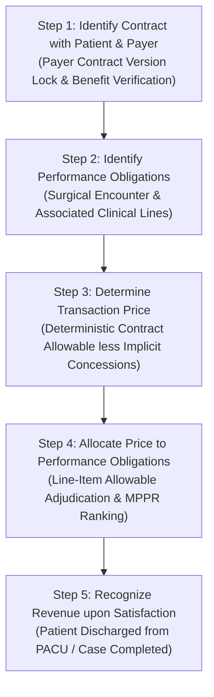

# PHASE 70 — REVENUE AND CHARGE DEFINITIONS
## Canonical Definitions, Revenue Recognition (ASC 606), Chargemaster Governance & Accounting Policy

> **Phase:** 70 — Financial Data Dictionary  
> **Status:** CANONICAL REVENUE & CHARGE SPECIFICATION  
> **Target Version:** ASCANALYST v2026.1 Enterprise  
> **Classification:** Healthcare Revenue Accounting Standards (GAAP / ASC 606, CMS Cost Reporting)  

---

## 1. REVENUE VS. CHARGE PHILOSOPHY

In healthcare provider accounting, **charges do not equal revenue**. 

Ambulatory Surgery Centers maintain a facility **Chargemaster** (list prices) establishing uniform gross fees for surgical procedures and supplies. However, third-party commercial payers and government programs (Medicare/Medicaid) do not pay chargemaster list prices; they reimburse based on legally binding contracted fee schedules, case rates, or statutory ASC payment indicators.

Therefore, ASCANALYST establishes a strict accounting distinction:
- **A Charge** is an internal billing assessment.
- **Expected Contractual Allowable** is an operational economic entitlement.
- **Recognized Revenue** is an accounting measure reflecting the transaction price expected to be received in exchange for clinical services under GAAP ASC 606.

---

## 2. CANONICAL REVENUE & CHARGE TAXONOMY

### 2.1 Gross Billed Charges
- **Canonical Code:** `gross_billed_charges`
- **Category:** Charges (Statistical)
- **Datatype:** `NUMERIC(12,2)`
- **Source of Truth:** Sum of `public.surgery_procedures.gross_charge` or `public.claim_lines.line_gross_charge`.
- **Business Definition:** The total aggregate chargemaster list price for all procedural CPT/HCPCS codes, supply lines, and room fees billed on an institutional UB-04 or professional CMS-1500 claim form.
- **Accounting Nature:** Statistical list fee. **Zero revenue recognition.**
- **Prohibited Treatment:** Must never be reported as revenue, gross revenue, or income on executive dashboards or financial statements.

### 2.2 Gross Scheduled Charges
- **Canonical Code:** `gross_scheduled_charges`
- **Category:** Operational Forecast
- **Datatype:** `NUMERIC(12,2)`
- **Source of Truth:** Sum of chargemaster rates for CPT codes attached to unperformed, scheduled cases (`surgeries.status = 'Scheduled'`).
- **Business Definition:** The estimated gross charge volume represented by scheduled cases on the surgical calendar.
- **Accounting Nature:** Pipeline valuation only.

### 2.3 Posted Charges
- **Canonical Code:** `posted_charges`
- **Category:** Billed Ledger
- **Datatype:** `NUMERIC(12,2)`
- **Source of Truth:** Finalized claim lines committed in `public.claims`.
- **Business Definition:** Charges that have passed pre-bill completeness validation, been assigned sequential claim IDs, and been officially posted to the facility billing ledger.

### 2.4 Contract Total Allowable
- **Canonical Code:** `contract_total_allowable`
- **Category:** Contractual Valuation
- **Datatype:** `NUMERIC(12,2)`
- **Source of Truth:** `public.reimbursement_calculations.total_contract_allowable`.
- **Business Definition:** The deterministic, maximum legal reimbursement permitted for the surgical encounter under the active, version-locked payer contract, inclusive of Multiple Procedure Payment Reduction (MPPR) discounting and approved implant carve-outs.
- **Accounting Nature:** Operational transaction price.

### 2.5 Medicare Benchmark Allowable
- **Canonical Code:** `medicare_benchmark_allowable`
- **Category:** Regulatory Reference
- **Datatype:** `NUMERIC(12,2)`
- **Source of Truth:** `public.medicare_base_rates` resolved via `fn_resolve_medicare_base_rate`.
- **Business Definition:** The statutory Medicare ASC Payment System rate for the encounter CPT codes, adjusted for facility CBSA wage index and device-intensive packaging. Used as a baseline to benchmark commercial payer performance (e.g. "Commercial contract yields 185% of Medicare").

### 2.6 Expected Contractual Revenue
- **Canonical Code:** `expected_contractual_revenue`
- **Category:** Operational Accrual
- **Datatype:** `NUMERIC(12,2)`
- **Source of Truth:** `contract_total_allowable` adjusted for historical bad-debt reserves and uncollectible patient responsibility estimates.
- **Business Definition:** The net dollar amount management reasonably expects to realize from an adjudicated case prior to cash settlement.

### 2.7 Net Patient Service Revenue (NPSR)
- **Canonical Code:** `net_patient_service_revenue`
- **Category:** Financial Accounting (ASC 606)
- **Datatype:** `NUMERIC(12,2)`
- **Source of Truth:** General Ledger / Remittance Reconciled Collections.
- **Business Definition:** Gross billed charges minus explicit contractual allowances and implicit price concessions (charity care, uncollectible patient copay write-offs). This is the GAAP metric reported on income statements.

### 2.8 Other Operating Revenue
- **Canonical Code:** `other_operating_revenue`
- **Category:** Ancillary Revenue
- **Datatype:** `NUMERIC(12,2)`
- **Source of Truth:** Ancillary service billing (e.g. pharmacy sales, clinical lab fees, facility equipment rental fees to visiting specialty physicians).

---

## 3. REVENUE RECOGNITION WORKFLOW (ASC 606 ALIGNMENT)

ASC 606 (*Revenue from Contracts with Customers*) requires a 5-step model for healthcare service revenue recognition:

### Policy Rules for ASCANALYST:
1. **Timing of Recognition:** Revenue must not be recognized when a case is scheduled. Recognition occurs only when the case status transitions to `Completed` (performance obligation satisfied upon discharge from PACU).
2. **Explicit vs. Implicit Deductions:**
   $$\text{Contractual Adjustment} = \text{Gross Billed Charges} - \text{Contract Total Allowable}$$
   $$\text{Recognized Revenue} = \text{Gross Billed Charges} - \text{Contractual Adjustment} - \text{Implicit Bad Debt Reserve}$$
3. **Audit Trail Requirement:** Any retroactive modification to recognized revenue resulting from payer takebacks or audit recoupments must be recorded as an adjustment event in `case_events` with an audit reason.
