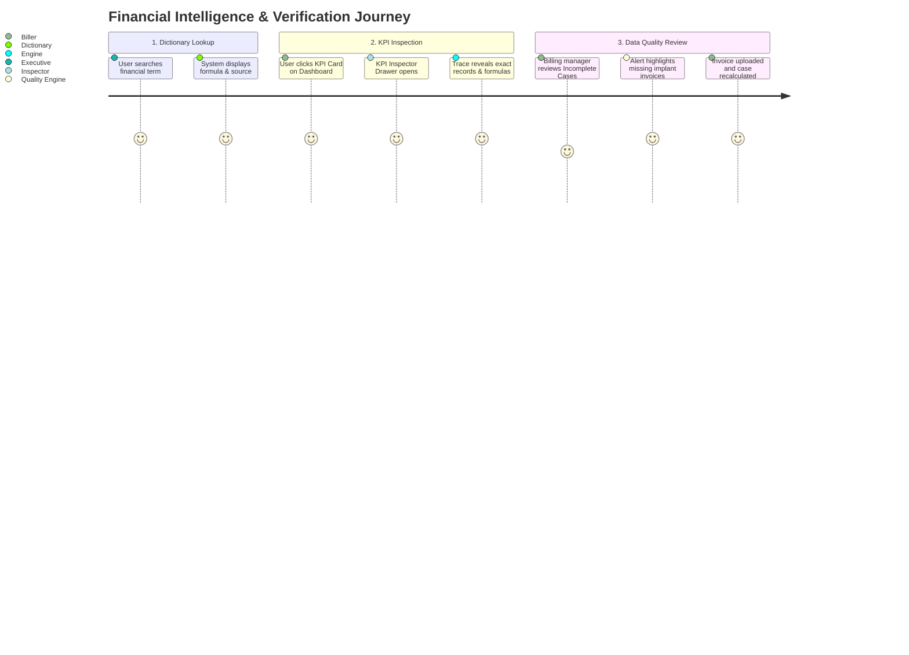

# PHASE 70 — UI AND REPORTING SPECIFICATION
## Financial Dictionary View, KPI Inspector, Data Quality Dashboard & Maestro Design Compliance

> **Phase:** 70 — Financial Data Dictionary  
> **Status:** UI & WORKFLOW SPECIFICATION  
> **Target Version:** ASCANALYST v2026.1 Enterprise  
> **Classification:** Maestro Clinical Design System & Healthcare UX  

---

## 1. USER INTERACTION MAP

Phase 70 defines four dedicated UI components ensuring financial explainability across the application:

---

## 2. COMPONENT SPECIFICATIONS

### 2.1 Financial Metric Dictionary (`FinancialDictionaryView.jsx`)
- **Navigation Location:** System Settings $\rightarrow$ Financial Governance $\rightarrow$ Metric Dictionary.
- **Header:** Title *"Canonical Financial Data Dictionary"*, search bar, and category filter pills (*All, Charges, Revenue, Payments, Costs, Margins, Adjustments*).
- **Table Columns:**
  - `Metric Code` (e.g. `expected_contribution_margin`)
  - `Canonical Name`
  - `Category Badge`
  - `Datatype / Precision`
  - `Source of Truth`
  - `Active Formula`
  - `Status` (`ACTIVE` / `DEPRECATED`)
- **Drill-down Drawer:** Clicking a row expands the full technical definition, GAAP accounting treatment, and downstream consumer module tags.

---

### 2.2 KPI Inspector Modal (`KPIInspectorModal.jsx`)
When an executive or biller clicks any financial metric card on the Executive Dashboard or Reimbursement Inspector:
- **Header:** Metric name with canonical code pill and reporting date range.
- **Summary Section:**
  - Authoritative Value: e.g. `$11,179.10`
  - Calculation Timestamp & Actor ID
  - Formula Code & Version Lock (e.g. `FORMULA-ECM-v2.1`)
  - Completeness Badge: `COMPLETE` (Emerald) or `MISSING_SOURCE_DATA` (Rose)
- **Source Breakdown Table:** Itemized list of all contributing records (CPT line items, scanned implant SKUs, staff labor hours, OR room duration minutes).
- **Exclusion Ledger:** Explicit list of cases excluded from the aggregate due to pending invoices or unverified rates.

---

### 2.3 Data Quality Dashboard (`FinancialDataQualityDashboard.jsx`)
Dedicated administrative screen surfacing operational data deficiencies:
- **KPI Summary Cards:**
  1. `Clean / Complete Cases`: 88.4% (Emerald)
  2. `Missing Implant Invoices`: 14 Cases (Amber)
  3. `Unresolved Contract Rates`: 3 Cases (Rose)
  4. `Unreconciled Remittances (> $50 diff)`: 8 Claims (Sky Blue)
- **Actionable Worklist:** Table with quick-action buttons allowing billing staff to directly upload missing invoices or trigger authoritative recalculations.

---

## 3. UI STATES & DESIGN SYSTEM GOVERNANCE

### 3.1 Standard UI States
- **Loading State:** Skeleton loaders with subtle pulse animation; never render synthetic numbers while fetching.
- **Empty State:** Clean slate card stating *"No financial records found for the selected reporting period and facility."*
- **Partial Data State:** Amber warning banner disclosing excluded records.
- **Permission Denied State:** Shield alert stating *"Financial clearance required: Your role does not have permission to view contractual margins."*

### 3.2 Maestro Design System Purple Ban
In strict compliance with workspace rules:
- **Absolute Ban on Purple:** Zero purple, violet, indigo, or fuchsia tokens may be rendered (`#7c3aed`, `#8b5cf6`, `purple-*`, `indigo-*`).
- **Approved Clinical Palette:**
  - Emerald (`#10b981`): Allowable, Contribution Margins, Complete Status.
  - Amber (`#f59e0b`): Patient Responsibility, Partial Data, Pending Verification.
  - Sky Blue (`#38bdf8`): Payer Payments, Reconciliations, Estimated Status.
  - Rose (`#f43f5e`): Dilutive Margins, Missing Invoices, Contract Not Found.
  - Neutral Slate (`#64748b` / `#0f172a`): Cards, borders, tables, dark backgrounds.
