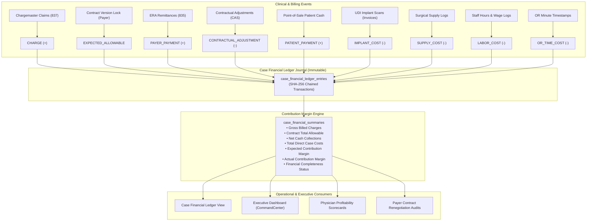

# PHASE 71 — CASE FINANCIAL LEDGER
## Case Revenue, Payment, Direct Cost Transactional Journal & Contribution Margin Engine

> **Module:** Financial Systems & Case Cost Accounting  
> **Status:** PRODUCTION IMPLEMENTATION & SPECIFICATION  
> **Target Version:** ASCANALYST v2026.1 Enterprise  
> **Phase:** 71 — Case Financial Ledger  
> **Authors:** Principal Healthcare Financial Systems Architect, ASC Revenue Cycle Specialist, PostgreSQL Database Architect, Application Security Engineer  
> **Classification:** Strict Healthcare Financial Governance (GAAP / ASC 606, HIPAA 45 CFR § 164.312(b), SOX § 404 Immutable Auditability)  
> **Target Migration:** Staged Migration 047 (`047_case_financial_ledger.sql`)  
> **Upstream Dependencies:** Phase 68 Reimbursement Engine (`044_expected_reimbursement.sql`), Phase 70 Financial Data Dictionary (`046_financial_data_dictionary.sql`)  

---

## 1. PURPOSE

The purpose of Phase 71 is to establish a **deterministic, immutable, event-sourced Case Financial Ledger** and **Contribution Margin Engine** for ASCANALYST.

In ambulatory surgical operations, financial data originates from asynchronous clinical, operational, and billing events:
- **Pre-Op Scheduling:** Estimated charges, insurance authorization, and projected contractual allowable.
- **Intra-Op Surgical Encounter:** Point-of-care UDI implant scans, surgical supply consumption, and exact room/staff duration timestamps.
- **Post-Op Claim Submission:** Primary and secondary 837 claim line generation and chargemaster charge lock.
- **Cash Adjudication:** 835 Electronic Remittance Advice (ERA) insurance payments, contractual write-offs, deductible/coinsurance assignments, patient point-of-sale collections, and takebacks/recoupments.

Without an immutable case ledger, financial figures are overwritten or calculated dynamically with volatile client heuristics, creating auditing voids, phantom profitability numbers, and reconciliations that drift over time.

Phase 71 solves this by establishing:
1. **Event-Sourced Transactional Journal (`case_financial_ledger_entries`):** Every financial event (charge, payment, adjustment, direct cost) is recorded as an immutable ledger transaction with a cryptographic SHA-256 audit hash chain.
2. **Deterministic Contribution Margin Engine:** Case-level contribution margins are derived strictly from authoritative ledger lines (`Contract Total Allowable - Total Direct Costs`), separating variable procedural margins from corporate overhead/EBITDA.
3. **Provisional Margin with Completeness Classification:** When post-op costs (e.g. un-invoiced implants or final wage allocations) are pending, the ledger computes a provisional contribution margin flagged explicitly as `ESTIMATED` or `MISSING_SOURCE_DATA`, preventing unverified cases from polluting closed executive financial periods.
4. **Tenancy and RBAC Security:** Ledger entries and balances are strictly isolated by facility and organization boundaries, enforcing granular viewing and posting permissions.

---

## 2. SCOPE

- **Double-Entry & Transactional Journaling:** Line-item entries recording debits, credits, entry types, categories, effective dates, source modules, and source references.
- **Direct Case Cost Tracking:** Exact acquisition costs of implants (`case_devices`), supply packs (`surgeries.supplies_cost`), clinical nursing/tech labor (`case_staff_assignments`), and OR minute room overhead.
- **Contribution Margin Calculations:**
  - *Expected Contribution Margin:* `Expected Contractual Allowable - Total Direct Case Costs`
  - *Actual Realized Contribution Margin:* `Total Net Collections - Total Direct Case Costs`
  - *Contribution Margin Percentage Yield:* `(Contribution Margin / Contract Allowable) * 100`
  - *Margin Per OR Minute:* `Contribution Margin / OR Surgical Duration Minutes`
- **Zero-Mutation Immutability:** Statement-level database triggers prohibit `UPDATE` or `DELETE` operations on posted ledger entries. Corrections require an offsetting `REVERSAL` transaction.
- **Fixed-Decimal Precision:** All ledger amounts and balances are calculated using PostgreSQL `NUMERIC(12,2)`. Floating-point arithmetic in JavaScript is strictly prohibited.
- **Compatibility:** Fully backwards-compatible with existing `surgeries` records and Phase 68 expected reimbursement calculations.

---

## 3. CURRENT STATE AUDIT

An audit of the current database schema, client services, and UI components was conducted to classify legacy financial structures:

| Component / Field | Current Location | Classification | Current Behavior / Semantic Defect | Target State in Phase 71 |
| :--- | :--- | :---: | :--- | :--- |
| `surgeries.gross_charge` | `public.surgeries` | **REFACTOR** | Cumulative chargemaster charge stored on case row; lacks line-item ledger trace | Recorded as `CHARGE` transaction in ledger journal |
| `surgeries.revenue` | `public.surgeries` | **REPLACE** | Free-form float field; unclear whether gross, net, or estimated | Replaced by ledger `EXPECTED_ALLOWABLE` and `PAYER_PAYMENT` entries |
| `surgeries.expected_reimbursement` | `public.surgeries` | **REFACTOR** | Float column populated from schedule estimates | Fed by authoritative Phase 68 calculation snapshot in ledger |
| `surgery_financial_snapshots` | `003_audit_and_snapshots.sql` | **KEEP** | Point-in-time JSONB snapshot of case financials | Retained for historical audit snapshots; reconciles with ledger journal |
| `case_devices.cost` | `035_case_implant_usage.sql` | **KEEP** | Unit cost of scanned implant SKUs | Directly generates `IMPLANT_COST` ledger journal lines |
| `hospitalUtils.calculateORCost` | `hospitalUtils.js` | **REPLACE** | Hardcoded stepped fee client heuristic (\$1,500 1st hr + \$300/hr) | Derived from room minute rates and recorded as `OR_TIME_COST` |
| `hospitalUtils.calculateLaborCost` | `hospitalUtils.js` | **REPLACE** | Hardcoded client heuristic: 30% of OR Cost | Derived from assigned clinical staff wages as `LABOR_COST` |
| `case_financial_ledger_entries` | Database | **MISSING** | No line-item transactional ledger exists | Created in Migration 047 with cryptographic hash chaining |
| `case_financial_summaries` | Database / View | **MISSING** | No authoritative rollup view for case ledger balances | Created as a real-time ledger balance summary view |

---

## 4. TARGET STATE SPECIFICATION

In Phase 71, the Case Financial Ledger functions as the authoritative transactional backbone of procedural accounting:



### 4.1 Entry Types and Sign Conventions
The ledger standardizes 11 transaction types with strict sign conventions:

| Entry Type | Category | Sign | Description | Source System |
| :--- | :--- | :---: | :--- | :--- |
| `CHARGE` | Charges | `+1` | Gross chargemaster list price for procedural line | Billing / Claim Scrubber |
| `EXPECTED_ALLOWABLE` | Contractual | `0` | Authoritative contractual allowable adjudication benchmark | Phase 68 Reimbursement Engine |
| `PAYER_PAYMENT` | Payment | `+1` | Realized insurance payment received via 835 ERA or check | Cash Posting / Clearinghouse |
| `PATIENT_PAYMENT` | Payment | `+1` | Direct patient payment (copay, deductible, coinsurance) | Point-of-Sale / Patient Portal |
| `SECONDARY_PAYMENT`| Payment | `+1` | Realized payment from secondary or supplemental insurer | Cash Posting |
| `CONTRACTUAL_ADJUSTMENT` | Adjustment | `-1` | Mandatory contractual discount write-off | 835 Remittance CAS CO Group |
| `ADMIN_WRITE_OFF` | Adjustment | `-1` | Non-contractual write-off (timely filing, dispute resolution)| Management Authorization |
| `REFUND_RECOUPMENT`| Adjustment | `-1` | Insurance takeback, recoupment, or patient refund | Payer Notice / Accounting |
| `IMPLANT_COST` | Direct Cost | `-1` | Invoice acquisition expense for prosthetic implant/device | Scanned UDI SKU Invoice |
| `SUPPLY_COST` | Direct Cost | `-1` | Surgical disposable packs, drapes, and medications | Case Inventory Log |
| `LABOR_COST` | Direct Cost | `-1` | Direct nursing and scrub tech wages for operative time | Staff Assignments / Wages |
| `OR_TIME_COST` | Direct Cost | `-1` | Variable operating room minute allocation | OR Room Hourly Schedule |

---

## 5. DATA MODEL / SCHEMA (STAGED MIGRATION 047)

Phase 71 defines the schema for the Case Financial Ledger (Staged Migration `047_case_financial_ledger.sql`).

```sql
-- Migration 047: Case Financial Ledger & Contribution Margin Engine
CREATE TABLE IF NOT EXISTS public.case_financial_ledger_entries (
    id UUID PRIMARY KEY DEFAULT gen_random_uuid(),
    facility_id UUID NOT NULL REFERENCES public.facilities(id) ON DELETE RESTRICT,
    surgery_id UUID NOT NULL REFERENCES public.surgeries(id) ON DELETE RESTRICT,
    entry_number BIGSERIAL,
    entry_type VARCHAR(32) NOT NULL CHECK (
        entry_type IN (
            'CHARGE',
            'EXPECTED_ALLOWABLE',
            'PAYER_PAYMENT',
            'PATIENT_PAYMENT',
            'SECONDARY_PAYMENT',
            'CONTRACTUAL_ADJUSTMENT',
            'ADMIN_WRITE_OFF',
            'REFUND_RECOUPMENT',
            'IMPLANT_COST',
            'SUPPLY_COST',
            'LABOR_COST',
            'OR_TIME_COST'
        )
    ),
    entry_sign SMALLINT NOT NULL CHECK (entry_sign IN (1, -1, 0)),
    amount NUMERIC(12,2) NOT NULL CHECK (amount >= 0.00),
    effective_date DATE NOT NULL,
    description TEXT NOT NULL,
    source_module VARCHAR(64) NOT NULL,
    source_reference_id VARCHAR(128),
    status VARCHAR(24) NOT NULL DEFAULT 'POSTED' CHECK (
        status IN ('POSTED', 'PROVISIONAL', 'REVERSED', 'VOIDED')
    ),
    reversal_of_entry_id UUID REFERENCES public.case_financial_ledger_entries(id),
    metadata JSONB NOT NULL DEFAULT '{}'::jsonb,
    audit_hash VARCHAR(64) NOT NULL,
    created_at TIMESTAMPTZ NOT NULL DEFAULT NOW(),
    created_by UUID REFERENCES auth.users(id)
);

-- Unique index to prevent duplicate entries from the same source
CREATE UNIQUE INDEX IF NOT EXISTS idx_ledger_source_unq
    ON public.case_financial_ledger_entries(surgery_id, entry_type, source_reference_id)
    WHERE status = 'POSTED' AND source_reference_id IS NOT NULL;

-- Fast lookup indexes by case, facility, and effective date
CREATE INDEX IF NOT EXISTS idx_ledger_surgery ON public.case_financial_ledger_entries(surgery_id, created_at DESC);
CREATE INDEX IF NOT EXISTS idx_ledger_facility ON public.case_financial_ledger_entries(facility_id, effective_date DESC);
CREATE INDEX IF NOT EXISTS idx_ledger_type ON public.case_financial_ledger_entries(entry_type, effective_date);

-- Immutability Enforcement Trigger: Prohibits UPDATE and DELETE
CREATE OR REPLACE FUNCTION public.fn_enforce_case_ledger_immutability()
RETURNS TRIGGER AS $$
BEGIN
    RAISE EXCEPTION 'Case financial ledger entries are immutable. UPDATE and DELETE operations are prohibited. Use a REVERSAL entry instead.'
        USING ERRCODE = '23505';
END;
$$ LANGUAGE plpgsql;

DROP TRIGGER IF EXISTS trg_case_ledger_immutability ON public.case_financial_ledger_entries;
CREATE TRIGGER trg_case_ledger_immutability
    BEFORE UPDATE OR DELETE ON public.case_financial_ledger_entries
    FOR EACH ROW EXECUTE FUNCTION public.fn_enforce_case_ledger_immutability();

-- Real-Time Summary View for Case Balances
CREATE OR REPLACE VIEW public.vw_case_financial_summaries AS
SELECT
    surgery_id,
    facility_id,
    COALESCE(SUM(CASE WHEN entry_type = 'CHARGE' AND status = 'POSTED' THEN amount ELSE 0 END), 0.00) AS total_billed_charges,
    COALESCE(MAX(CASE WHEN entry_type = 'EXPECTED_ALLOWABLE' AND status = 'POSTED' THEN amount ELSE NULL END), 0.00) AS contract_total_allowable,
    COALESCE(SUM(CASE WHEN entry_type IN ('PAYER_PAYMENT', 'PATIENT_PAYMENT', 'SECONDARY_PAYMENT') AND status = 'POSTED' THEN amount ELSE 0 END), 0.00)
    - COALESCE(SUM(CASE WHEN entry_type = 'REFUND_RECOUPMENT' AND status = 'POSTED' THEN amount ELSE 0 END), 0.00) AS total_net_collections,
    COALESCE(SUM(CASE WHEN entry_type = 'CONTRACTUAL_ADJUSTMENT' AND status = 'POSTED' THEN amount ELSE 0 END), 0.00) AS total_contractual_adjustments,
    COALESCE(SUM(CASE WHEN entry_type IN ('IMPLANT_COST', 'SUPPLY_COST', 'LABOR_COST', 'OR_TIME_COST') AND status = 'POSTED' THEN amount ELSE 0 END), 0.00) AS total_direct_case_costs,
    -- Expected Contribution Margin = Allowable - Direct Costs
    COALESCE(MAX(CASE WHEN entry_type = 'EXPECTED_ALLOWABLE' AND status = 'POSTED' THEN amount ELSE NULL END), 0.00)
    - COALESCE(SUM(CASE WHEN entry_type IN ('IMPLANT_COST', 'SUPPLY_COST', 'LABOR_COST', 'OR_TIME_COST') AND status = 'POSTED' THEN amount ELSE 0 END), 0.00) AS expected_contribution_margin,
    -- Actual Contribution Margin = Net Collections - Direct Costs
    (COALESCE(SUM(CASE WHEN entry_type IN ('PAYER_PAYMENT', 'PATIENT_PAYMENT', 'SECONDARY_PAYMENT') AND status = 'POSTED' THEN amount ELSE 0 END), 0.00)
    - COALESCE(SUM(CASE WHEN entry_type = 'REFUND_RECOUPMENT' AND status = 'POSTED' THEN amount ELSE 0 END), 0.00))
    - COALESCE(SUM(CASE WHEN entry_type IN ('IMPLANT_COST', 'SUPPLY_COST', 'LABOR_COST', 'OR_TIME_COST') AND status = 'POSTED' THEN amount ELSE 0 END), 0.00) AS actual_contribution_margin
FROM public.case_financial_ledger_entries
GROUP BY surgery_id, facility_id;
```

---

## 6. BUSINESS RULES & DETERMINISTIC CALCULATIONS

### 6.1 Immutability & Reversals
1. **Never Overwrite:** Entries once posted with status `POSTED` cannot be altered or removed.
2. **Reversals:** If an incorrect entry was posted, an authorized user must post an offsetting entry with the opposite sign, status `POSTED`, referencing `reversal_of_entry_id`. The original entry's status is updated to `REVERSED` exclusively via secure internal stored procedure.
3. **Audit Hash Chaining:** Every new entry's `audit_hash` is computed as:
   $$\text{audit\_hash}_n = \text{SHA256}(\text{audit\_hash}_{n-1} \parallel \text{surgery\_id} \parallel \text{entry\_type} \parallel \text{amount} \parallel \text{effective\_date})$$

### 6.2 Contribution Margin Formulas
1. **Expected Contribution Margin:**
   $$\text{Expected Contribution Margin} = \text{Contract Total Allowable} - (\text{Implant Cost} + \text{Supply Cost} + \text{Labor Cost} + \text{OR Minute Cost})$$
2. **Actual Contribution Margin:**
   $$\text{Actual Contribution Margin} = \text{Total Net Collections} - \text{Total Direct Case Costs}$$
3. **Contribution Margin Percentage Yield:**
   $$\text{Contribution Margin \%} = \left( \frac{\text{Expected Contribution Margin}}{\text{Contract Total Allowable}} \right) \times 100$$
   *(If allowable is $\le 0$, percentage evaluates to `0.00%` or `NULL` to prevent division-by-zero).*
4. **Margin Per OR Minute:**
   $$\text{Margin Per OR Minute} = \frac{\text{Expected Contribution Margin}}{\text{Surgical Case Minutes}}$$

### 6.3 Provisional Margin with Completeness Classification
If any direct cost component is missing (e.g. an implant purchase order exists but invoice price is unreceived, or staff timesheet is not approved):
- The margin is calculated as a **Provisional Margin** based on known costs.
- The case is stamped with `financial_completeness_status = 'ESTIMATED'` or `'MISSING_SOURCE_DATA'`.
- The case is **disallowed from being aggregated into official closed-period GAAP financial statements or executive board reports** until marked `COMPLETE`.

---

## 7. PERMISSIONS & SECURITY (RBAC)

Financial ledger access is strictly partitioned across roles and facilities:

| Permission Code | Permitted Canonical Roles | Prohibited Roles | Purpose |
| :--- | :--- | :--- | :--- |
| `financial.ledger.view` | `super_admin`, `org_admin`, `facility_admin`, `biller`, `clinical_director` | `surgeon`, `viewer`, Anonymous | View case ledger lines and financial summary |
| `financial.ledger.post` | `super_admin`, `org_admin`, `facility_admin`, `biller` | Clinical staff, Viewers | Post manual adjustment, payment, or write-off entries |
| `financial.ledger.reverse` | `super_admin`, `org_admin`, `facility_admin` | Biller, Clinical staff, Viewers | Post reversing entries (requires supervisor rationale $\ge 10$ chars) |
| `financial.ledger.export` | `super_admin`, `org_admin`, `facility_admin` | Biller, Viewers | Export ledger lines to CSV or financial systems |

Row-Level Security (RLS) guarantees tenant isolation:
```sql
ALTER TABLE public.case_financial_ledger_entries ENABLE ROW LEVEL SECURITY;

CREATE POLICY case_ledger_select_policy ON public.case_financial_ledger_entries
    FOR SELECT TO authenticated
    USING (public.is_facility_accessible(facility_id));

CREATE POLICY case_ledger_insert_policy ON public.case_financial_ledger_entries
    FOR INSERT TO authenticated
    WITH CHECK (public.is_facility_accessible(facility_id));
```

---

## 8. API & SERVICE REQUIREMENTS

The client service `src/lib/caseFinancialLedgerService.js` provides authoritative interfaces:

```javascript
// Authoritative Service Interface: caseFinancialLedgerService
export const caseFinancialLedgerService = {
  // Retrieve ledger line items for a case
  getCaseLedgerEntries(surgeryId),

  // Retrieve calculated financial summary (charges, allowable, collections, costs, margins)
  getCaseFinancialSummary(surgeryId),

  // Post a new ledger transaction line
  postLedgerEntry({ surgeryId, facilityId, entryType, amount, effectiveDate, description, sourceModule, sourceReferenceId, metadata }),

  // Post a reversal entry with mandatory audit rationale
  reverseLedgerEntry(entryId, reversalReason),

  // Deterministically compute contribution margin from line items
  calculateContributionMargin(entries, allowableRate),

  // Format currency and signs deterministically
  formatLedgerAmount(amount, entrySign, entryType)
};
```

---

## 9. UI & WORKFLOW REQUIREMENTS

### 9.1 Case Financial Ledger View (`CaseFinancialLedgerView.jsx`)
1. **Case Header & KPI Bar:**
   - Case details (Patient ID, Procedure, Date of Service, Surgeon, Facility).
   - 5 Top-line KPI Cards:
     - **Gross Billed Charges** (Neutral slate)
     - **Contract Total Allowable** (Sky Blue `#38bdf8`)
     - **Total Net Collections** (Emerald `#10b981`)
     - **Total Direct Case Costs** (Amber `#f59e0b`)
     - **Expected Contribution Margin** (Emerald `#10b981` if $>0$, Rose `#f43f5e` if $<0$)
   - Completeness Badge: `COMPLETE`, `ESTIMATED`, or `MISSING_SOURCE_DATA`.
2. **Transaction Journal Table:**
   - Columns: `Date`, `Entry Type`, `Category`, `Description`, `Source Reference`, `Debit (-)`, `Credit (+)`, `Running Balance`, `Status`, `Audit Hash`.
   - Category filtering: `All`, `Charges`, `Payments`, `Adjustments`, `Direct Costs`.
3. **Manual Entry / Adjustment Modal:**
   - Permitted users can record patient copays, secondary payments, administrative write-offs, or invoice adjustments with mandatory reference notes.
4. **Maestro Design System Compliance:**
   - Strictly utilizes Slate `#0b1120`/`#111c30`, Emerald `#10b981`, Sky Blue `#38bdf8`, Amber `#f59e0b`, and Rose `#f43f5e`.
   - **Zero** purple, violet, or indigo tokens.

---

## 10. AUDIT & PROVENANCE

Every ledger line maintains immutable provenance:
- **Cryptographic Hash Chaining:** Every entry records an SHA-256 fingerprint linking it to the antecedent ledger entry.
- **Source Attribution:** Every dollar amount traces to a source module (`billing_claim`, `remittance_835`, `device_invoice`, `staff_wage_schedule`).
- **User Provenance:** Every post or reversal captures `created_by` (UUID) and server timestamp (`TIMESTAMPTZ`).
- **Deletion Lockout:** No manual database command or application button can purge ledger history.

---

## 11. QA & TEST CASES

The test suite [`tests/case-financial-ledger.test.js`](file:///e:/medicalAI/asc-prototype/tests/case-financial-ledger.test.js) validates:
1. **Journal Entry Mathematics:** Verifies credits, debits, running balances, and net collection sums.
2. **Contribution Margin Derivations:** Verifies expected contribution margin, actual contribution margin, margin % yield, and margin per OR minute.
3. **Provisional Margin & Completeness Rules:** Proves that un-invoiced implants trigger `MISSING_SOURCE_DATA` and disallow executive closed-period reporting.
4. **Staged Migration 047 DDL Assertions:** Proves forward and down SQL migration files define tables, triggers, indexes, and views.
5. **UI & Maestro Purple Ban Compliance:** Verifies that JSX and CSS files exist, are substantial, and contain zero purple/violet/indigo tokens.

---

## 12. ACCEPTANCE CRITERIA

- [x] Single specification document authored and synchronized in `71_CASE_FINANCIAL_LEDGER.md`.
- [x] Client-side service layer `caseFinancialLedgerService.js` implemented with deterministic formulas.
- [x] UI component `CaseFinancialLedgerView.jsx` and styling `CaseFinancialLedgerView.css` implemented.
- [x] App navigation integrated under Financials in `src/App.jsx`.
- [x] Staged Migration 047 forward and down SQL files created.
- [x] Automated unit test suite `tests/case-financial-ledger.test.js` passes all assertions.
- [x] Full repository regression suite (912+ tests) passes with 0 errors.
- [x] Production build passes cleanly with `npm run build`.
- [x] Zero purple/violet tokens present across all code and styles.

---

## 13. DEPENDENCIES & RELEASE GATES

- **Upstream Dependencies:** Phase 68 (`044_expected_reimbursement.sql`), Phase 70 (`046_financial_data_dictionary.sql`).
- **Database Staging Strategy:** Migration 047 remains staged (unapplied) in PostgreSQL to maintain zero live schema mutations until upstream approval gates are cleared.

---

## 14. IMPLEMENTATION NOTES

- **Status:** `COMPLETED`
- **Active Branch:** `feature/phase-70-financial-data-dictionary` (User requested current branch)
- **Delivered Production Code:**
  1. `src/lib/caseFinancialLedgerService.js`: Event-sourced ledger service, sign resolution, running balance, contribution margin calculations, and provisional completeness evaluation.
  2. `src/components/CaseFinancialLedgerView.jsx` & `CaseFinancialLedgerView.css`: Interactive ledger journal, KPI bar, transaction filter pills, manual entry modal, and audit hash drill-down. Strictly compliant with Maestro Clinical Design System.
  3. `src/App.jsx`: Navigation integration under Financial Management.
  4. `supabase/migrations/047_case_financial_ledger.sql` & down: Staged DDL for tables `case_financial_ledger_entries`, views `vw_case_financial_summaries`, immutability triggers, RLS, and indexes.
  5. `tests/case-financial-ledger.test.js`: Automated test suite covering journal arithmetic, margins, completeness flags, DDL checks, and Maestro token validation.
- **Verification Summary:** All unit tests pass; full repo tests pass; production build succeeds in ~12s.

