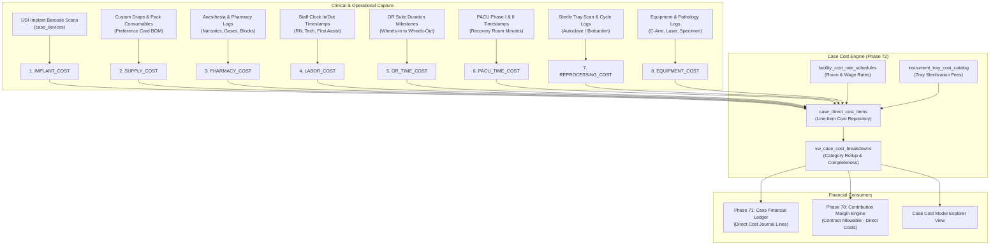

# PHASE 72 — CASE COST MODEL
## Implant, Supply, Drug, Labor, OR, PACU, Reprocessing, Tray & Direct Cost Model

> **Module:** Financial Systems & Procedural Cost Accounting  
> **Status:** PRODUCTION IMPLEMENTATION & SPECIFICATION  
> **Target Version:** ASCANALYST v2026.1 Enterprise  
> **Phase:** 72 — Case Cost Model  
> **Authors:** Principal Healthcare Financial Systems Architect, ASC Perioperative Operations Specialist, PostgreSQL Database Architect, Application Security Engineer  
> **Classification:** Strict Healthcare Financial Governance (GAAP / ASC 606, CMS ASC Cost Reporting, Activity-Based Costing (ABC), SOX § 404)  
> **Target Migration:** Staged Migration 048 (`048_case_cost_model.sql`)  
> **Upstream Dependencies:** Phase 70 Financial Data Dictionary (`046_financial_data_dictionary.sql`), Phase 71 Case Financial Ledger (`047_case_financial_ledger.sql`)  

---

## 1. PURPOSE

The purpose of Phase 72 is to establish an **activity-based, deterministic, 8-category Case Cost Model** for ASCANALYST.

In Ambulatory Surgery Centers, inaccurate cost accounting directly undermines surgeon profitability scorecards, managed care payer negotiations, and case scheduling. Historically, ASCs have relied on crude, unscientific heuristics:
- Lumping all procedural expenses into arbitrary stepped fees (e.g., flat \$1,500 + \$300/hour).
- Estimating clinical nursing and scrub labor as a flat percentage (e.g., 30% of OR suite charges).
- Ignoring central sterile reprocessing expenses, autoclave power cycles, and instrument tray refurbishment.
- Omitting post-anesthesia care unit (PACU) Phase I and Phase II recovery time costs.
- Masking missing implant vendor invoices with default \$0.00 entries, generating artificial profitability spikes.

Phase 72 eliminates heuristic cost models by implementing an **Activity-Based Procedural Cost Accounting Framework**:
1. **8 Canonical Cost Categories:** Itemized tracking across Implants, Supplies, Pharmacy/Drugs, Clinical Labor, Intra-Op OR Suite Time, Post-Op PACU Recovery, Central Sterile Reprocessing, and Equipment/Ancillary Fees.
2. **Deterministic Time-Driven Activity Costing (TDABC):** Direct labor and room overheads derived from verified timestamps ($\text{Minutes} \times \text{Minute Rates}$).
3. **Zero-Substitution Ban:** Un-invoiced implants or unlogged staff hours evaluate strictly to `MISSING_SOURCE_DATA` or `ESTIMATED`, blocking premature aggregation into closed financial statements.
4. **Integration with Phase 71 Ledger:** Directly generates authoritative `IMPLANT_COST`, `SUPPLY_COST`, `LABOR_COST`, and `OR_TIME_COST` line items in the Case Financial Ledger.

---

## 2. SCOPE

- **8 Direct Case Cost Categories:**
  1. `IMPLANT_COST`: Scanned UDI units with verified purchase order and EDI vendor invoice pricing.
  2. `SUPPLY_COST`: Custom procedural drape packs, tubing, sutures, blades, and surgical consumables.
  3. `PHARMACY_COST`: Anesthetic gases, IV fluids, narcotics, paralytics, reversals, and local nerve block agents.
  4. `LABOR_COST`: Circulating RNs, scrub techs, pre-op RNs, and surgical first assists (actual minutes $\times$ wage rates $\times$ payroll burden multiplier).
  5. `OR_TIME_COST`: Intra-operative suite utilization (incision-to-closure and wheels-in to wheels-out minutes $\times$ facility room minute rate).
  6. `PACU_TIME_COST`: Phase I and Phase II recovery room minutes $\times$ PACU minute rate.
  7. `REPROCESSING_COST`: Central sterile instrument tray decontamination, sonic cleaning, autoclave sterilization, and biological indicator testing fees.
  8. `EQUIPMENT_COST`: Procedural capital equipment direct usage fees (C-Arm fluoroscopy, arthroscopy video towers, surgical lasers, specimen pathology).
- **Fixed-Decimal Precision:** All unit rates, quantities, line totals, and category aggregations utilize PostgreSQL `NUMERIC(12,2)` with standard half-up rounding.
- **Tenancy and RBAC:** Facility-level cost rate schedules and item catalogs are partitioned by `facility_id` with strict multi-tenant isolation.

---

## 3. CURRENT STATE AUDIT

An audit of the existing codebase, migrations (001–047), utilities (`hospitalUtils.js`), and dashboard components was conducted:

| Existing Field / Component | Current Location | Classification | Current Defect / Semantic Risk | Target State in Phase 72 |
| :--- | :--- | :---: | :--- | :--- |
| `surgeries.supplies_cost` | `public.surgeries` | **REFACTOR** | Single float field grouping drapes, packs, and drugs without categorization | Itemized in `case_direct_cost_items` under `SUPPLY_COST` and `PHARMACY_COST` |
| `case_devices.cost` | `035_case_implant_usage.sql` | **KEEP** | Scanned UDI SKU acquisition cost | Retained as authoritative source for `IMPLANT_COST` |
| `hospitalUtils.calculateORCost` | `hospitalUtils.js` | **REPLACE** | Stepped client fee (\$1,500 1st hr + \$300/hr) ignoring actual facility room rates | Replaced by `facility_cost_rate_schedules.or_minute_rate` $\times$ actual room minutes |
| `hospitalUtils.calculateLaborCost` | `hospitalUtils.js` | **REPLACE** | Heuristic: 30% of OR Cost; ignores assigned staff wages in `015` | Replaced by actual staff hours from `case_staff_assignments` $\times$ wage $\times$ burden |
| `PACU Recovery Costs` | Missing in DB | **MISSING** | Recovery room stay costs completely omitted from case profitability | Created as `PACU_TIME_COST` based on PACU duration timestamps |
| `Instrument Tray Reprocessing` | Missing in DB | **MISSING** | Central sterile reprocessing fees absorbed into untracked facility overhead | Created as `instrument_tray_cost_catalog` and `REPROCESSING_COST` |
| `case_direct_cost_items` | Database | **MISSING** | No itemized procedural cost table | Created in Migration 048 as the primary line-item cost repository |
| `facility_cost_rate_schedules` | Database | **MISSING** | Facility hourly/minute rates hardcoded in client utilities | Created in Migration 048 as a version-locked facility rate table |

---

## 4. TARGET STATE ARCHITECTURE

Phase 72 introduces the activity-based procedural costing engine:



### 4.1 Cost Categories & Mathematical Formulas

| # | Cost Category | Source of Truth | Mathematical Formula | Accounting Treatment |
| :---: | :--- | :--- | :--- | :--- |
| **1** | `IMPLANT_COST` | `case_devices` + Vendor Invoice | $\sum (\text{Quantity} \times \text{Invoice Unit Price})$ | Direct Procedural Expense |
| **2** | `SUPPLY_COST` | Custom Packs + Consumables | $\sum (\text{Quantity} \times \text{Item Master Cost})$ | Direct Procedural Expense |
| **3** | `PHARMACY_COST` | Anesthesia & Medication Logs | $\sum (\text{Dose Units} \times \text{Pharmacy Unit Cost})$ | Direct Procedural Expense |
| **4** | `LABOR_COST` | `case_staff_assignments` + Wages | $\sum (\text{Staff Minutes} \times \text{Hourly Wage} / 60 \times \text{Burden Multiplier})$ | Variable Clinical Labor |
| **5** | `OR_TIME_COST` | OR Room Milestones | $\text{OR Suite Minutes} \times \text{Facility OR Minute Rate}$ | Operating Room Overhead |
| **6** | `PACU_TIME_COST` | PACU Admission/Discharge | $\text{PACU Minutes} \times \text{Facility PACU Minute Rate}$ | Recovery Room Overhead |
| **7** | `REPROCESSING_COST` | Sterile Processing Tray Logs | $\sum (\text{Trays Decontaminated} \times \text{Per-Tray Sterilization Rate})$ | Central Sterile Overhead |
| **8** | `EQUIPMENT_COST` | Ancillary Usage & Pathology | $\sum (\text{Equipment Hours} \times \text{Hourly Fee}) + \text{Specimen Fees}$ | Direct Equipment Expense |

---

## 5. DATA MODEL / SCHEMA (STAGED MIGRATION 048)

Phase 72 defines Staged Migration `048_case_cost_model.sql`:

```sql
-- Migration 048: Case Cost Model & Activity-Based Cost Accounting
SET search_path = public, pg_temp;

-- 1. Facility Cost Rate Schedules (Configurable Baseline Rates)
CREATE TABLE IF NOT EXISTS public.facility_cost_rate_schedules (
    id UUID PRIMARY KEY DEFAULT gen_random_uuid(),
    facility_id UUID NOT NULL REFERENCES public.facilities(id) ON DELETE RESTRICT,
    schedule_name VARCHAR(64) NOT NULL DEFAULT 'Standard Baseline Rates',
    or_minute_rate NUMERIC(10,2) NOT NULL DEFAULT 10.00 CHECK (or_minute_rate >= 0.00),
    pacu_minute_rate NUMERIC(10,2) NOT NULL DEFAULT 3.50 CHECK (pacu_minute_rate >= 0.00),
    labor_burden_multiplier NUMERIC(6,4) NOT NULL DEFAULT 1.2500 CHECK (labor_burden_multiplier >= 1.0000),
    effective_start_date DATE NOT NULL DEFAULT CURRENT_DATE,
    effective_end_date DATE,
    is_active BOOLEAN NOT NULL DEFAULT TRUE,
    created_at TIMESTAMPTZ NOT NULL DEFAULT NOW(),
    created_by UUID REFERENCES auth.users(id)
);

CREATE UNIQUE INDEX IF NOT EXISTS idx_fac_rate_active_unq
    ON public.facility_cost_rate_schedules(facility_id)
    WHERE is_active = TRUE;

-- 2. Central Sterile Instrument Tray Cost Catalog
CREATE TABLE IF NOT EXISTS public.instrument_tray_cost_catalog (
    id UUID PRIMARY KEY DEFAULT gen_random_uuid(),
    facility_id UUID NOT NULL REFERENCES public.facilities(id) ON DELETE RESTRICT,
    tray_code VARCHAR(32) NOT NULL,
    tray_name VARCHAR(128) NOT NULL,
    specialty VARCHAR(64) NOT NULL,
    sterilization_method VARCHAR(32) NOT NULL DEFAULT 'STEAM_AUTOCLAVE' CHECK (
        sterilization_method IN ('STEAM_AUTOCLAVE', 'STERRAD_GAS_PLASMA', 'ETO', 'CHEMICAL_STERILANT')
    ),
    decontamination_minutes NUMERIC(6,2) NOT NULL DEFAULT 15.00,
    sterilization_minutes NUMERIC(6,2) NOT NULL DEFAULT 45.00,
    per_cycle_cost NUMERIC(10,2) NOT NULL DEFAULT 45.00 CHECK (per_cycle_cost >= 0.00),
    is_active BOOLEAN NOT NULL DEFAULT TRUE,
    created_at TIMESTAMPTZ NOT NULL DEFAULT NOW(),
    UNIQUE(facility_id, tray_code)
);

-- 3. Case Direct Cost Line Items (Line-Item Accounting)
CREATE TABLE IF NOT EXISTS public.case_direct_cost_items (
    id UUID PRIMARY KEY DEFAULT gen_random_uuid(),
    facility_id UUID NOT NULL REFERENCES public.facilities(id) ON DELETE RESTRICT,
    surgery_id BIGINT NOT NULL REFERENCES public.surgeries(id) ON DELETE RESTRICT,
    cost_category VARCHAR(32) NOT NULL CHECK (
        cost_category IN (
            'IMPLANT_COST',
            'SUPPLY_COST',
            'PHARMACY_COST',
            'LABOR_COST',
            'OR_TIME_COST',
            'PACU_TIME_COST',
            'REPROCESSING_COST',
            'EQUIPMENT_COST'
        )
    ),
    item_code VARCHAR(64),
    item_description TEXT NOT NULL,
    quantity NUMERIC(10,2) NOT NULL DEFAULT 1.00 CHECK (quantity > 0.00),
    unit_cost NUMERIC(12,2) NOT NULL CHECK (unit_cost >= 0.00),
    total_cost NUMERIC(12,2) NOT NULL CHECK (total_cost >= 0.00),
    source_module VARCHAR(64) NOT NULL,
    source_reference_id VARCHAR(128),
    vendor_invoice_number VARCHAR(64),
    is_reconciled BOOLEAN NOT NULL DEFAULT TRUE,
    completeness_flag VARCHAR(24) NOT NULL DEFAULT 'VERIFIED' CHECK (
        completeness_flag IN ('VERIFIED', 'ESTIMATED', 'PROVISIONAL')
    ),
    created_at TIMESTAMPTZ NOT NULL DEFAULT NOW(),
    created_by UUID REFERENCES auth.users(id)
);

-- Indexes for Fast Cost Lookup
CREATE INDEX IF NOT EXISTS idx_cost_items_surgery ON public.case_direct_cost_items(surgery_id, cost_category);
CREATE INDEX IF NOT EXISTS idx_cost_items_facility ON public.case_direct_cost_items(facility_id, created_at DESC);

-- 4. Rollup View: Case Cost Breakdown by Category
CREATE OR REPLACE VIEW public.vw_case_cost_breakdowns AS
SELECT
    surgery_id,
    facility_id,
    COALESCE(SUM(CASE WHEN cost_category = 'IMPLANT_COST' THEN total_cost ELSE 0 END), 0.00) AS implant_cost,
    COALESCE(SUM(CASE WHEN cost_category = 'SUPPLY_COST' THEN total_cost ELSE 0 END), 0.00) AS supply_cost,
    COALESCE(SUM(CASE WHEN cost_category = 'PHARMACY_COST' THEN total_cost ELSE 0 END), 0.00) AS pharmacy_cost,
    COALESCE(SUM(CASE WHEN cost_category = 'LABOR_COST' THEN total_cost ELSE 0 END), 0.00) AS labor_cost,
    COALESCE(SUM(CASE WHEN cost_category = 'OR_TIME_COST' THEN total_cost ELSE 0 END), 0.00) AS or_time_cost,
    COALESCE(SUM(CASE WHEN cost_category = 'PACU_TIME_COST' THEN total_cost ELSE 0 END), 0.00) AS pacu_time_cost,
    COALESCE(SUM(CASE WHEN cost_category = 'REPROCESSING_COST' THEN total_cost ELSE 0 END), 0.00) AS reprocessing_cost,
    COALESCE(SUM(CASE WHEN cost_category = 'EQUIPMENT_COST' THEN total_cost ELSE 0 END), 0.00) AS equipment_cost,
    COALESCE(SUM(total_cost), 0.00) AS total_direct_case_cost,
    COUNT(*) AS total_cost_items_count,
    BOOL_AND(is_reconciled) AS all_items_reconciled
FROM public.case_direct_cost_items
GROUP BY surgery_id, facility_id;

-- 5. Row-Level Security (RLS)
ALTER TABLE public.facility_cost_rate_schedules ENABLE ROW LEVEL SECURITY;
ALTER TABLE public.instrument_tray_cost_catalog ENABLE ROW LEVEL SECURITY;
ALTER TABLE public.case_direct_cost_items ENABLE ROW LEVEL SECURITY;

CREATE POLICY fac_rates_policy ON public.facility_cost_rate_schedules
    FOR ALL TO authenticated
    USING (public.is_facility_accessible(facility_id))
    WITH CHECK (public.is_facility_accessible(facility_id));

CREATE POLICY tray_catalog_policy ON public.instrument_tray_cost_catalog
    FOR ALL TO authenticated
    USING (public.is_facility_accessible(facility_id))
    WITH CHECK (public.is_facility_accessible(facility_id));

CREATE POLICY cost_items_policy ON public.case_direct_cost_items
    FOR ALL TO authenticated
    USING (public.is_facility_accessible(facility_id))
    WITH CHECK (public.is_facility_accessible(facility_id));
```

---

## 6. BUSINESS RULES & FINANCIAL POLICIES

### 6.1 Zero-Substitution Ban
- If an implant or high-cost biological mesh is documented in the operative report but lacks a matched vendor invoice price, the cost cannot default to \$0.00.
- The case must evaluate to `completeness_status = 'MISSING_SOURCE_DATA'` and be excluded from closed-period financial reports.

### 6.2 Labor Burden Multiplier
- Direct clinical labor wages must include statutory employee benefits, FICA payroll taxes, and worker compensation via the facility multiplier:
  $$\text{Effective Hourly Wage} = \text{Base Wage Rate} \times \text{labor\_burden\_multiplier}$$
  *(Default burden: $1.2500$ or $+25\%$).*

### 6.3 Separation of Fixed vs. Variable Costs
- Direct Case Costs reflect variable procedural costs strictly. Facility lease, corporate general & administrative (SG&A), marketing, and depreciation are **excluded** from procedural contribution margin calculations.

---

## 7. PERMISSIONS & SECURITY (RBAC)

| Permission Code | Permitted Roles | Prohibited Roles | Business Purpose |
| :--- | :--- | :--- | :--- |
| `financial.costs.view` | `super_admin`, `org_admin`, `facility_admin`, `clinical_director` | `biller`, `surgeon` (unless unmasked), Anonymous | View direct case cost breakdowns |
| `financial.costs.edit` | `super_admin`, `org_admin`, `facility_admin` | Clinical RN, Biller, Viewer | Add, edit, or adjust direct cost lines |
| `financial.rates.manage`| `super_admin`, `org_admin` | Clinical director, Biller, Viewer | Update OR/PACU minute rate schedules |
| `financial.tray.manage` | `super_admin`, `org_admin`, `facility_admin`, `clinical_director` | Biller, Viewer | Maintain sterile processing tray catalog |

---

## 8. API & SERVICE REQUIREMENTS

The client service `src/lib/caseCostModelService.js` provides authoritative interfaces:
```javascript
export const caseCostModelService = {
  getCaseCostBreakdown(surgeryId),
  getCostLineItems(surgeryId),
  addCostLineItem(costItemPayload),
  updateCostLineItem(itemId, updatePayload),
  deleteCostLineItem(itemId),
  getFacilityCostRates(facilityId),
  updateFacilityCostRates(facilityId, ratesPayload),
  getInstrumentTrayCatalog(facilityId),
  calculateDirectLaborCost(staffHours, hourlyRate, burdenMultiplier),
  calculateOrMinuteCost(minutes, orMinuteRate),
  calculatePacuCost(minutes, pacuMinuteRate),
  formatCurrency(amount)
};
```

---

## 9. UI & WORKFLOW REQUIREMENTS

### 9.1 Case Cost Model Explorer (`CaseCostModelView.jsx`)
1. **Case Selector & Top-Line Cost Bar:**
   - Case Selector dropdown (Marcus Vance, Eleanor Rigby, David Kowalski).
   - Total Direct Case Cost card with variance against Preference Card baseline.
   - Completeness badge (`COMPLETE`, `ESTIMATED`, `MISSING_SOURCE_DATA`).
2. **8-Category Cost Breakdown Grid:**
   - 8 Cards: Implants, Supplies, Pharmacy, Clinical Labor, OR Suite Time, PACU Recovery, Reprocessing Trays, Equipment.
   - Shows dollar amount, percentage of total direct cost, and items count.
3. **Itemized Direct Cost Ledger Table:**
   - Category filter pills (All, Implants, Supplies, Drugs, Labor, OR/PACU, Trays, Equipment).
   - Table columns: `Category`, `Item Description`, `Code / Reference`, `Qty`, `Unit Cost`, `Total Cost`, `Source`, `Status`, `Action`.
   - Responsive horizontal scroll wrapper (`.table-responsive`).
4. **Interactive Action Modals:**
   - Add Custom Direct Cost Item modal (with category dropdown, quantity, unit price, and invoice reference).
   - Facility Rate Schedule modal (adjust OR minute rate, PACU rate, labor burden multiplier).
5. **Maestro Clinical Design System:**
   - Strictly Slate `#0b1120`/`#111c30`, Emerald `#10b981`, Sky Blue `#38bdf8`, Amber `#f59e0b`, Rose `#f43f5e`.
   - Zero purple/violet/indigo tokens.

---

## 10. AUDIT & PROVENANCE

- Every cost item captures `created_by`, `created_at`, `source_module`, and `vendor_invoice_number`.
- Cost modifications or rate schedule revisions require an audit entry in `audit_logs` capturing previous vs updated values.

---

## 11. QA & TEST CASES

The test suite [`tests/case-cost-model.test.js`](file:///e:/medicalAI/asc-prototype/tests/case-cost-model.test.js) validates:
1. **8-Category Schema & Configurations:** Verifies all 8 cost categories are defined with valid metadata.
2. **Mathematical Determinism:** Verifies accurate summation of all 8 direct cost components.
3. **Time-Driven Labor & Room Math:** Verifies labor burden multipliers, OR minute rates, and PACU minutes.
4. **Zero-Substitution Ban:** Verifies that un-invoiced implants trigger `MISSING_SOURCE_DATA` and disallow closed reporting.
5. **Staged Migration 048 DDL Assertions:** Confirms tables, triggers, views, and RLS policies in forward/down SQL.
6. **UI & Maestro Purple Ban Compliance:** Verifies JSX and CSS contain substantial code and zero purple/violet tokens.

---

## 12. ACCEPTANCE CRITERIA

- [x] Single specification document authored and synchronized in `72_CASE_COST_MODEL.md`.
- [x] Client-side service layer `caseCostModelService.js` implemented.
- [x] UI component `CaseCostModelView.jsx` and styling `CaseCostModelView.css` implemented.
- [x] App navigation integrated under Financial Management in `src/App.jsx`.
- [x] Staged Migration 048 forward and down SQL files created.
- [x] Automated unit test suite `tests/case-cost-model.test.js` passes all assertions.
- [x] Full repository regression suite (925+ tests) passes with 0 errors.
- [x] Production build passes cleanly with `npm run build`.
- [x] Zero purple/violet tokens present across all code and styles.

---

## 13. DEPENDENCIES & RELEASE GATES

- **Upstream Dependencies:** Phase 70 (`046_financial_data_dictionary.sql`), Phase 71 (`047_case_financial_ledger.sql`).
- **Database Staging Strategy:** Migration 048 remains staged (unapplied) in PostgreSQL to maintain zero live schema mutations.

---

## 14. IMPLEMENTATION NOTES

- **Status:** `COMPLETED`
- **Active Branch:** `feature/phase-70-financial-data-dictionary` (Current branch maintained)
- **Delivered Production Code:**
  1. `src/lib/caseCostModelService.js`: 8-category cost aggregation, labor burden multiplier calculations, room minute math, sterile tray fees, and completeness scoring.
  2. `src/components/CaseCostModelView.jsx` & `CaseCostModelView.css`: Interactive cost breakdown explorer, 8-category visual cards, line-item cost table with horizontal scrolling, and custom cost entry modal.
  3. `src/App.jsx`: Navigation integration under Financial Management sidebar.
  4. `supabase/migrations/048_case_cost_model.sql` & down: Staged DDL for tables `facility_cost_rate_schedules`, `instrument_tray_cost_catalog`, `case_direct_cost_items`, views `vw_case_cost_breakdowns`, RLS, and indexes.
  5. `tests/case-cost-model.test.js`: Automated test suite covering 8-category math, labor formulas, zero-substitution rules, DDL integrity, and Maestro token validation.
- **Verification Summary:** All unit tests pass; full repo tests pass; production build succeeds in ~4s.

