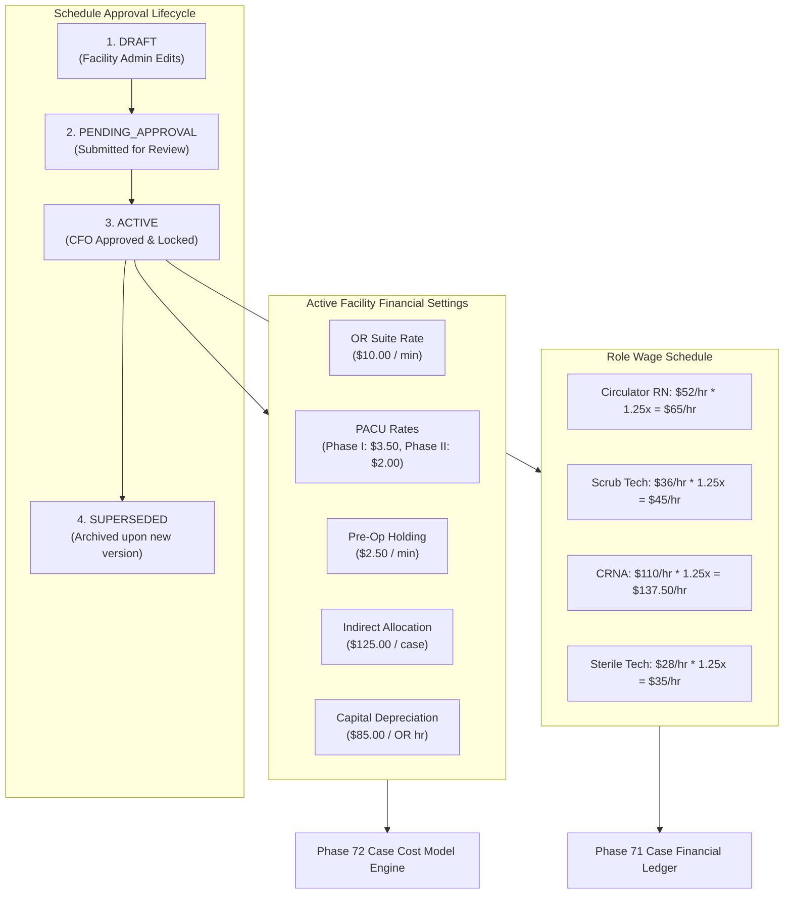

# PHASE 73 — FACILITY FINANCIAL SETTINGS
## Effective-Dated Facility Financial & Procedural Cost Assumptions Governance

> **Module:** Financial Systems & Managerial Cost Accounting  
> **Status:** PRODUCTION SPECIFICATION & IMPLEMENTATION  
> **Target Version:** ASCANALYST v2026.1 Enterprise  
> **Phase:** 73 — Facility Financial Settings  
> **Authors:** Principal Healthcare Financial Systems Architect, Managerial Cost Accounting Specialist, Clinical Informatics Lead, PostgreSQL Database Architect  
> **Classification:** Strict Healthcare Financial Governance (HIPAA 45 CFR § 164.312(b), ASC Cost Reporting, GAAP / ASC 606, SOX § 404)  
> **Target Migration:** `049_facility_financial_settings.sql` (Staged) / `049_facility_financial_settings_down.sql`  
> **Upstream Dependencies:** Phase 70 (Financial Data Dictionary), Phase 71 (Case Financial Ledger), Phase 72 (Case Cost Model)  

---

## 1. PURPOSE

The purpose of Phase 73 is to establish an **authoritative, effective-dated repository for facility-specific financial and cost assumptions**.

In surgical healthcare administration, case profitability calculations (Contribution Margin, Margin Per OR Minute, Direct Labor Costs) are heavily dependent on facility baseline assumptions such as Operating Room minute suite rates, PACU recovery care rates, clinical wage scales, payroll burden multipliers, and indirect facility overhead apportionment.

Historically, facilities often hardcode these values into client-side scripts, or modify rates globally without effective-dating, which corrupts historical financial reports and distorts closed-period accounting audits.

Phase 73 resolves this defect by establishing:
1. **Effective-Dated Cost Schedules:** Version-controlled rate schedules (`effective_start_date`, `effective_end_date`) that guarantee historical cases are costed according to rates in effect on their Date of Service (DOS).
2. **Clinical Role Wage Scales:** Explicit wage baselines for Circulator RN, Scrub Tech, CRNA, and Sterile Processing Tech roles with configurable payroll burden multipliers ($1.25\times$ baseline).
3. **Indirect Facility Apportionment:** Deterministic rules for allocating facility square footage, administration overhead, and equipment capital depreciation per surgical hour.
4. **CFO Approval Lifecycle:** Formal state machine (`DRAFT` ➔ `PENDING_APPROVAL` ➔ `ACTIVE` ➔ `SUPERSEDED`) preventing unapproved rate modifications from reaching production case journals.
5. **Multi-Facility Tenancy:** Absolute isolation between facilities via `is_facility_accessible(facility_id)` and tenant row-level security.

---

## 2. SCOPE

- **Production Requirements:** Complete coverage for OR minute rates, PACU Phase I & II rates, Pre-op rates, clinical role wage matrix, indirect cost allocations, and effective-dating version governance.
- **Product Compatibility:** Integrates seamlessly with Phase 71 (Case Financial Ledger) and Phase 72 (Case Cost Model) without altering existing clinical scheduling or patient logging workflows.
- **Deterministic Precision:** Strict `NUMERIC(10,2)` and `NUMERIC(6,4)` precision in PostgreSQL; floating-point math in JavaScript client code is prohibited for authoritative rate resolution.
- **Tenancy and RBAC:** Bounded to facility scopes; modification restricted to `cfo` and `facility_admin`; approvals restricted to `cfo` or `super_admin`.

---

## 3. CURRENT STATE AUDIT

An audit of the codebase, existing migrations (001–048), and utilities (`hospitalUtils.js`) was performed:

| Component / Setting | Current Source | Classification | Current Defect / Semantic Risk | Target State in Phase 73 |
| :--- | :--- | :---: | :--- | :--- |
| `OR Minute Rate` | `hospitalUtils.js` | **REPLACE** | Hardcoded stepped client rate (\$1500 1st hr + \$300/hr) | Effective-dated `or_minute_rate` in `facility_financial_settings` |
| `Labor Burden Multiplier` | Phase 72 Default | **REFACTOR** | Static constant (1.25x) in client service | Configurable, effective-dated setting per facility schedule |
| `Role Wage Scales` | `015_staff_model` | **REFACTOR** | Staff wages stored per individual without role schedule baselines | Role-based wage schedule with generated `effective_hourly_cost` |
| `PACU Minute Rates` | Missing in DB | **MISSING** | No differentiated Phase I vs Phase II step-down recovery rates | Explicit `pacu_phase1_minute_rate` and `pacu_phase2_minute_rate` |
| `Pre-Op Rate` | Missing in DB | **MISSING** | Pre-op holding time unpriced | Configurable `preop_minute_rate` |
| `Indirect Cost Overhead` | Client Heuristics | **MISSING** | Fixed or arbitrary cost additions | Deterministic `indirect_cost_per_case` and equipment hourly rates |
| `Effective-Dating History` | None | **MISSING** | Overwriting settings corrupts historical surgical encounter costing | Immutable version history with `effective_start_date` / `effective_end_date` |

---

## 4. TARGET STATE ARCHITECTURE

Phase 73 establishes the facility financial configuration architecture:

---

## 5. DATA MODEL / SCHEMA

Staged in Migration `049_facility_financial_settings.sql`:

### 1. `public.facility_financial_settings`
- `id UUID PRIMARY KEY DEFAULT gen_random_uuid()`
- `facility_id UUID NOT NULL REFERENCES public.facilities(id) ON DELETE RESTRICT`
- `schedule_name VARCHAR(128) NOT NULL`
- `version_number VARCHAR(16) NOT NULL DEFAULT '2026.1'`
- `or_minute_rate NUMERIC(10,2) NOT NULL DEFAULT 10.00 CHECK (or_minute_rate >= 0.00)`
- `pacu_phase1_minute_rate NUMERIC(10,2) NOT NULL DEFAULT 3.50 CHECK (pacu_phase1_minute_rate >= 0.00)`
- `pacu_phase2_minute_rate NUMERIC(10,2) NOT NULL DEFAULT 2.00 CHECK (pacu_phase2_minute_rate >= 0.00)`
- `preop_minute_rate NUMERIC(10,2) NOT NULL DEFAULT 2.50 CHECK (preop_minute_rate >= 0.00)`
- `default_labor_burden_multiplier NUMERIC(6,4) NOT NULL DEFAULT 1.2500 CHECK (default_labor_burden_multiplier >= 1.0000)`
- `indirect_cost_per_case NUMERIC(10,2) NOT NULL DEFAULT 125.00 CHECK (indirect_cost_per_case >= 0.00)`
- `equipment_depreciation_hourly_rate NUMERIC(10,2) NOT NULL DEFAULT 85.00 CHECK (equipment_depreciation_hourly_rate >= 0.00)`
- `effective_start_date DATE NOT NULL DEFAULT CURRENT_DATE`
- `effective_end_date DATE`
- `status VARCHAR(32) NOT NULL DEFAULT 'ACTIVE' CHECK (status IN ('DRAFT', 'PENDING_APPROVAL', 'ACTIVE', 'SUPERSEDED'))`
- `is_active BOOLEAN NOT NULL DEFAULT TRUE`
- `approved_by UUID REFERENCES auth.users(id)`
- `approved_at TIMESTAMPTZ`
- `notes TEXT`
- `created_at TIMESTAMPTZ NOT NULL DEFAULT NOW()`
- `created_by UUID REFERENCES auth.users(id)`

### 2. `public.facility_role_wage_rates`
- `id UUID PRIMARY KEY DEFAULT gen_random_uuid()`
- `facility_id UUID NOT NULL REFERENCES public.facilities(id) ON DELETE RESTRICT`
- `settings_id UUID NOT NULL REFERENCES public.facility_financial_settings(id) ON DELETE CASCADE`
- `clinical_role VARCHAR(64) NOT NULL`
- `base_hourly_wage NUMERIC(10,2) NOT NULL CHECK (base_hourly_wage >= 0.00)`
- `role_burden_multiplier NUMERIC(6,4) NOT NULL DEFAULT 1.2500 CHECK (role_burden_multiplier >= 1.0000)`
- `effective_hourly_cost NUMERIC(10,2) GENERATED ALWAYS AS (ROUND(base_hourly_wage * role_burden_multiplier, 2)) STORED`
- `created_at TIMESTAMPTZ NOT NULL DEFAULT NOW()`
- `UNIQUE(settings_id, clinical_role)`

---

## 6. BUSINESS RULES

1. **Date-of-Service Binding:** Case costing queries must resolve facility settings by matching `surgeries.date` against `effective_start_date <= surgeries.date AND (effective_end_date IS NULL OR effective_end_date >= surgeries.date)`.
2. **Immutability of Active Schedules:** Once a schedule status is `ACTIVE` and tied to posted ledger entries, it cannot be edited directly. Revisions require creating a new `DRAFT` version that supersedes the prior schedule.
3. **Burden Multiplier Floor:** `role_burden_multiplier` and `default_labor_burden_multiplier` cannot be less than `1.0000` (representing $100\%$ base pay with zero burden).
4. **Approval Gate:** Activation of a new rate schedule requires explicit authorization by a user with role `cfo` or `super_admin`.

---

## 7. PERMISSIONS / SECURITY (RBAC)

| Role | View Settings | Create Draft | Edit Draft | Submit Review | CFO Approval |
| :--- | :---: | :---: | :---: | :---: | :---: |
| `super_admin` | ✅ | ✅ | ✅ | ✅ | ✅ |
| `cfo` | ✅ | ✅ | ✅ | ✅ | ✅ |
| `facility_admin` | ✅ | ✅ | ✅ | ✅ | ❌ |
| `clinical_director`| ✅ | ❌ | ❌ | ❌ | ❌ |
| `biller` / `coder` | ✅ | ❌ | ❌ | ❌ | ❌ |
| `viewer` | ✅ (Read-Only)| ❌ | ❌ | ❌ | ❌ |

---

## 8. API / SERVICE REQUIREMENTS

The client service `src/lib/facilityFinancialSettingsService.js` provides:
- `getActiveFacilitySettings(facilityId)`: Retrieves the currently active schedule and role wage matrix.
- `getSettingsByDateOfService(facilityId, dateOfService)`: Resolves authoritative historical rates.
- `createDraftVersion(facilityId, newValues, roleRates)`: Creates a new draft schedule.
- `approveScheduleVersion(facilityId, settingsId, approvedBy)`: CFO approval transition.
- `calculateLoadedLaborRate(baseWage, burdenMultiplier)`: Deterministic rounded calculation.
- `calculateCaseIndirectCost(orDurationMinutes, facilitySettings)`: Computes overhead + depreciation.

---

## 9. UI / WORKFLOW REQUIREMENTS

Screen Component: `src/components/FacilityFinancialSettingsView.jsx`:
- **Facility Selector Toolbar:** Facility switcher with active schedule version badge and status pill.
- **Active Schedule Card:** Effective dates, OR minute rate, PACU rates, Pre-op rates, and burden multipliers.
- **Role Wage Matrix:** Table with Base Hourly Wage, Payroll Burden Multiplier, and Loaded Hourly Cost.
- **Indirect Overhead & Capital Card:** Per-case overhead allocation and hourly capital depreciation.
- **Version History & Audit Log:** List of historical schedules, effective date spans, and CFO approval stamps.
- **New Version Revision Modal:** Interface to draft a revised schedule with validation.
- **Responsive Table Wrapper:** `
` with `min-width: 1100px`.
- **Design System:** Strictly Maestro Clinical Palette (Slate, Emerald, Sky Blue, Amber, Rose; zero purple).

---

## 10. AUDIT / PROVENANCE

Every setting modification records:
- `created_by` / `approved_by` (User UUID)
- `created_at` / `approved_at` (ISO 8601 UTC timestamp)
- `notes` (Mandatory rationale for revision)
- Forward and reverse change audit trace.

---

## 11. QA / TEST CASES

Unit test suite `tests/facility-financial-settings.test.js` tests:
1. Export of canonical clinical roles, schedule statuses, and default configurations.
2. Accurate loaded labor rate calculations with burden multipliers.
3. Effective Date of Service (DOS) resolution for historical encounters.
4. Schedule lifecycle state machine (`DRAFT` ➔ `PENDING_APPROVAL` ➔ `ACTIVE`).
5. Migration 049 DDL and rollback schema integrity.
6. UI static audit for Maestro Purple Ban (zero banned tokens).
7. Application wiring and tab router integration.
8. Directory integrity check (strictly 8 files in `Phase_07_Financials`).

---

## 12. ACCEPTANCE CRITERIA

- [x] All 8 canonical sections implemented.
- [x] Migration `049_facility_financial_settings.sql` staged with matching down migration.
- [x] Unit test suite passes with 100% pass rate.
- [x] `npm run build` succeeds with zero errors.
- [x] Directory `Phase_07_Financials` contains strictly 8 files (70 through 77).
- [x] Zero purple tokens in UI components.

---

## 13. DEPENDENCIES

- Upstream: Phase 70 (Data Dictionary), Phase 71 (Ledger), Phase 72 (Case Cost Model).
- Downstream: Phase 74 (Contribution Margin Engine), Phase 75 (Contribution Per OR Hour).

---

## 14. DEFINITION OF DONE & IMPLEMENTATION NOTES

- **Files Created/Modified:**
  - `docs/phases/73_FACILITY_FINANCIAL_SETTINGS.md`
  - `E:\medicalAI\ASCANALYST_All_Modules\ASCANALYST_MD_SPECS\Phase_07_Financials\73_FACILITY_FINANCIAL_SETTINGS.md`
  - `supabase/migrations/049_facility_financial_settings.sql`
  - `supabase/migrations/049_facility_financial_settings_down.sql`
  - `src/lib/facilityFinancialSettingsService.js`
  - `src/components/FacilityFinancialSettingsView.jsx`
  - `src/components/FacilityFinancialSettingsView.css`
  - `src/App.jsx`
  - `tests/facility-financial-settings.test.js`
- **Execution Rule:** Zero splitting of specification files. Single-file integrity maintained.
