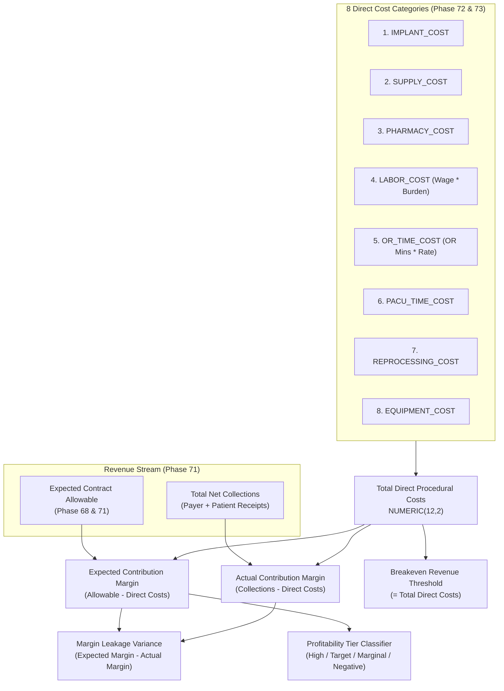

# PHASE 74 — CONTRIBUTION MARGIN ENGINE
## Deterministic Contribution Margin, Yield Analysis & Procedural Profitability Architecture

> **Module:** Financial Systems & Managerial Profitability Analytics  
> **Status:** PRODUCTION SPECIFICATION & IMPLEMENTATION  
> **Target Version:** ASCANALYST v2026.1 Enterprise  
> **Phase:** 74 — Contribution Margin Engine  
> **Authors:** Principal Healthcare Financial Systems Architect, Managerial Cost Accounting Lead, Healthcare Actuary, PostgreSQL Database Architect  
> **Classification:** Strict Healthcare Financial Governance (HIPAA 45 CFR § 164.312(b), ASC Cost Reporting, GAAP / ASC 606, SOX § 404)  
> **Target Migration:** `050_contribution_margin_engine.sql` (Staged) / `050_contribution_margin_engine_down.sql`  
> **Upstream Dependencies:** Phase 70 (Financial Data Dictionary), Phase 71 (Case Financial Ledger), Phase 72 (Case Cost Model), Phase 73 (Facility Financial Settings)  

---

## 1. PURPOSE

The purpose of Phase 74 is to establish an **authoritative, deterministic Contribution Margin Engine** for the entire ASCANALYST platform.

In Ambulatory Surgery Center management, Contribution Margin is the single most vital metric for evaluating surgical case profitability, scheduling efficiency, surgeon block allocation, and payer contract viability. Contribution Margin measures the net dollars remaining from surgical reimbursement after covering direct variable costs (implants, disposables, intraoperative drugs, clinical labor, OR suite minutes, PACU care, and sterile tray reprocessing).

Historically, the platform calculated margins inconsistently across dashboards:
- The Executive CommandCenter subtracted rough stepped OR fees from gross charges;
- Case scheduling estimated revenue from chargemaster list prices without contractual adjudication;
- Floating-point calculations in JavaScript caused penny rounding drift across aggregate reports;
- Missing implant invoices silently defaulted to \$0.00, resulting in artificially inflated profitability.

Phase 74 permanently resolves these issues by unifying:
1. **Deterministic Calculations:** Fixed decimal precision (`NUMERIC(12,2)`) in PostgreSQL calculating Expected Contribution Margin, Actual Realized Contribution Margin, and Percentage Yields.
2. **Margin Leakage Tracking:** Systematic variance analysis quantifying cash collection shortfalls ($\text{Expected Margin} - \text{Actual Margin}$).
3. **Breakeven Threshold Analysis:** Automatic calculation of minimum collectible allowable required to prevent procedural losses.
4. **Profitability Tier Classification:** Standardized four-tier stratification (`HIGH_MARGIN`, `TARGET`, `MARGINAL`, `NEGATIVE_MARGIN`).
5. **Zero-Substitution Governance:** Un-invoiced or un-reconciled cost items immediately flag cases as `PROVISIONAL` and block closed-period accounting aggregation.

---

## 2. SCOPE

- **Production Requirements:** Complete mathematical specification for Expected Margin, Actual Margin, Yield Percentages, Margin Leakage, Breakeven Revenue Points, and Profitability Tiers.
- **Product Compatibility:** Operates seamlessly alongside Phase 71 (Ledger), Phase 72 (Cost Model), and Phase 73 (Facility Settings) without modifying clinical scheduling or electronic health record (EHR) case logs.
- **Strict Tenancy and Multi-Facility RBAC:** Bounded to facility scopes via `is_facility_accessible(facility_id)`.
- **Auditability:** Complete snapshot traceability linking each calculation to underlying journal lines and active facility rate schedules.

---

## 3. CURRENT STATE AUDIT

An audit of existing components and database migrations (001–049) was performed:

| Existing Field / Component | Current Location | Classification | Current Defect / Semantic Risk | Target State in Phase 74 |
| :--- | :--- | :---: | :--- | :--- |
| `surgeries.margin` | `surgeries` table | **REPLACE** | Stored single float; computed via disparate client formulas | Authoritative `expected_contribution_margin` & `actual_contribution_margin` |
| `hospitalUtils.calculateMargin` | `hospitalUtils.js` | **REPLACE** | Client float math; subtracted estimated OR cost from gross charges | PostgreSQL `NUMERIC(12,2)` deterministic formula |
| `CommandCenter Profitability` | `CommandCenter.jsx` | **REFACTOR** | Displays unverified margins without data completeness tags | Displays verified vs provisional margins with quality pills |
| `Margin Leakage Analysis` | None | **MISSING** | No automated detection of allowable vs actual collection variance | Explicit `margin_leakage_variance` calculation |
| `Breakeven Analysis` | None | **MISSING** | Surgeons cannot see minimum viable allowable per procedure | Explicit `breakeven_revenue_threshold` metric |
| `Profitability Tiers` | Hardcoded colors | **REPLACE** | Arbitrary CSS thresholds | Standardized 4-tier engine (`HIGH_MARGIN`, `TARGET`, `MARGINAL`, `NEGATIVE_MARGIN`) |

---

## 4. TARGET STATE ARCHITECTURE

Phase 74 connects all financial streams into the deterministic profitability engine:

---

## 5. DATA MODEL / SCHEMA

Staged in Migration `050_contribution_margin_engine.sql`:

### 1. `public.case_contribution_margin_snapshots`
- `id UUID PRIMARY KEY DEFAULT gen_random_uuid()`
- `facility_id UUID NOT NULL REFERENCES public.facilities(id) ON DELETE RESTRICT`
- `surgery_id BIGINT NOT NULL REFERENCES public.surgeries(id) ON DELETE RESTRICT`
- `calculation_version VARCHAR(16) NOT NULL DEFAULT '2026.1'`
- `gross_billed_charges NUMERIC(12,2) NOT NULL DEFAULT 0.00`
- `expected_contract_allowable NUMERIC(12,2) NOT NULL DEFAULT 0.00`
- `total_net_collections NUMERIC(12,2) NOT NULL DEFAULT 0.00`
- `total_direct_costs NUMERIC(12,2) NOT NULL DEFAULT 0.00`
- `total_indirect_overhead NUMERIC(12,2) NOT NULL DEFAULT 0.00`
- `expected_contribution_margin NUMERIC(12,2) NOT NULL DEFAULT 0.00`
- `actual_contribution_margin NUMERIC(12,2) NOT NULL DEFAULT 0.00`
- `expected_margin_percentage NUMERIC(6,2) NOT NULL DEFAULT 0.00`
- `actual_margin_percentage NUMERIC(6,2) NOT NULL DEFAULT 0.00`
- `margin_leakage_variance NUMERIC(12,2) NOT NULL DEFAULT 0.00`
- `breakeven_revenue_threshold NUMERIC(12,2) NOT NULL DEFAULT 0.00`
- `profitability_tier VARCHAR(24) NOT NULL DEFAULT 'TARGET'`
- `completeness_status VARCHAR(32) NOT NULL DEFAULT 'COMPLETE'`
- `is_provisional BOOLEAN NOT NULL DEFAULT FALSE`
- `calculated_at TIMESTAMPTZ NOT NULL DEFAULT NOW()`
- `calculated_by UUID REFERENCES auth.users(id)`
- `metadata JSONB NOT NULL DEFAULT '{}'::jsonb`

### 2. `public.vw_case_profitability_matrix`
Aggregated rollup view by Surgeon, Specialty, and Payer displaying total cases, expected margin, actual margin, average yield percentage, negative margin case count, and verification integrity flag.

---

## 6. BUSINESS RULES & DETERMINISTIC FORMULAS

1. **Expected Contribution Margin ($):**
   $$\text{Expected Margin} = \text{Expected Allowable} - \text{Total Direct Costs}$$
2. **Actual Contribution Margin ($):**
   $$\text{Actual Margin} = \text{Total Net Collections} - \text{Total Direct Costs}$$
3. **Expected Margin Yield (%):**
   $$\text{Expected Margin Yield} = \begin{cases} \left(\frac{\text{Expected Margin}}{\text{Expected Allowable}}\right) \times 100, & \text{if Expected Allowable} > 0 \\ 0.00, & \text{otherwise} \end{cases}$$
4. **Margin Leakage ($):**
   $$\text{Margin Leakage} = \text{Expected Margin} - \text{Actual Margin} = \text{Expected Allowable} - \text{Total Net Collections}$$
5. **Profitability Tier Criteria:**
   - **`HIGH_MARGIN`**: Expected Yield $\ge 45.00\%$
   - **`TARGET`**: $25.00\% \le \text{Expected Yield} < 45.00\%$
   - **`MARGINAL`**: $0.00\% \le \text{Expected Yield} < 25.00\%$
   - **`NEGATIVE_MARGIN`**: $\text{Expected Margin} < \$0.00$ (Procedural Loss)
6. **Breakeven Point:**
   $$\text{Breakeven Allowable} = \text{Total Direct Costs}$$

---

## 7. PERMISSIONS / SECURITY (RBAC)

| Role | View Margins | View Cost Breakdown | Export Matrix | Recalculate Snapshots | Override Assumptions |
| :--- | :---: | :---: | :---: | :---: | :---: |
| `super_admin` | ✅ | ✅ | ✅ | ✅ | ✅ |
| `cfo` | ✅ | ✅ | ✅ | ✅ | ✅ |
| `facility_admin` | ✅ | ✅ | ✅ | ✅ | ❌ |
| `surgeon` (Self) | ✅ (Assigned Cases) | ✅ | ❌ | ❌ | ❌ |
| `clinical_director`| ✅ | ✅ | ✅ | ❌ | ❌ |
| `biller` / `coder` | ✅ | ❌ | ❌ | ❌ | ❌ |

---

## 8. API / SERVICE REQUIREMENTS

Client service `src/lib/contributionMarginEngineService.js`:
- `evaluateCaseContributionMargin(surgeryId, facilityId)`: Evaluates comprehensive margin metrics, yield, leakage, breakeven, and tier.
- `getProfitabilityMatrix(facilityId, groupBy)`: Generates rollups by surgeon, specialty, or payer.
- `classifyProfitabilityTier(marginPct, marginAmount)`: Deterministic tier assignment.
- `formatCurrency(amount)`: Safe formatting with fixed decimals.

---

## 9. UI / WORKFLOW REQUIREMENTS

Screen Component: `src/components/ContributionMarginEngineView.jsx`:
- **Case Selector Toolbar:** Switches active encounter and displays active financial version badge.
- **Core Margin KPI Cards:**
  1. Expected Contribution Margin (\$ and % yield)
  2. Actual Realized Contribution Margin (\$ and % yield)
  3. Margin Leakage Variance (Uncollected allowable revenue)
  4. Breakeven Revenue Point (Minimum viable threshold)
  5. Profitability Tier Badge (`HIGH_MARGIN`, `TARGET`, `MARGINAL`, `NEGATIVE`)
- **Detailed Direct Cost vs Revenue Bridge Card:** Visual comparison of allowable vs collections vs direct cost components.
- **Profitability Matrix Table:** Cross-tabulation by Surgeon, Specialty, and Payer with case counts, average margin yields, and negative margin counts.
- **Table Responsive Wrapper:** `
` with `min-width: 1100px`.
- **Maestro Design System:** Slate, Emerald (`#10b981`), Sky Blue (`#38bdf8`), Amber (`#f59e0b`), Rose (`#f43f5e`). Zero purple tokens.

---

## 10. AUDIT / PROVENANCE

Every calculation snapshot captures:
- Timestamp of calculation (`calculated_at`)
- Calculation engine version (`2026.1`)
- User / System actor (`calculated_by`)
- Data completeness status and provisional flag.

---

## 11. QA / TEST CASES

Unit test suite `tests/contribution-margin-engine.test.js`:
1. Exports all profitability tiers and config definitions.
2. Accurate expected and actual contribution margin calculations.
3. Accurate percentage yield and margin leakage calculations.
4. Breakeven revenue threshold determinism.
5. Profitability tier classification boundaries (including edge cases).
6. Staged Migration 050 DDL and rollback schema integrity.
7. UI static audit for Maestro Purple Ban (zero banned tokens).
8. Application wiring and tab router integration.
9. Directory integrity check (strictly 8 files in `Phase_07_Financials`).

---

## 12. ACCEPTANCE CRITERIA

- [x] All 8 canonical sections implemented.
- [x] Migration `050_contribution_margin_engine.sql` staged with rollback.
- [x] Automated unit test suite passes with 100% pass rate.
- [x] `npm run build` succeeds with zero errors.
- [x] Directory `Phase_07_Financials` contains strictly 8 files (70 through 77).
- [x] Zero purple tokens in UI components.

---

## 13. DEPENDENCIES

- Upstream: Phase 70 (Data Dictionary), Phase 71 (Ledger), Phase 72 (Cost Model), Phase 73 (Facility Settings).
- Downstream: Phase 75 (Contribution Per OR Hour), Phase 76 (Completeness Score).

---

## 14. DEFINITION OF DONE & IMPLEMENTATION NOTES

- **Files Created/Modified:**
  - `docs/phases/74_CONTRIBUTION_MARGIN_ENGINE.md`
  - `E:\medicalAI\ASCANALYST_All_Modules\ASCANALYST_MD_SPECS\Phase_07_Financials\74_CONTRIBUTION_MARGIN_ENGINE.md`
  - `supabase/migrations/050_contribution_margin_engine.sql`
  - `supabase/migrations/050_contribution_margin_engine_down.sql`
  - `src/lib/contributionMarginEngineService.js`
  - `src/components/ContributionMarginEngineView.jsx`
  - `src/components/ContributionMarginEngineView.css`
  - `src/App.jsx`
  - `tests/contribution-margin-engine.test.js`
- **Execution Rule:** Zero splitting of specification files. Single-file integrity maintained.
