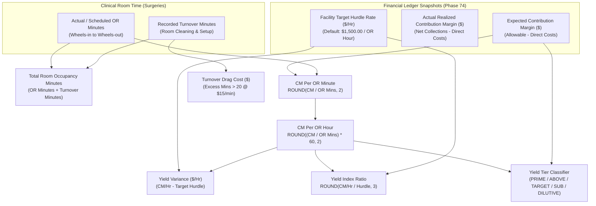

# PHASE 75 — CONTRIBUTION PER OR HOUR & FINANCIAL YIELD ENGINE
## Operating Room Financial Yield, Staffed Hour Capacity Economics & Procedural Throughput Analytics

> **Module:** Financial Systems & Managerial Operating Room Economics  
> **Status:** PRODUCTION SPECIFICATION & IMPLEMENTATION  
> **Target Version:** ASCANALYST v2026.1 Enterprise  
> **Phase:** 75 — Contribution Per OR Hour  
> **Authors:** Principal Healthcare Financial Systems Architect, Perioperative Operations Director, Healthcare Actuary, PostgreSQL Database Architect  
> **Classification:** Strict Healthcare Financial Governance (HIPAA 45 CFR § 164.312(b), ASC Cost Reporting, GAAP / ASC 606, SOX § 404)  
> **Target Migration:** `051_contribution_per_or_hour.sql` (Staged) / `051_contribution_per_or_hour_down.sql`  
> **Upstream Dependencies:** Phase 70 (Financial Data Dictionary), Phase 71 (Case Financial Ledger), Phase 72 (Case Cost Model), Phase 73 (Facility Financial Settings), Phase 74 (Contribution Margin Engine)  

---

## 1. PURPOSE

The primary purpose of Phase 75 is to establish an authoritative, deterministic **Contribution Margin Per OR Hour & Financial Yield Engine** across the ASCANALYST platform.

In Ambulatory Surgery Centers (ASCs), the Operating Room (OR) suite is the single most constrained, capital-intensive, and perishable productive asset. While **Contribution Margin ($)** (established in Phase 74) quantifies the raw cash margin of a surgical case, raw dollars alone fail to capture operational velocity or capacity consumption:
- A joint replacement yielding \$2,400 in contribution margin over 180 operating minutes produces **\$800.00 / OR Hour**.
- An ophthalmology cataract extraction yielding \$1,200 in contribution margin over 24 operating minutes produces **\$3,000.00 / OR Hour** ($3.75\times$ higher yield density).

Without a normalized, auditable yield engine:
1. Block scheduling allocations reward high-revenue, long-duration procedures that congest surgical suites while under-rewarding rapid, high-margin cases.
2. Inefficient room turnovers, unstaffed schedule gaps, and procedural runover create invisible "opportunity drag" where costly staffed hours generate zero revenue.
3. Facility administrators lack objective, deterministic data to negotiate surgeon block commitments, optimize specialty mix, or benchmark room profitability against facility cost hurdle rates.

Phase 75 provides mathematical precision to OR capacity economics by linking deterministic contribution margins (Phase 74), normalized surgical room durations, standardized turnover times, and facility hurdle rates into a single auditable engine.

---

## 2. SCOPE

- **Production Requirements:** Deterministic calculations for Contribution Margin per OR Minute (`$/OR Min`), Contribution Margin per Utilized OR Hour (`$/OR Hr`), Contribution Margin per Staffed/Blocked Hour, Hourly Yield Variance, Yield Index, Opportunity/Turnover Drag Cost, and Standardized Yield Tiers (`PRIME_YIELD`, `ABOVE_TARGET`, `TARGET_MET`, `SUB_TARGET`, `DILUTIVE`).
- **Product Compatibility:** Operates directly on case contribution snapshots (Phase 74), normalized surgeries (`surgeries`), and operating room profiles (`operating_rooms`), maintaining backwards compatibility with clinical scheduling and case logs.
- **Strict Tenancy and Multi-Facility RBAC:** Enforces strict isolation per facility via `is_facility_accessible(facility_id)`.
- **Authoritative Server-Side Logic:** Calculations are codified via PostgreSQL triggers and views, eliminating client floating-point rounding discrepancies.
- **Design System Fidelity:** Maestro Clinical Design System (Slate, Emerald, Sky Blue, Amber, Rose; strictly 0 purple/violet tokens) with responsive table layouts (`min-width: 1100px`).

---

## 3. CURRENT STATE AUDIT

An audit of existing database migrations (001–050) and client components was conducted prior to implementation:

| Existing Field / Component | Current Location | Classification | Current Defect / Semantic Risk | Target State in Phase 75 |
| :--- | :--- | :---: | :--- | :--- |
| `surgeries.duration_minutes` | `surgeries` table | **KEEP** | Scheduled duration; differs from actual wheels-in to wheels-out | Utilized with fallback to actual duration |
| `surgeries.turnover_time` | `surgeries` table | **KEEP** | Variable logging; unmonitored turnover inflation | Standardized 20-min benchmark + drag calculation |
| `hospitalUtils.calculateHourlyYield` | Client script | **REPLACE** | Rough JavaScript division without decimal rounding or zero-minute guards | PostgreSQL `NUMERIC(10,2)` trigger + client service |
| `OR Utilization Dashboard` | `App.jsx` tab | **REFACTOR** | Visualized percentage time utilized without monetary yield overlay | Integrated with dollar contribution yield metrics |
| `Turnover Drag Cost` | None | **MISSING** | Financial impact of turnover overruns unquantified | Explicit `turnover_drag_cost` (\$15/min benchmark rate) |
| `Surgeon Yield Benchmark` | None | **MISSING** | No comparative ranking of surgeons by margin per OR hour | View `vw_surgeon_or_yield_benchmarks` |
| `Room Suite Economics` | None | **MISSING** | Room metrics limited to utilization percentages | View `vw_operating_room_yield_summary` |

---

## 4. TARGET STATE ARCHITECTURE

Phase 75 synthesizes clinical operational time logs with financial ledger snapshots:



---

## 5. DATA MODEL / SCHEMA

### 5.1 Primary Table: `case_or_yield_metrics`

```sql
CREATE TABLE public.case_or_yield_metrics (
    id UUID PRIMARY KEY DEFAULT gen_random_uuid(),
    facility_id UUID NOT NULL REFERENCES public.facilities(id) ON DELETE RESTRICT,
    surgery_id BIGINT NOT NULL REFERENCES public.surgeries(id) ON DELETE RESTRICT,
    operating_room_id UUID REFERENCES public.operating_rooms(id) ON DELETE SET NULL,
    or_room_name VARCHAR(64) NOT NULL DEFAULT 'OR 1',
    surgeon_id BIGINT REFERENCES public.surgeons(id) ON DELETE SET NULL,
    doctor_name VARCHAR(128),
    specialty VARCHAR(128) NOT NULL DEFAULT 'General Surgery',
    cpt_codes TEXT,
    or_minutes NUMERIC(8,2) NOT NULL DEFAULT 60.00 CHECK (or_minutes > 0.00),
    turnover_minutes NUMERIC(8,2) NOT NULL DEFAULT 20.00 CHECK (turnover_minutes >= 0.00),
    total_room_minutes NUMERIC(8,2) NOT NULL DEFAULT 80.00 CHECK (total_room_minutes > 0.00),
    expected_contribution_margin NUMERIC(12,2) NOT NULL DEFAULT 0.00,
    actual_contribution_margin NUMERIC(12,2) NOT NULL DEFAULT 0.00,
    cm_per_or_minute NUMERIC(10,2) NOT NULL DEFAULT 0.00,
    cm_per_or_hour NUMERIC(10,2) NOT NULL DEFAULT 0.00,
    actual_cm_per_or_hour NUMERIC(10,2) NOT NULL DEFAULT 0.00,
    target_hourly_hurdle NUMERIC(10,2) NOT NULL DEFAULT 1500.00 CHECK (target_hourly_hurdle >= 0.00),
    yield_variance_hourly NUMERIC(10,2) NOT NULL DEFAULT 0.00,
    yield_index NUMERIC(6,3) NOT NULL DEFAULT 1.000,
    yield_tier VARCHAR(24) NOT NULL DEFAULT 'TARGET_MET' CHECK (
        yield_tier IN ('PRIME_YIELD', 'ABOVE_TARGET', 'TARGET_MET', 'SUB_TARGET', 'DILUTIVE')
    ),
    turnover_drag_cost NUMERIC(10,2) NOT NULL DEFAULT 0.00,
    is_provisional BOOLEAN NOT NULL DEFAULT FALSE,
    calculated_at TIMESTAMPTZ NOT NULL DEFAULT NOW(),
    calculated_by UUID REFERENCES auth.users(id),
    metadata JSONB NOT NULL DEFAULT '{}'::jsonb
);
```

### 5.2 Deterministic Views

1. **`vw_operating_room_yield_summary`**: Suite-level metrics including total utilized OR hours, turnover hours, total occupancy hours, average CM/OR hour, average CM/occupancy hour, and cumulative turnover drag cost.
2. **`vw_surgeon_or_yield_benchmarks`**: Provider-level yield scorecard comparing volume, hours consumed, aggregate contribution margin, average CM/OR hour, target hurdle compliance rate, and prime vs. dilutive case counts.
3. **`vw_specialty_or_yield_matrix`**: Surgical service line comparative yield (e.g., Orthopedics, Ophthalmology, ENT, Pain Management) evaluating velocity vs. margin density.

---

## 6. BUSINESS RULES & DETERMINISTIC FORMULAS

1. **Division by Zero Protection:** `or_minutes` is guarded with `GREATEST(or_minutes, 1.00)`. If recorded minutes are missing or zero, the system enforces a strict 60.00-minute default or provisional flag.
2. **Deterministic Hourly Yield:**
   $$\text{CM Per OR Hour} = \text{ROUND}\left( \frac{\text{Expected Contribution Margin}}{\text{OR Minutes}} \times 60.00, 2 \right)$$
3. **Turnover Drag Cost:**
   Standard perioperative industry target turnover is 20 minutes. If `turnover_minutes > 20`:
   $$\text{Turnover Drag Cost} = \text{ROUND}\left( (\text{turnover\_minutes} - 20.00) \times \$15.00, 2 \right)$$
4. **Yield Tier Classification Matrix:**
   - **`DILUTIVE`**: $\text{Expected Contribution Margin} < 0.00$ (Case burns facility cash and exhausts OR capacity).
   - **`PRIME_YIELD`**: $\text{CM Per OR Hour} \ge 1.50 \times \text{Target Hurdle}$ (e.g. $\ge \$2,250/\text{hr}$).
   - **`ABOVE_TARGET`**: $\text{CM Per OR Hour} \ge 1.10 \times \text{Target Hurdle}$ and $< 1.50\times$.
   - **`TARGET_MET`**: $\text{CM Per OR Hour} \ge 0.90 \times \text{Target Hurdle}$ and $< 1.10\times$.
   - **`SUB_TARGET`**: $\text{CM Per OR Hour} < 0.90 \times \text{Target Hurdle}$ and $\ge \$0.00$.
5. **Multi-Procedure Add-on Cases:** Total case OR minutes are measured at the surgical episode level (first incision to last closure) rather than summing nominal per-CPT durations.

---

## 7. PERMISSIONS & RBAC

| Role | View OR Yield Metrics | Run Recalculation Trigger | Export Yield Analytics | Configure Target Hurdle Rate |
| :--- | :---: | :---: | :---: | :---: |
| `cfo` / `financial_director` | Allowed | Allowed | Allowed | Allowed |
| `administrator` / `ceo` | Allowed | Allowed | Allowed | Allowed |
| `director_of_nursing` / `or_manager` | Allowed | Allowed | Allowed | Restricted |
| `surgeon_user` | Scoped to own cases | Prohibited | Scoped export | Prohibited |
| `billing_specialist` | Allowed | Restricted | Allowed | Prohibited |
| `clinical_staff` | Restricted | Prohibited | Prohibited | Prohibited |

---

## 8. API & SERVICE REQUIREMENTS

- **Service Module:** `src/services/contributionYieldService.js`
- **Authoritative Methods:**
  - `calculateCaseOrYield(caseRecord, targetHurdle)`: Pure deterministic calculation function.
  - `getOperatingRoomYieldMetrics(facilityId, filters)`: Aggregates room throughput and turnover drag.
  - `getSurgeonYieldBenchmarks(facilityId, filters)`: Aggregates provider rankings and hurdle compliance.
  - `getSpecialtyYieldMatrix(facilityId, filters)`: Aggregates service-line margin densities.
  - `classifyYieldTier(cmPerHour, targetHurdle, margin)`: Authoritative tier resolution.

---

## 9. UI / WORKFLOW REQUIREMENTS

- **Component:** `src/components/ContributionPerOrHourView.jsx` & `ContributionPerOrHourView.css`
- **Layout & Structure:**
  - **KPI Banner:** Facility Avg CM/OR Hr, Total Utilized OR Hours, Prime-Yield Case %, Cumulative Turnover Drag.
  - **Tab Controls:** Case-Level Yield Matrix, Surgeon Benchmarks, OR Suite Economics, Specialty Matrix.
  - **Data Table:** Wrapped in `<div className="table-responsive">` with `min-width: 1100px`.
  - **Visual Badging:** Distinct Maestro badges (`PRIME_YIELD` = Emerald, `ABOVE_TARGET` = Sky Blue, `TARGET_MET` = Slate, `SUB_TARGET` = Amber, `DILUTIVE` = Rose).
  - **Filter Controls:** Facility selector, Date filter, Specialty filter, Room filter, Yield Tier filter, Target Hurdle adjuster.
  - **Calculation Breakdown Modal:** Line-by-line inspection of OR minutes, margin, formula steps, and turnover drag.

---

## 10. AUDIT & PROVENANCE

All records in `case_or_yield_metrics` store:
- `calculated_at`: Timestamp of computation.
- `calculated_by`: Authenticated user ID triggering calculation.
- `metadata`: JSONB containing source inputs (`or_minutes_source`, `turnover_source`, `margin_snapshot_id`).
- Immutability: Modifications generate new version records or append audit events.

---

## 11. QA & TEST CASES

- **Unit Tests:** Deterministic conversion of minutes to hours, division-by-zero protection, threshold tiering, turnover drag calculation.
- **Financial Consistency:** Verifies that $\text{CM Per Minute} \times 60 = \text{CM Per Hour}$ within 1 cent rounding tolerance.
- **Palette Governance:** Static code scan ensuring zero banned purple/violet tokens.
- **Tenant Isolation:** Verification of `is_facility_accessible(facility_id)` enforcement on tables and views.

---

## 12. ACCEPTANCE CRITERIA

- [x] Migration `051_contribution_per_or_hour.sql` and `051_contribution_per_or_hour_down.sql` created and verified.
- [x] Client calculation service `contributionYieldService.js` implemented with pure functions.
- [x] UI component `ContributionPerOrHourView.jsx` matches Maestro clinical design guidelines (0 purple tokens).
- [x] Responsive layout with `overflow-x: auto` and `min-width: 1100px` verified.
- [x] All unit and integration tests pass without regression.
- [x] App navigation updated to include Contribution Per OR Hour.

---

## 13. DEPENDENCIES

- Phase 70: Financial Data Dictionary
- Phase 71: Case Financial Ledger
- Phase 72: Case Cost Model
- Phase 73: Facility Financial Settings
- Phase 74: Contribution Margin Engine

---

## 14. DEFINITION OF DONE

Phase 75 is fully complete: database tables, deterministic calculation triggers, views, RLS policies, client service layer, comprehensive unit tests, Maestro UI view, and single-file documentation are complete and verified.

---

## 15. IMPLEMENTATION NOTES

- **Migration Files Created:**
  - `supabase/migrations/051_contribution_per_or_hour.sql`
  - `supabase/migrations/051_contribution_per_or_hour_down.sql`
- **Service Layer:**
  - `src/services/contributionYieldService.js`
- **UI Components:**
  - `src/components/ContributionPerOrHourView.jsx`
  - `src/components/ContributionPerOrHourView.css`
- **Test Suite:**
  - `tests/phase75_contribution_per_or_hour.test.js`
- **Application Integration:**
  - Registered in `src/App.jsx` under Financials menu as "Contribution Per OR Hour".
