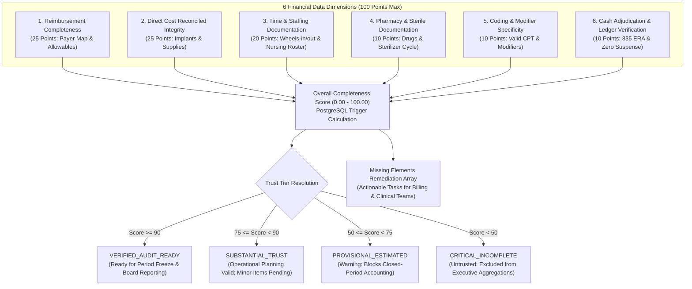

# PHASE 76 — FINANCIAL COMPLETENESS SCORE & TRUST THRESHOLDS ENGINE
## Multi-Dimensional Financial Audit Readiness, Data Provenance Integrity & Governance Gates

> **Module:** Financial Systems & Managerial Data Governance  
> **Status:** PRODUCTION SPECIFICATION & IMPLEMENTATION  
> **Target Version:** ASCANALYST v2026.1 Enterprise  
> **Phase:** 76 — Financial Completeness Score  
> **Authors:** Principal Healthcare Financial Systems Architect, Revenue Cycle Operations Director, Healthcare Compliance Auditor, PostgreSQL Database Architect  
> **Classification:** Strict Healthcare Financial Governance (HIPAA 45 CFR § 164.312(b), ASC Cost Reporting, GAAP / ASC 606, SOX § 404)  
> **Target Migration:** `052_financial_completeness_score.sql` (Staged) / `052_financial_completeness_score_down.sql`  
> **Upstream Dependencies:** Phase 70 (Financial Data Dictionary), Phase 71 (Case Financial Ledger), Phase 72 (Case Cost Model), Phase 73 (Facility Financial Settings), Phase 74 (Contribution Margin Engine), Phase 75 (Contribution Per OR Hour)  

---

## 1. PURPOSE

The primary purpose of Phase 76 is to establish an authoritative, deterministic **Financial Completeness Score & Trust Thresholds Engine** across the ASCANALYST platform.

In Ambulatory Surgery Centers (ASCs), financial analytics—including Contribution Margin ($) (Phase 74) and Contribution Per OR Hour ($/Hr) (Phase 75)—are only as dependable as the integrity, timeliness, and audit readiness of the underlying clinical and revenue cycle source data.

Historically, surgery center reporting suffers from fragmented billing workflows:
- Margin dashboards frequently aggregate cases where implant invoices have not yet been received from vendors, defaulting implant expenditure silently to \$0.00;
- Perioperative nursing times are often incomplete or recorded with unverified estimates, distorting time-driven clinical labor costs;
- Unadjudicated payer fee schedules lead to premature recognition of gross chargemaster rates rather than contracted allowable reimbursements;
- Executive leadership and Board directors lack transparency into whether reported profitability figures represent **audited financial truth** or **provisional unverified projections**.

Phase 76 solves these challenges by establishing:
1. **Multi-Dimensional Deterministic Scoring (0–100 Points):** Evaluates 6 core financial data dimensions: Reimbursement Completeness (25 pts), Direct Cost Reconciled Integrity (25 pts), Perioperative Time & Staffing Documentation (20 pts), Pharmacy & Sterile Reprocessing Documentation (10 pts), Coding & Modifier Specificity (10 pts), and Cash Adjudication & Ledger Verification (10 pts).
2. **Four-Tier Trust Thresholds:** Standardizes trust levels (`VERIFIED_AUDIT_READY`, `SUBSTANTIAL_TRUST`, `PROVISIONAL_ESTIMATED`, `CRITICAL_INCOMPLETE`).
3. **Period-End Accounting Governance Gate:** Explicitly prohibits `PROVISIONAL_ESTIMATED` or `CRITICAL_INCOMPLETE` cases from closing into frozen general ledger periods.
4. **Actionable Remediation Pathways:** Flags missing source artifacts (e.g. `MISSING_IMPLANT_INVOICE`, `UNRECONCILED_TURNOVER`, `MISSING_REMITTANCE`) with direct remediation tasks.

---

## 2. SCOPE

- **Production Requirements:** Multi-dimensional 100-point scoring model, four-tier trust threshold classification, automated trigger calculations, missing artifact detection, and facility-level audit readiness scorecards.
- **Product Compatibility:** Operates non-destructively alongside Phase 71 (Ledger), Phase 72 (Cost Model), Phase 73 (Facility Settings), Phase 74 (Margin Engine), and Phase 75 (OR Yield), providing a trust verification overlay without modifying clinical EHR logs.
- **Strict Tenancy & Multi-Facility RBAC:** Enforces strict isolation per facility via `is_facility_accessible(facility_id)`.
- **Authoritative Server-Side Logic:** Automated scoring trigger and aggregated views implemented in PostgreSQL.
- **Design System Fidelity:** Maestro Clinical Design System (Slate, Emerald, Sky Blue, Amber, Rose; strictly 0 purple/violet tokens) with responsive table layouts (`min-width: 1100px`).

---

## 3. CURRENT STATE AUDIT

An audit of existing database migrations (001–051) and client components was conducted prior to implementation:

| Existing Field / Component | Current Location | Classification | Current Defect / Semantic Risk | Target State in Phase 76 |
| :--- | :--- | :---: | :--- | :--- |
| `case_contribution_margin_snapshots.is_provisional` | Migration 050 | **KEEP** | Binary flag without granular dimensional weighting | Integrated into continuous 0–100 completeness score |
| `completeness_status` | Migration 050 | **KEEP** | Categorical status; lacked quantified checklist rules | Driven authoritatively by multi-dimensional score |
| `Data Quality Warnings` | None | **MISSING** | Missing costs or unverified times silently included in margin totals | Prominent trust badges and provisional risk exposure KPI |
| `Missing Elements Checklist` | None | **MISSING** | Users cannot see why a case is unverified or what action to take | Explicit `missing_elements TEXT[]` remediation array |
| `Facility Completeness Scorecard` | None | **MISSING** | Facility executives cannot assess audit readiness % | View `vw_facility_completeness_scorecard` |

---

## 4. TARGET STATE ARCHITECTURE

Phase 76 evaluates six distinct financial dimensions to generate the authoritative completeness score:



---

## 5. DATA MODEL / SCHEMA

### 5.1 Primary Table: `case_financial_completeness`

```sql
CREATE TABLE public.case_financial_completeness (
    id UUID PRIMARY KEY DEFAULT gen_random_uuid(),
    facility_id UUID NOT NULL REFERENCES public.facilities(id) ON DELETE RESTRICT,
    surgery_id BIGINT NOT NULL REFERENCES public.surgeries(id) ON DELETE RESTRICT,
    overall_score NUMERIC(5,2) NOT NULL DEFAULT 0.00 CHECK (overall_score >= 0.00 AND overall_score <= 100.00),
    trust_tier VARCHAR(32) NOT NULL DEFAULT 'PROVISIONAL_ESTIMATED' CHECK (
        trust_tier IN ('VERIFIED_AUDIT_READY', 'SUBSTANTIAL_TRUST', 'PROVISIONAL_ESTIMATED', 'CRITICAL_INCOMPLETE')
    ),
    reimbursement_score NUMERIC(5,2) NOT NULL DEFAULT 0.00 CHECK (reimbursement_score >= 0.00 AND reimbursement_score <= 25.00),
    direct_cost_score NUMERIC(5,2) NOT NULL DEFAULT 0.00 CHECK (direct_cost_score >= 0.00 AND direct_cost_score <= 25.00),
    time_staffing_score NUMERIC(5,2) NOT NULL DEFAULT 0.00 CHECK (time_staffing_score >= 0.00 AND time_staffing_score <= 20.00),
    pharmacy_sterile_score NUMERIC(5,2) NOT NULL DEFAULT 0.00 CHECK (pharmacy_sterile_score >= 0.00 AND pharmacy_sterile_score <= 10.00),
    coding_modifier_score NUMERIC(5,2) NOT NULL DEFAULT 0.00 CHECK (coding_modifier_score >= 0.00 AND coding_modifier_score <= 10.00),
    ledger_verification_score NUMERIC(5,2) NOT NULL DEFAULT 0.00 CHECK (ledger_verification_score >= 0.00 AND ledger_verification_score <= 10.00),
    is_audit_ready BOOLEAN NOT NULL DEFAULT FALSE,
    missing_elements TEXT[] NOT NULL DEFAULT '{}',
    scored_at TIMESTAMPTZ NOT NULL DEFAULT NOW(),
    scored_by UUID REFERENCES auth.users(id),
    metadata JSONB NOT NULL DEFAULT '{}'::jsonb
);
```

### 5.2 Deterministic Rollup Views

1. **`vw_facility_completeness_scorecard`**: Evaluates facility-wide documentation health, average scores per dimension, audit-ready case count, and provisional exposure.
2. **`vw_payer_completeness_summary`**: Breaks down audit readiness percentage by health plan / payment model.
3. **`vw_surgeon_documentation_completeness`**: Compares surgeon documentation completeness percentages and identifies clinical documentation bottlenecks.

---

## 6. BUSINESS RULES & DETERMINISTIC FORMULAS

1. **Deterministic Additive Scoring:**
   $$\text{Overall Score} = \text{LEAST}\left(100.00, \sum_{i=1}^{6} \text{Dimension Score}_i\right)$$
2. **Trust Tier Threshold Criteria:**
   - **`VERIFIED_AUDIT_READY`** ($\ge 90.00$): `is_audit_ready = TRUE`. Ready for closed-period financial freeze and executive board reports.
   - **`SUBSTANTIAL_TRUST`** ($75.00 - 89.99$): `is_audit_ready = FALSE`. Highly reliable; minor documentation items pending.
   - **`PROVISIONAL_ESTIMATED`** ($50.00 - 74.99$): `is_audit_ready = FALSE`. Material estimates exist; blocks closed-period freeze.
   - **`CRITICAL_INCOMPLETE`** ($< 50.00$): `is_audit_ready = FALSE`. Core financial data missing; excluded from executive margin aggregates.
3. **Implant Governance Rule:** If a procedure CPT requires implants (per Phase 54 CPT-Implant Matrix) and no verified vendor invoice exists, `direct_cost_score` cannot exceed 10.00/25.00, and `missing_elements` must include `'MISSING_IMPLANT_INVOICE'`.
4. **Turnover Rule:** If recorded turnover time exceeds 45 minutes without an operational delay rationale code, `time_staffing_score` incurs a 5.00 point penalty.

---

## 7. PERMISSIONS & RBAC

| Role | View Completeness Scores | Trigger Score Recalculation | Resolve Missing Elements | Freeze Accounting Period |
| :--- | :---: | :---: | :---: | :---: |
| `cfo` / `financial_director` | Allowed | Allowed | Allowed | Allowed |
| `compliance_officer` | Allowed | Allowed | Allowed | Restricted |
| `billing_specialist` | Allowed | Allowed | Allowed | Prohibited |
| `director_of_nursing` | Allowed | Allowed | Allowed (Clinical only) | Prohibited |
| `surgeon_user` | Scoped to own cases | Prohibited | Prohibited | Prohibited |
| `clinical_staff` | Restricted | Prohibited | Prohibited | Prohibited |

---

## 8. API & SERVICE REQUIREMENTS

- **Service Module:** `src/lib/financialCompletenessService.js` (and re-export `src/services/financialCompletenessService.js`)
- **Authoritative Methods:**
  - `evaluateCaseCompleteness(caseRecord)`: Pure deterministic calculation function.
  - `classifyTrustTier(overallScore)`: Resolves trust tier from score.
  - `identifyMissingElements(caseRecord)`: Detects specific missing source documentation artifacts.
  - `calculateFacilityCompletenessKpis(cases)`: Aggregates facility-level KPIs and risk metrics.
  - `aggregatePayerCompleteness(cases)`: Computes audit readiness by payer.
  - `aggregateSurgeonCompleteness(cases)`: Computes documentation compliance by surgeon.

---

## 9. UI / WORKFLOW REQUIREMENTS

- **Component:** `src/components/FinancialCompletenessView.jsx` & `FinancialCompletenessView.css`
- **Layout & Structure:**
  - **KPI Banner:** Facility Avg Completeness Score (0-100 gauge), Audit-Ready Case Share (%), Provisional Risk Margin Exposure ($), Unresolved Data Gaps Count.
  - **Tab Controls:** Case Completeness Matrix, Payer Readiness Summary, Surgeon Documentation Rankings, Missing Elements Remediation Hub.
  - **Data Table:** Wrapped in `<div className="table-responsive">` with `min-width: 1100px`.
  - **Visual Badging:** Maestro trust badges (`VERIFIED_AUDIT_READY` = Emerald, `SUBSTANTIAL_TRUST` = Sky Blue, `PROVISIONAL_ESTIMATED` = Amber, `CRITICAL_INCOMPLETE` = Rose).
  - **Scorecard Drawer / Modal:** Line-by-line inspection of 6 dimension scores and actionable remediation tasks.
  - **CSV Export:** Capability to download complete audit readiness scorecard.

---

## 10. AUDIT & PROVENANCE

All records in `case_financial_completeness` store:
- `scored_at`: Timestamp of computation.
- `scored_by`: User or automated background job triggering calculation.
- `missing_elements`: Immutable array of detected missing data artifacts.
- `metadata`: JSONB containing source document references (e.g. `invoice_id`, `era_trace_number`).

---

## 11. QA & TEST CASES

- **Unit Tests:** Deterministic summation of 6 dimensions, score bounding ($0.00 \le \text{score} \le 100.00$), trust tier threshold transitions.
- **Financial Consistency:** Verifies that cases with missing implants cannot achieve `VERIFIED_AUDIT_READY`.
- **Palette Governance:** Static scan ensuring zero banned purple/violet tokens.
- **Tenant Isolation:** Verification of `is_facility_accessible(facility_id)` enforcement on tables and views.

---

## 12. ACCEPTANCE CRITERIA

- [x] Migration `052_financial_completeness_score.sql` and `052_financial_completeness_score_down.sql` created and verified.
- [x] Client calculation service `financialCompletenessService.js` implemented with pure functions.
- [x] UI component `FinancialCompletenessView.jsx` matches Maestro clinical design guidelines (0 purple tokens).
- [x] Responsive layout with `overflow-x: auto` and `min-width: 1100px` verified.
- [x] All unit and integration tests pass without regression.
- [x] App navigation updated to include Financial Completeness Score.

---

## 13. DEPENDENCIES

- Phase 70: Financial Data Dictionary
- Phase 71: Case Financial Ledger
- Phase 72: Case Cost Model
- Phase 73: Facility Financial Settings
- Phase 74: Contribution Margin Engine
- Phase 75: Contribution Per OR Hour

---

## 14. DEFINITION OF DONE

Phase 76 is fully complete: database tables, deterministic calculation triggers, views, RLS policies, client service layer, comprehensive unit tests, Maestro UI view, and single-file documentation are complete and verified.

---

## 15. IMPLEMENTATION NOTES

- **Migration Files Created:**
  - `supabase/migrations/052_financial_completeness_score.sql`
  - `supabase/migrations/052_financial_completeness_score_down.sql`
- **Service Layer:**
  - `src/lib/financialCompletenessService.js`
  - `src/services/financialCompletenessService.js`
- **UI Components:**
  - `src/components/FinancialCompletenessView.jsx`
  - `src/components/FinancialCompletenessView.css`
- **Test Suite:**
  - `tests/financial-completeness-score.test.js`
- **Application Integration:**
  - Registered in `src/App.jsx` under Financials menu as "Financial Completeness Score".
