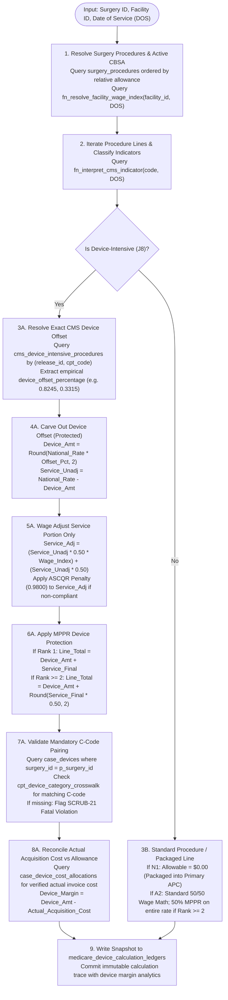
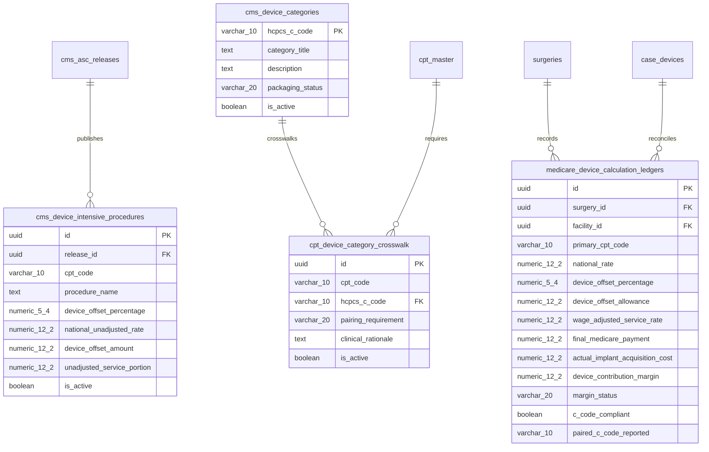

# PHASE 63 — DEVICE-INTENSIVE PAYMENT RULES & PACKAGING SPECIFICATION
## Comprehensive Production Specification: Statutory 42 CFR § 416.171(b)(2) Engine, Device Packaging & Implant Margin Reconciliation

### Executive Summary

| Specification Dimension | Target Specification Detail |
| :--- | :--- |
| **Document Purpose** | Production Specification for Medicare ASC Device-Intensive Payment, Packaging Rules, and Implant Margin Reconciliation |
| **Statutory Authority** | **42 CFR § 416.171(b)(2)** (Device-Intensive ASC Payment), **42 CFR § 416.171(a)(2)** (ASCQR), **42 CFR § 416.172** (MPPR) |
| **CMS Device-Intensive Threshold** | Procedure involving an implant where the device offset percentage is **strictly greater than 30%** ($> 30.00\%$) |
| **Core Statutory Rule** | **The device offset amount is 100% exempt from geographic wage adjustment and 100% exempt from the 50% MPPR cut.** |
| **Packaging Architecture** | Implant hardware (HCPCS C-codes) is **packaged** into the primary procedure APC ($0.00 separate allowable). |
| **Target Database Objects** | `public.cms_device_intensive_procedures`, `public.cms_device_categories`, `public.cpt_device_category_crosswalk`, `public.medicare_device_calculation_ledgers` |
| **Authoritative RPCs** | `fn_calculate_device_intensive_payment`, `fn_validate_device_packaging` |

---

### 1. Statutory Authority & Regulatory Framework

#### 1.1 The 30% Device-Intensive Threshold
Under **42 CFR § 416.171(b)(2)**, as amended in the CY 2019 OPPS/ASC Final Rule (83 FR 58818), a procedure is designated as **Device-Intensive** if:
1. It involves the implantation of medical device hardware; and
2. Its national device offset percentage established by CMS from hospital claims data is **greater than 30 percent** ($> 30.00\%$).

Procedures meeting this criterion are assigned ASC **Payment Indicator `J8`** (or `G2` / `P2` with device-intensive designation in specific office/outpatient crosswalk rules).

#### 1.2 Statutory Payment Determination Sequence
The statutory payment calculation for a device-intensive procedure must strictly follow this mathematical sequence:

1. **Step 1: Retrieve National Unadjusted Baseline Rate ($\text{Rate}_{\text{nat}}$)**
   Extracted from official CMS Addendum AA for the applicable payment year (e.g. CY 2026 CMS-1823-FC).

2. **Step 2: Resolve Empirical Device Offset Percentage ($\text{DOP}$)**
   Extracted from the official CMS Device-Intensive Procedure List. Range: $0.3001$ to $0.8500+$.

3. **Step 3: Carve Out Protected Device Offset Amount ($\text{Amt}_{\text{dev}}$)**
   $$\text{Amt}_{\text{dev}} = \text{ROUND}\left(\text{Rate}_{\text{nat}} \times \text{DOP}, 2\right)$$
   *Regulatory Invariant:* This amount represents the non-labor hardware acquisition cost and is **strictly excluded** from the geographic wage adjustment.

4. **Step 4: Derive Unadjusted Service Portion ($\text{Srv}_{\text{unadj}}$)**
   $$\text{Srv}_{\text{unadj}} = \text{Rate}_{\text{nat}} - \text{Amt}_{\text{dev}}$$

5. **Step 5: Apply Statutory 50/50 Geographic Wage Adjustment to Service Portion**
   Under 42 CFR § 416.171(b), the wage index ($\text{WI}$) adjusts the 50.00% labor-related share of the service portion only:
   $$\text{Srv}_{\text{adj}} = \left(\text{Srv}_{\text{unadj}} \times 0.50 \times \text{WI}\right) + \left(\text{Srv}_{\text{unadj}} \times 0.50\right)$$

6. **Step 6: Apply ASC Quality Reporting (ASCQR) Penalty Factor (if non-compliant)**
   Under 42 CFR § 416.171(a)(2), failure to comply with ASCQR incurs a 2.0% statutory reduction ($\text{Factor} = 0.9800$) applied **only to the wage-adjusted service portion**:
   $$\text{Srv}_{\text{final}} = \begin{cases} \text{Srv}_{\text{adj}} & \text{if ASCQR Compliant} \\ \text{ROUND}\left(\text{Srv}_{\text{adj}} \times 0.9800, 2\right) & \text{if Non-Compliant} \end{cases}$$
   *Regulatory Invariant:* The device offset amount is **never** reduced by the ASCQR penalty.

7. **Step 7: Apply Multiple Procedure Payment Reduction (MPPR) Carve-Out (if applicable)**
   Under 42 CFR § 416.172, if the procedure is a secondary surgical procedure subject to 50% MPPR:
   $$\text{Payment}_{\text{final}} = \begin{cases} \text{Amt}_{\text{dev}} + \text{Srv}_{\text{final}} & \text{Rank 1 (Primary / Highest Allowance)} \\ \text{Amt}_{\text{dev}} + \text{ROUND}\left(\text{Srv}_{\text{final}} \times 0.50, 2\right) & \text{Rank } \ge 2 \text{ (Secondary Surgical)} \end{cases}$$
   *Regulatory Invariant:* The 50% MPPR reduction applies **strictly to the service portion**. The device offset amount remains 100% paid.

---

### 2. Packaging Rules Architecture

```
                                  CLAIM LINE ITEM CLASSIFICATION
                                                │
         ┌──────────────────────────────────────┼──────────────────────────────────────┐
         ▼                                      ▼                                      ▼
PRIMARY SURGICAL (J8 / A2)             IMPLANT HARDWARE (C-CODES)             PACKAGED ANCILLARY (N1)
• Paid under statutory ASC formula     • HCPCS C-Codes (e.g. C1776, C1767)    • Supplies, imaging, prep
• J8 includes bundled device offset    • Packaged under 42 CFR § 416.166      • Packaged into primary APC
• Rate includes service + device       • Medicare Allowable = $0.00           • Medicare Allowable = $0.00
• Primary revenue driver               • Mandatory for claim scrubbing        • Billed with primary surgical
```

#### 2.1 The Device Packaging Principle
In the Medicare ASC payment system:
* All implanted medical devices, prosthetics, and implant supplies (HCPCS C-codes such as `C1776` joint prosthesis, `C1767` neurostimulator generator, `C1785` pacemaker, `L8699` prosthetic unspecified) are **packaged**.
* **Zero Separate Reimbursement:** Medicare does **not** pay a separate fee schedule amount on the device line ($0.00 allowable).
* **Payment Included in Procedure:** Reimbursement for the device is explicitly delivered through the primary procedure's payment rate, specifically via the protected **Device Offset Amount**.
* **Reporting Requirement:** While paid at $0.00, reporting the corresponding HCPCS C-code is mandatory to satisfy CMS claims processing edits (enforced via `SCRUB-21`).

#### 2.2 Commercial vs Medicare Packaging Distinction
* **Gross Chargemaster:** Facilities may establish a gross chargemaster charge on device lines (e.g. $4,200.00) for commercial percentage-of-charge contracts or cost reporting.
* **Zero Medicare Spillover:** Under no circumstance shall the gross charge be treated as Medicare reimbursement. Medicare allowable on device lines is always strictly **$0.00**.

---

### 3. Architecture & Authoritative Calculation Flow



---

### 4. Proposed Data Model (`039_device_intensive_payment_rules.sql`)



#### 4.1 Schema DDL Specifications

```sql
-- 1. CMS Official Device-Intensive Procedure Reference Table
CREATE TABLE IF NOT EXISTS public.cms_device_intensive_procedures (
    id UUID PRIMARY KEY DEFAULT gen_random_uuid(),
    release_id UUID NOT NULL REFERENCES public.cms_asc_releases(id) ON DELETE RESTRICT,
    cpt_code VARCHAR(10) NOT NULL,
    procedure_name TEXT NOT NULL,
    device_offset_percentage NUMERIC(5, 4) NOT NULL CHECK (device_offset_percentage > 0.3000 AND device_offset_percentage <= 1.0000),
    national_unadjusted_rate NUMERIC(12, 2) NOT NULL CHECK (national_unadjusted_rate >= 0.00),
    device_offset_amount NUMERIC(12, 2) GENERATED ALWAYS AS (ROUND(national_unadjusted_rate * device_offset_percentage, 2)) STORED,
    unadjusted_service_portion NUMERIC(12, 2) GENERATED ALWAYS AS (national_unadjusted_rate - ROUND(national_unadjusted_rate * device_offset_percentage, 2)) STORED,
    effective_start_date DATE NOT NULL DEFAULT '2026-01-01',
    effective_end_date DATE,
    is_active BOOLEAN NOT NULL DEFAULT true,
    created_at TIMESTAMPTZ NOT NULL DEFAULT NOW(),
    CONSTRAINT uq_dev_proc_release UNIQUE (release_id, cpt_code)
);

CREATE INDEX IF NOT EXISTS idx_dev_proc_lookup ON public.cms_device_intensive_procedures(cpt_code, is_active);

-- 2. CMS Device Category HCPCS C-Codes Reference Catalog
CREATE TABLE IF NOT EXISTS public.cms_device_categories (
    hcpcs_c_code VARCHAR(10) PRIMARY KEY,
    category_title TEXT NOT NULL,
    description TEXT,
    packaging_status VARCHAR(20) NOT NULL DEFAULT 'PACKAGED_INTO_APC'
        CHECK (packaging_status IN ('PACKAGED_INTO_APC', 'PASS_THROUGH_SEPARATE', 'SPECIAL_COST_BASED')),
    is_active BOOLEAN NOT NULL DEFAULT true,
    created_at TIMESTAMPTZ NOT NULL DEFAULT NOW()
);

-- 3. CPT to Device Category Crosswalk Table (Pairing Validation)
CREATE TABLE IF NOT EXISTS public.cpt_device_category_crosswalk (
    id UUID PRIMARY KEY DEFAULT gen_random_uuid(),
    cpt_code VARCHAR(10) NOT NULL,
    hcpcs_c_code VARCHAR(10) NOT NULL REFERENCES public.cms_device_categories(hcpcs_c_code) ON DELETE RESTRICT,
    pairing_requirement VARCHAR(20) NOT NULL DEFAULT 'MANDATORY'
        CHECK (pairing_requirement IN ('MANDATORY', 'PRIMARY_CHOICE', 'ALTERNATIVE_ALLOWED')),
    clinical_rationale TEXT,
    is_active BOOLEAN NOT NULL DEFAULT true,
    created_at TIMESTAMPTZ NOT NULL DEFAULT NOW(),
    CONSTRAINT uq_cpt_c_code UNIQUE (cpt_code, hcpcs_c_code)
);

CREATE INDEX IF NOT EXISTS idx_cpt_c_crosswalk ON public.cpt_device_category_crosswalk(cpt_code, is_active);

-- 4. Medicare Device Calculation & Implant Margin Ledger
CREATE TABLE IF NOT EXISTS public.medicare_device_calculation_ledgers (
    id UUID PRIMARY KEY DEFAULT gen_random_uuid(),
    surgery_id BIGINT NOT NULL REFERENCES public.surgeries(id) ON DELETE CASCADE,
    facility_id UUID NOT NULL REFERENCES public.facilities(id) ON DELETE CASCADE,
    cpt_code VARCHAR(10) NOT NULL,
    payment_indicator VARCHAR(5) NOT NULL DEFAULT 'J8',
    mppr_rank INTEGER NOT NULL DEFAULT 1 CHECK (mppr_rank >= 1),
    is_mppr_applied BOOLEAN NOT NULL DEFAULT false,
    
    -- Medicare Reimbursement Math Breakdown
    national_unadjusted_rate NUMERIC(12, 2) NOT NULL,
    device_offset_percentage NUMERIC(5, 4) NOT NULL,
    device_offset_allowance NUMERIC(12, 2) NOT NULL,
    unadjusted_service_portion NUMERIC(12, 2) NOT NULL,
    wage_index_applied NUMERIC(6, 4) NOT NULL,
    wage_adjusted_service_rate NUMERIC(12, 2) NOT NULL,
    ascqr_compliant BOOLEAN NOT NULL DEFAULT true,
    final_medicare_payment NUMERIC(12, 2) NOT NULL,
    
    -- Actual Implant Hardware Acquisition Reconciliation
    actual_implant_acquisition_cost NUMERIC(12, 2) NOT NULL DEFAULT 0.00,
    cost_hierarchy_tier VARCHAR(40),
    device_contribution_margin NUMERIC(12, 2) GENERATED ALWAYS AS (
        device_offset_allowance - actual_implant_acquisition_cost
    ) STORED,
    margin_status VARCHAR(20) GENERATED ALWAYS AS (
        CASE 
            WHEN device_offset_allowance > actual_implant_acquisition_cost THEN 'SURPLUS'
            WHEN device_offset_allowance = actual_implant_acquisition_cost THEN 'BREAKEVEN'
            ELSE 'DEFICIT'
        END
    ) STORED,
    
    -- Pre-Bill Compliance Validation
    c_code_compliant BOOLEAN NOT NULL DEFAULT false,
    paired_c_code_reported VARCHAR(10),
    validation_status VARCHAR(20) NOT NULL DEFAULT 'VALIDATED'
        CHECK (validation_status IN ('VALIDATED', 'WARNING', 'FATAL_BLOCKED')),
    
    -- Metadata & Auditing
    calculation_timestamp TIMESTAMPTZ NOT NULL DEFAULT NOW(),
    provenance_release TEXT NOT NULL,
    calculated_by UUID REFERENCES auth.users(id) ON DELETE SET NULL,
    
    CONSTRAINT uq_surg_cpt_ledger UNIQUE (surgery_id, cpt_code)
);

CREATE INDEX IF NOT EXISTS idx_dev_calc_surg ON public.medicare_device_calculation_ledgers(surgery_id);
CREATE INDEX IF NOT EXISTS idx_dev_calc_fac ON public.medicare_device_calculation_ledgers(facility_id, margin_status);
```

---

### 5. Authoritative Stored Procedures (RPC Contracts)

#### 5.1 Stored Procedure: `fn_calculate_device_intensive_payment`
```sql
CREATE OR REPLACE FUNCTION public.fn_calculate_device_intensive_payment(
    p_surgery_id BIGINT,
    p_facility_id UUID DEFAULT NULL,
    p_dos DATE DEFAULT CURRENT_DATE
)
RETURNS TABLE (
    surgery_id BIGINT,
    cpt_code VARCHAR(10),
    payment_indicator VARCHAR(5),
    mppr_rank INTEGER,
    national_unadjusted_rate NUMERIC(12, 2),
    device_offset_percentage NUMERIC(5, 4),
    device_offset_allowance NUMERIC(12, 2),
    wage_adjusted_service_rate NUMERIC(12, 2),
    final_medicare_payment NUMERIC(12, 2),
    actual_implant_acquisition_cost NUMERIC(12, 2),
    device_contribution_margin NUMERIC(12, 2),
    margin_status VARCHAR(20),
    c_code_compliant BOOLEAN,
    paired_c_code VARCHAR(10)
)
LANGUAGE plpgsql
SECURITY DEFINER
SET search_path = public
AS $$
-- Implements 42 CFR § 416.171(b)(2) with MPPR device protection and cost reconciliation
$$;
```

#### 5.2 Stored Procedure: `fn_validate_device_packaging`
```sql
CREATE OR REPLACE FUNCTION public.fn_validate_device_packaging(
    p_surgery_id BIGINT
)
RETURNS TABLE (
    is_clean BOOLEAN,
    blocker_count INTEGER,
    warning_count INTEGER,
    validation_findings JSONB
)
LANGUAGE plpgsql
SECURITY DEFINER
SET search_path = public
AS $$
-- Validates that every J8 procedure has a verified paired C-code and that N1 codes have primary surgical anchors
$$;
```

---

### 6. Multi-Tenant Permissions & RBAC Catalog

Eight permissions required in `src/lib/rbacService.js`:

| Permission Identifier | Description | Risk Level | Minimum Role Required |
| :--- | :--- | :---: | :--- |
| `device_payment.view_rates` | View device-intensive offset percentages and baseline rate allowances | `low` | `Clinical Viewer`, `Biller`, `Coder` |
| `device_payment.view_margins` | View device contribution margin (reimbursement vs actual invoice cost) | `sensitive` | `CFO`, `Facility Admin`, `Org Admin` |
| `device_payment.edit_offsets` | Stage or modify facility-specific device offset adjustments | `critical` | `CFO`, `Super Admin` |
| `device_payment.approve_offset_override` | Authorize and lock a facility-specific device reimbursement override | `critical` | `Super Admin` |
| `device_payment.run_reconciliation` | Execute 3-way reconciliation linking case implants to device offsets | `standard` | `Biller`, `CFO`, `Facility Admin` |
| `device_payment.override_c_code_block` | Sign off on temporary bypass of missing C-code pre-bill block | `critical` | `CFO`, `Facility Admin` |
| `device_payment.export_reconciliation` | Export itemized device reimbursement margin and variance ledgers | `sensitive` | `CFO`, `Billing Lead` |
| `device_payment.audit_log` | View calculation version, provenance, and override audit history | `standard` | `Compliance Auditor`, `Super Admin` |

---

### 7. UI / Workflow Requirements

#### 7.1 Screen: Device-Intensive Reimbursement & Margin Inspector
* **Location:** Inside `MedicareRateExplorer.jsx` under a dedicated sub-view or tab.
* **Component Cards:**
  1. **Device Reimbursement Header:** Displays procedure code, national unadjusted baseline, empirical CMS device offset %, carved-out device allowance ($), and wage-adjusted service portion.
  2. **Device Hardware Margin Card:** Compares the CMS device offset allowance against the actual vendor invoice acquisition cost from `case_device_cost_allocations`. Displays positive green `SURPLUS` badge or red `DEFICIT` alert.
  3. **C-Code Pairing Compliance Badge:** Shows whether the required device category HCPCS C-code (e.g. `C1776`) was documented on the case with green checkmark or fatal pre-bill warning.
  4. **Strict Purple Ban Enforced:** UI styled exclusively using Slate, Blue, Emerald, Amber, and Rose tokens.

