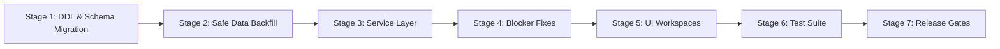

# PHASE 65 — PRODUCTION IMPLEMENTATION PLAN: PAYER & PAYER PLAN MASTER

> **Document ID:** `PHASE_65_IMPLEMENTATION_PLAN.md`  
> **Status:** Production Implementation Roadmap  
> **Target Release:** Phase 65 — Payer Master & Payer Plan Master  
> **Proposed Migration:** `041_payer_master.sql`  

---

## 1. Implementation Philosophy & Phasing

Phase 65 transitions ASCANALYST from a rudimentary, facility-siloed payer lookup table to an **enterprise multi-tenant Payer & Plan Master directory** with Coordination of Benefits (COB) and commercial contract integration.

To eliminate operational risk, implementation will follow a **7-Stage Zero-Downtime Migration Pattern**:

---

## 2. Detailed Staged Execution Plan

### Stage 1: Database Migration (`041_payer_master.sql` & down script)
- **Forward Migration**: `supabase/migrations/041_payer_master.sql`
  - Creates 8 normalized tables:
    1. `public.payer_master`
    2. `public.payer_plans`
    3. `public.payer_identifiers`
    4. `public.facility_payers`
    5. `public.facility_payer_plans`
    6. `public.patient_insurance_coverages`
    7. `public.payer_contracts` & `public.payer_contract_versions`
    8. `public.payer_audit_logs`
  - Deploys immutability triggers on audit logs and statement-level deletion blockers.
  - Attaches tenant-isolated RLS policies utilizing `public.is_facility_accessible` and `public.user_has_facility_role` (**strictly zero queries to `public.user_roles`**).
  - Deploys authoritative RPC `public.fn_resolve_encounter_payer_contract(p_facility_id UUID, p_payer_id UUID, p_dos DATE)`.
- **Down Migration**: `supabase/migrations/041_payer_master_down.sql`
  - Reversible drop of all created triggers, functions, policies, and tables in exact reverse dependency order.

### Stage 2: Zero-Downtime Data Backfill & Backward Compatibility
- **Payer Master Seed & Backfill**:
  - Migrate all unique rows from legacy `public.payers` into `public.payer_master` (deduplicating national payers across facilities by `payer_code`).
  - Create corresponding rows in `public.facility_payers` linking each legacy facility to its master payer UUID.
- **Patient Coverage Backfill**:
  - For every existing record in `public.patients` with `primary_payer_id IS NOT NULL` or `insurance_provider IS NOT NULL`:
    - Insert a record into `public.patient_insurance_coverages` with `coverage_order = 'PRIMARY'`.
    - Backfill policy number and group number from existing flat columns.
- **Legacy View Preservation**:
  - Keep legacy `public.payers` synchronized via bi-directional triggers so existing code querying `payers` continues to function without immediate breaking changes.

### Stage 3: Client Service Layer (`src/lib/payerMasterService.js`)
- Author `src/lib/payerMasterService.js` wired to the `db` singleton:
  - `getPayerMasterDirectory(options)`: Filtered, paginated search across payers with category, status, and facility filters.
  - `getPayerById(payerId)`: Retrieves full entity details including benefit plans, electronic IDs, and active contracts.
  - `getPayerPlans(payerId)`: Fetches products and benefit plans for a payer.
  - `getFacilityPayers(facilityId)`: Fetches facility participation, in-network status, and clearinghouse routing.
  - `getPatientCoverages(patientId)`: Retrieves sequenced primary, secondary, and tertiary insurance policies.
  - `savePatientCoverage(coverageData)`: Upserts patient insurance coverage with COB sequencing validation.
  - `toggleFacilityPayer(facilityId, payerId, isEnabled)`: Facility enablement toggle with audit logging.
  - `stagePayerImport(filePayload)`: Parses, validates, and stages bulk CSV/clearinghouse directories.
  - `commitPayerImport(batchId)`: Server-side atomic commit of staged records.

### Stage 4: Critical Blocker Remediations
- **Remediate Blocker 1 (Medicare Fallback Leakage)**:
  - Update `src/utils/hospitalUtils.js` line 382 to look up `payer_master.payer_category`.
  - Eliminate the silent fallback to `'Medicare'`; uncontracted commercial encounters will fail-closed with uncontracted pricing alerts.
- **Remediate Blocker 2 (RBAC Registration)**:
  - Register all 12 canonical `payer.*` permissions in `src/lib/rbacService.js` under the `finance` and `billing` categories.
  - Update `getRolePermissions` mappings for `super_admin`, `org_admin`, `facility_admin`, `biller`, and `cfo`.

### Stage 5: User Interface Integration
- **New Workspace Component**: `src/components/PayerMasterDirectory.jsx`
  - Tab 1: **Master Payer Directory** (Search, category chips, status badges, plan counts, electronic payer IDs).
  - Tab 2: **Benefit Plans & Products** (HMO, PPO, EPO, Medicare Advantage catalog with timely filing windows).
  - Tab 3: **Facility Enablement & Participation** (In-network vs Out-of-network switches, clearinghouse selector, local billing notes).
  - Tab 4: **Commercial Contracts Matrix** (Percent of Medicare multipliers, fee schedules, device carve-out rules).
  - Tab 5: **Bulk Import & Deduplication Workbench** (Staging grid, 4-tier match confidence badges, human review/commit).
  - **Zero Maestro Purple Ban Compliance**: Strict use of Slate, Blue, Emerald, Amber, and Rose tokens.
- **Wire into `src/App.jsx`**:
  - Replace orphaned placeholder card (line 3860) with `PayerMasterDirectory.jsx`.
  - Add primary sidebar navigation item: `"Payer Master"` under the Billing & Financial section, gated with `RoleGate permission="payer.view"`.
- **Enhance Existing Forms**:
  - Update `src/components/PatientManagement.jsx`: Add multi-coverage insurance tabs (Primary, Secondary, Tertiary) with real-time plan selectors.
  - Update `src/components/SurgeryScheduler.jsx`: Add Payer and Plan dropdowns to case booking drawer.

### Stage 6: Automated Test Suite (`tests/payer-master-and-plans.test.js`)
Author a comprehensive Node.js test suite verifying 100% of Phase 65 invariants:
1. Migration 041 forward and down SQL files exist and are substantive.
2. Creates required tables, constraints, check constraints, and triggers.
3. Multi-tenant RLS policies enforce isolation without querying `public.user_roles`.
4. Decoupled global master allows multiple facilities to participate without duplicate payer records.
5. Payer plan hierarchy enforces parent payer integrity.
6. Electronic payer ID resolution prioritizes clearinghouse-specific routing.
7. Patient insurance coverages enforce unique `(patient_id, coverage_order)`.
8. Elimination of Medicare fallback in `hospitalUtils.js`: uncontracted commercial encounters fail-closed.
9. RBAC catalog registers all 12 `payer.*` permissions.
10. Maestro Purple Ban static audit across all Phase 65 source and CSS files.

### Stage 7: Quality Gates & Verification
1. `node --test tests/payer-master-and-plans.test.js` passes 100%.
2. `npm test` passes all 835+ tests without regressions.
3. `npx eslint` returns 0 warnings and 0 errors across all modified files.
4. `npm run build` succeeds cleanly.
5. Commit to dedicated git branch with conventional commit message.

