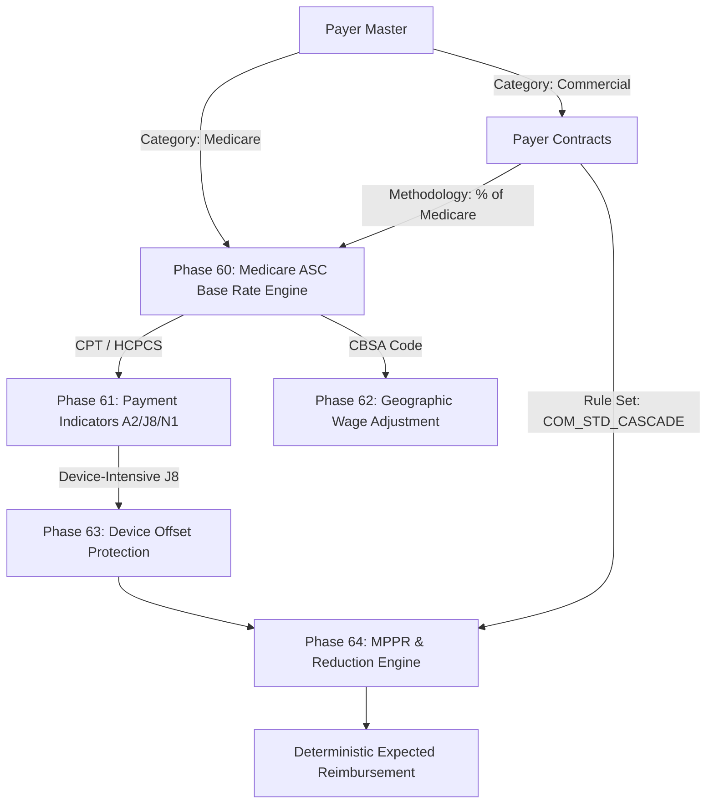

# PHASE 65 — PAYER CONTRACT & FINANCIAL REIMBURSEMENT INTEGRATION

> **Document ID:** `PHASE_65_PAYER_CONTRACT_INTEGRATION.md`  
> **Status:** Production Integration Specification  
> **System:** ASCANALYST Medical Operations & Financial Intelligence  
> **Domain:** Payer Contracting, Reimbursement Calculation Engines, Upstream Phases 60–64 Integration  

---

## 1. Executive Integration Framework

Payer Master is the **authoritative identity layer** of the ASCANALYST billing engine. It establishes **who** the insurer is, what electronic identifiers apply, and what benefit plan is being billed.

> [!IMPORTANT]
> **Cardinal Financial Invariant**: Payer Master **does not calculate reimbursement itself**.  
> Reimbursement is calculated by the **authoritative financial pricing engine** by resolving:
> $$\text{Encounter} \xrightarrow{\text{Insurance}} \text{Payer Plan} \xrightarrow{\text{Facility}} \text{Payer Contract Version} \xrightarrow{\text{Methodology}} \text{Rules Engine (Phases 60–64)}$$

---

## 2. Upstream Medicare Engine Integration (Phases 60–64)

The Phase 65 Payer Master deeply interfaces with the completed Medicare regulatory engines:



### 2.1 Phase 60: Medicare ASC Base Rate Engine
- When `payer_master.payer_category = 'Medicare'`, claims and encounters automatically route to `public.fn_resolve_medicare_base_rate` to pull authoritative CMS Addenda AA/BB rates.
- Commercial contracts utilizing `PERCENT_OF_MEDICARE` pull the statutory base rate from Phase 60 and multiply by the contractual factor (e.g., $1.4500 \times \text{Base Rate}$).

### 2.2 Phase 61: CMS Payment Indicators
- Commercial plans can either:
  1. **Adopt CMS Packaging Rules**: Procedures with indicator `N1` receive $0.00 separate allowable (packaged into surgical APC).
  2. **Override Packaging via Contract Carve-Out**: Specific commercial contracts may separately reimburse packaged supplies or C-codes at invoice cost.

### 2.3 Phase 62: Geographic Wage Adjustment
- The contract specifies whether the commercial `PERCENT_OF_MEDICARE` multiplier is applied to the **national unadjusted rate** or the **facility-wage-adjusted rate**:
  $$\text{Allowable}_{\text{adjusted}} = \text{Multiplier} \times \left[(\text{Service} \times 0.50 \times \text{CBSA Wage Index}) + (\text{Service} \times 0.50) + \text{Device Offset}\right]$$

### 2.4 Phase 63: Device-Intensive Payment Rules
- When a commercial contract includes a **Device Carve-Out**:
  - The surgical procedure rate is discounted per contract terms.
  - The medical device implant is **100% reimbursed** at actual vendor invoice acquisition cost plus an agreed handling markup (e.g., $\text{Invoice Cost} \times 1.10$), verified against the Phase 54-57 Implant Skus and invoices.

### 2.5 Phase 64: Multiple Procedure Payment Rules (MPPR)
- Each Payer Plan and Contract Version links to a registered `multiple_procedure_rule_sets.rule_set_code`:
  - **Medicare ASC**: `MEDICARE_ASC_416_172` (Rank 1 at 100%, Rank 2+ at 50% service portion, 100% protected J8 device offset, endoscopy family base deduction, bilateral 150%).
  - **Commercial Standard**: `COM_STD_CASCADE` (100% / 50% / 25% / 0% bundled).
  - **Commercial Symmetric**: `COM_SYM_50` (100% / 50% / 50% / 50%).

---

## 3. Commercial Reimbursement Methodologies

Phase 65 establishes five normalized commercial contract methodologies under `public.payer_contracts`:

### 3.1 Methodology 1: `PERCENT_OF_MEDICARE`
- **Application**: Most common modern ASC commercial payer contract.
- **Formula**:
  $$\text{Contracted Allowable} = \text{Medicare ASC Rate} \times \text{Multiplier}$$
- **Parameters**:
  - `medicare_multiplier`: Typically `1.2000` to `2.2500` (120% to 225% of Medicare).
  - `apply_geographic_adjustment`: Boolean.

### 3.2 Methodology 2: `COMMERCIAL_FEE_SCHEDULE`
- **Application**: Traditional carrier contracts with negotiated line-item fee schedules.
- **Mechanism**:
  - Direct lookup in `public.payer_fee_schedules` matching `(facility_id, payer_id, cpt_code_id, effective_date)`.
  - If a CPT is missing from the fee schedule, the contract defines fallback: `PERCENT_OF_BILLED` or `MEDICARE_EQUIVALENT`.

### 3.3 Methodology 3: `PERCENT_OF_BILLED_CHARGES`
- **Application**: Out-of-network claims, unlisted CPT codes, or emerging technologies.
- **Formula**:
  $$\text{Expected Reimbursement} = \text{Gross Chargemaster Charge} \times \text{Discount Factor}$$
  *(e.g., Gross Charge \$10,000 \times 0.65 = \$6,500 allowable).*

### 3.4 Methodology 4: `CASE_RATE_BUNDLES` (Ambulatory Case Rates)
- **Application**: Global per-encounter case packages (e.g. Total Joint Replacement Bundle).
- **Mechanism**:
  - Covers primary CPT, secondary procedures, anesthesia, standard facility trays, and recovery.
  - Secondary lines are marked `$0.00 (Bundled into Case Rate)`.

### 3.5 Methodology 5: `HYBRID_WITH_DEVICE_CARVEOUT`
- **Application**: High-acuity spine and orthopedic device cases.
- **Mechanism**:
  - Professional/facility surgical service is paid under fee schedule or percent-of-Medicare.
  - Implants with FDA UDI and vendor invoices exceeding threshold (e.g. `threshold_cost = $500.00`) are billed separately under Revenue Code 0278 and reimbursed at $\text{Invoice Acquisition Cost} + \text{Contract Markup } (10\% - 15\%)$.

---

## 4. Authoritative Contract Resolution Hierarchy

When an encounter or claim requires expected reimbursement calculation, the server-side resolver executes this strict hierarchy:

```
[Start: Encounter Billing Resolution]
         │
         ▼
[1. Resolve Patient Insurance Coverage: Primary Coverage]
         │ (Payer ID, Plan ID)
         ▼
[2. Check Active Facility Payer Contract Version on DOS]
         │
         ├───────────────────────────────────────────┐
   (Contract Found)                           (No Contract Found)
         │                                           │
         ▼                                           ▼
[3. Check Plan-Specific Contract Schedule]    [Non-Contracted Out-of-Network]
         │                                           │
         ├──────────────┐                            ▼
    (Found)         (Default)                 [Apply Facility Default OON %]
         │              │                     (e.g. 50% of Chargemaster)
         ▼              ▼
[Apply Plan Rate]  [Apply Global Contract Rate]
         │              │
         └──────────────┴────────────────────────────┐
                                                     │
                                                     ▼
                             [4. Apply MPPR Cascades (Phase 64)]
                                                     │
                                                     ▼
                             [5. Output Deterministic Allowable]
```

---

## 5. Remediation of Legacy Fallback Defects

### Defect Remediation in `src/utils/hospitalUtils.js`
In the current codebase (lines 382-388), if a commercial encounter lacks an exact string match, it blindly executes `calculateMedicareRevenue`.

#### Required Remediation:
1. **Eliminate String Fallback**: Remove `surgery.patients?.payer_type || ... || 'Medicare'`.
2. **Authoritative Payer Category Lookup**: Query the joined `payer_master.payer_category`.
3. **Fail-Closed Financial Precision**: If a commercial payer contract is unconfigured, return:
   ```json
   {
     "status": "UNCONTRACTED_PRICING_REQUIRED",
     "reimbursement": 0.00,
     "warning": "Encounter payer has no active commercial fee schedule or contract on DOS. Cannot default to Medicare."
   }
   ```
4. **Chargemaster Separation**: Ensure gross chargemaster charges (`gross_charge`) are strictly tracked as billed amounts, never conflated with expected reimbursement.
