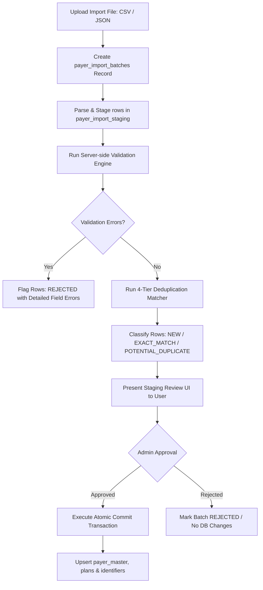

# PHASE 65 — PAYER IDENTIFIER, ROUTING & IMPORT SPECIFICATION

> **Document ID:** `PHASE_65_PAYER_IDENTIFIER_AND_IMPORT_SPEC.md`  
> **Status:** Production Specification  
> **System:** ASCANALYST Medical Operations & Financial Intelligence  
> **Domain:** HIPAA EDI 837/270/276 Routing, Clearinghouse Integration, Bulk Import & Deduplication  

---

## 1. Payer Identifier Architecture

In US healthcare operations, there is **no single universal identifier** for health insurance payers. Electronic routing identifiers vary fundamentally by clearinghouse, transaction type, line of business, and trading partner destination.

### 1.1 Supported Identifier Types & Scopes

| Identifier Type | Standard Format | Issuing Entity | Transaction Scope | Uniqueness Scope | Operational Purpose |
|---|---|---|---|---|---|
| `EDI_PAYER_ID` | 5 alphanumeric characters (e.g. `60054`, `87726`, `00590`) | Major National Clearinghouses | `837P_PROFESSIONAL`, `837I_INSTITUTIONAL` | Unique per clearinghouse + transaction type | Populates Loop 2010BB NM109 (Payer Primary Identifier) on electronic claims |
| `CLEARINGHOUSE_ROUTING_CODE` | 4-10 characters (e.g. `AVAL-60054`) | Availity / Waystar / Change Healthcare | All EDI Transactions | Unique per clearinghouse partner | Internal routing gateway within intermediary switches |
| `ELIGIBILITY_PAYER_ID` | 5 alphanumeric characters | Clearinghouse / Payer Gateway | `270_ELIGIBILITY` | Unique per clearinghouse | Directs real-time 270 eligibility verification requests |
| `CLAIM_STATUS_PAYER_ID` | 5 alphanumeric characters | Clearinghouse / Payer Gateway | `276_CLAIM_STATUS` | Unique per clearinghouse | Directs automated 276 claim status inquiries |
| `NAIC_CODE` | 5 digits (e.g. `60054`, `35378`) | National Association of Insurance Commissioners | N/A (Corporate) | Unique nationally across US insurance companies | Legal entity corporate identification and regulatory audit |
| `STATE_MEDICAID_ID` | 6-10 digits | State Department of Health / Medicaid Agency | State FFS Claims | Unique per US State / Territory | State-specific fee-for-service provider enrollment tie-in |

---

## 2. EDI 837 Claim File Mapping Standards

When ASCANALYST generates an EDI 837 Health Care Claim (837I for Institutional ASC facility claims or 837P for Professional fee claims), the authoritative identifier resolution engine must follow this sequence:

```
[Claim Created]
       │
       ▼
[Check Facility-Payer Clearinghouse Override] ──► Found? ──► Use Override Value
       │ (No)
       ▼
[Query payer_identifiers for Active EDI_PAYER_ID]
  (Matching activeFacility.preferred_clearinghouse + '837I') ──► Found? ──► Use Clearinghouse ID
       │ (No)
       ▼
[Query payer_identifiers for 'GLOBAL' EDI_PAYER_ID] ──► Found? ──► Use Global Payer ID
       │ (No)
       ▼
[Halt Claim Generation: Validation Blocker SCRUB-EDI-01]
  "Missing verified 5-digit Electronic Payer ID for payer on claim header."
```

### 2.1 HIPAA 5010 Loop Mapping Table
- **Loop 2010BB - Payer Name**:
  - `NM101` = `'PR'` (Payer)
  - `NM102` = `'2'` (Non-Person Entity)
  - `NM103` = `payer_master.legal_name`
  - `NM108` = `'PI'` (Payer Identification)
  - `NM109` = `payer_identifiers.identifier_value` (Resolved 5-digit Electronic Payer ID)
  - `N301` / `N302` = Payer mailing address line 1 / line 2
  - `N401` - `N403` = City, State, Postal Zip Code

---

## 3. Data Import Architecture & Pipeline

To eliminate manual entry and maintain fresh electronic routing tables, ASCANALYST supports automated and manual bulk imports from authoritative sources:
1. **CMS National Payer List** (Medicare MACs, Railroad Medicare).
2. **Clearinghouse Payer Master Guides** (Availity, Change Healthcare, Waystar comprehensive payer lists).
3. **Enterprise Facility CSV Spreadsheets** (Legacy ASC billing system exports).



---

## 4. Staging Data Model

### 4.1 Table: `public.payer_import_batches`
Tracks import files, source provenance, actor, and verification state.

```sql
CREATE TABLE IF NOT EXISTS public.payer_import_batches (
    id UUID PRIMARY KEY DEFAULT gen_random_uuid(),
    facility_id UUID REFERENCES public.facilities(id) ON DELETE SET NULL,
    organization_id UUID REFERENCES public.organizations(id) ON DELETE SET NULL,
    source_name VARCHAR(100) NOT NULL, -- 'AVAILITY_DIRECTORY', 'WAYSTAR_CATALOG', 'MANUAL_CSV'
    file_name VARCHAR(255) NOT NULL,
    file_sha256 VARCHAR(64) NOT NULL,
    total_rows INTEGER NOT NULL DEFAULT 0,
    valid_rows INTEGER NOT NULL DEFAULT 0,
    duplicate_rows INTEGER NOT NULL DEFAULT 0,
    error_rows INTEGER NOT NULL DEFAULT 0,
    status VARCHAR(25) NOT NULL DEFAULT 'STAGED' 
        CHECK (status IN ('STAGED', 'VALIDATED', 'COMMITTED', 'ROLLED_BACK', 'REJECTED')),
    imported_by UUID REFERENCES auth.users(id) ON DELETE SET NULL,
    committed_by UUID REFERENCES auth.users(id) ON DELETE SET NULL,
    committed_at TIMESTAMPTZ,
    created_at TIMESTAMPTZ NOT NULL DEFAULT NOW()
);
```

### 4.2 Table: `public.payer_import_staging`
Stores raw row payloads, normalized values, match classifications, and error flags.

```sql
CREATE TABLE IF NOT EXISTS public.payer_import_staging (
    id BIGINT GENERATED ALWAYS AS IDENTITY PRIMARY KEY,
    batch_id UUID NOT NULL REFERENCES public.payer_import_batches(id) ON DELETE CASCADE,
    row_number INTEGER NOT NULL,
    raw_payload JSONB NOT NULL,
    
    -- Normalized Proposed Attributes
    parsed_payer_name VARCHAR(255),
    parsed_payer_category VARCHAR(30),
    parsed_edi_payer_id VARCHAR(50),
    parsed_clearinghouse VARCHAR(40),
    parsed_naic_code VARCHAR(10),
    parsed_tax_id VARCHAR(20),
    
    -- Processing State
    validation_status VARCHAR(20) NOT NULL DEFAULT 'PENDING'
        CHECK (validation_status IN ('PENDING', 'VALID', 'INVALID')),
    validation_errors TEXT[],
    match_classification VARCHAR(30) NOT NULL DEFAULT 'UNEVALUATED'
        CHECK (match_classification IN ('UNEVALUATED', 'NEW', 'EXACT_MATCH', 'POTENTIAL_DUPLICATE', 'IDENTIFIER_CONFLICT')),
    matched_payer_id UUID REFERENCES public.payer_master(id) ON DELETE SET NULL,
    match_confidence NUMERIC(5, 4),
    
    created_at TIMESTAMPTZ NOT NULL DEFAULT NOW()
);
```

---

## 5. Four-Tier Deduplication & Matching Algorithm

To protect the master directory from record explosion and duplicate fragmentation, the server-side validation engine applies a deterministic 4-tier matching algorithm:

### Tier 1: Exact Electronic Identifier & Clearinghouse Match (Confidence: 1.00)
- **Match Criteria**: `raw.parsed_edi_payer_id = identifier_value` AND `raw.parsed_clearinghouse = clearinghouse` AND `identifier_type = 'EDI_PAYER_ID'`.
- **Outcome**: Classify as `EXACT_MATCH`. Existing payer is mapped; import updates metadata without creating a duplicate entity.

### Tier 2: Exact NAIC Code Match (Confidence: 0.98)
- **Match Criteria**: `raw.parsed_naic_code = naic_code` AND `naic_code IS NOT NULL`.
- **Outcome**: Classify as `EXACT_MATCH`. Payer identity confirmed through official insurance commissioner directory.

### Tier 3: Tax Identification Number (EIN) Match (Confidence: 0.95)
- **Match Criteria**: `raw.parsed_tax_id = tax_id` AND `tax_id IS NOT NULL`.
- **Outcome**: Classify as `EXACT_MATCH` (Parent entity match).

### Tier 4: Fuzzy String Distance on Legal / Trade Name (Confidence: 0.60 - 0.90)
- **Match Criteria**: Trigram similarity `similarity(LOWER(parsed_payer_name), LOWER(legal_name)) > 0.85` or normalized token overlap (e.g. *"Aetna Life Insurance Company"* vs *"Aetna"*).
- **Outcome**:
  - If similarity $\ge 0.88$: Flag as `POTENTIAL_DUPLICATE`.
  - If Electronic Payer ID matches another payer: Flag as `IDENTIFIER_CONFLICT`.
  - **PROHIBITION**: Never automatically merge or overwrite records based solely on Tier 4 fuzzy name similarity. Require explicit administrative human approval.

---

## 6. Payer Merge & Consolidation Governance

When duplicate payer entries are identified (e.g., legacy manual entries *"BCBS FL"* and *"Florida Blue"*):

1. **Merge Proposal**:
   - Authorized user initiates merge: Selects `survivor_payer_id` (record to keep) and `absorbed_payer_id` (record to retire).
2. **Impact Assessment**:
   - Engine counts all dependent records:
     - `patient_insurance_coverages`
     - `surgeries`
     - `claims`
     - `facility_payers`
     - `payer_fee_schedules`
     - `multiple_procedure_rule_sets`
3. **Audit & Re-pointer Execution**:
   - Inside an atomic database transaction:
     - Relational pointers in dependent records are re-pointed to `survivor_payer_id`.
     - Identifiers from `absorbed_payer_id` are copied to `survivor_payer_id` (if non-duplicate).
     - `absorbed_payer_id` status is updated to `ARCHIVED` with `change_rationale = 'MERGED_INTO:' || survivor_payer_id`.
     - Hard delete of `absorbed_payer_id` is **strictly forbidden**.
   - Transaction stamps immutable audit event into `public.payer_audit_logs`.

