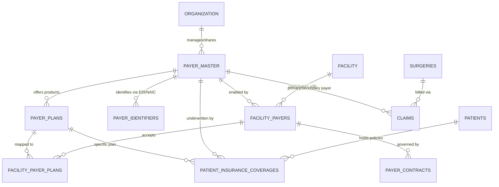

# PHASE 65 — PRODUCTION SPECIFICATION: PAYER & PAYER PLAN MASTER

> **Document ID:** `PHASE_65_PAYER_MASTER_SPEC.md`  
> **Status:** Production Specification  
> **System:** ASCANALYST Medical Operations & Financial Intelligence  
> **Module:** Payer Master, Payer Plan Master & Facility Enablement Subsystem  

---

## 1. System Purpose & Functional Scope

The **Payer Master & Payer Plan Master** subsystem establishes an authoritative, normalized, and enterprise-grade data architecture for healthcare payers, insurance carriers, health plans, electronic transaction routing, and facility-specific participation across ambulatory surgery centers.

### 1.1 Architectural Objectives
1. **Decoupled Tenancy (Global/Enterprise Master vs. Facility Enablement)**:
   - A single national or regional payer entity (e.g. *UnitedHealthcare*, *Aetna*, *First Coast Service Options*) exists once in the master directory with a permanent UUID.
   - Individual surgery centers enable, disable, and configure in-network participation, electronic clearinghouse routing, and localized billing instructions through a lightweight facility enablement bridge.
2. **Normalized Payer Plan Hierarchy**:
   - Explicitly models the 1-to-many relationship between a Payer Carrier and its specific insurance products and benefit plans (*HMO*, *PPO*, *EPO*, *POS*, *Medicare Advantage*, *Medicaid Managed Care*).
3. **Multi-Identifier Electronic Routing (EDI / Clearinghouse)**:
   - Supports multiple electronic routing identifiers per payer based on clearinghouse (Availity, Change Healthcare, Waystar), transaction type (EDI 837 Claim, EDI 270 Eligibility, EDI 276 Claim Status), and NAIC codes.
4. **Coordination of Benefits (COB) Ready**:
   - Enables multi-payer coverage per patient (Primary, Secondary, Tertiary supplemental) with subscriber, policy, and group numbers, supporting real-world ASC billing.
5. **Deterministic Reimbursement Isolation**:
   - Decouples payer identity from contractual fee calculation. Payer Master identifies *who* the insurer is; contract versions and statutory rules engines calculate *what* is owed.
6. **Zero Historical Mutation**:
   - Safe lifecycle transitions (`DRAFT`, `ACTIVE`, `SUSPENDED`, `INACTIVE`, `ARCHIVED`). Deactivating a payer or terminating a plan never cascades or mutates past claims, encounters, or financial audit ledgers.

---

## 2. Target Conceptual Architecture

---

## 3. Core Functional Domains

### 3.1 Payer Master Entity
Represents the legal carrier, insurer, or health program organization.

- **Primary Identifier**: Immutable UUID (`id`).
- **Payer Code**: Canonical human-readable code (e.g., `PAYER-UHC`, `PAYER-AETNA`, `CMS-MEDICARE-FL`).
- **Legal Entity Name**: Official registered business name (e.g., *United HealthCare Services, Inc.*).
- **Trade Name / Doing Business As (DBA)**: Common operational name (e.g., *UnitedHealthcare*).
- **Payer Category**:
  - `Medicare`: Traditional CMS Fee-for-Service Medicare Part B.
  - `Medicaid`: State Fee-for-Service Medicaid.
  - `Commercial`: Commercial insurance carriers (Aetna, Cigna, Humana, BCBS).
  - `Medicare_Advantage`: Medicare Part C managed care plans.
  - `Medicaid_Managed`: State Medicaid MCO contracts.
  - `Workers_Comp`: Workers' compensation insurance carriers.
  - `Veterans_Affairs`: VA Community Care Network (CCN) / TriWest.
  - `Tricare`: Military health system coverage.
  - `Self_Pay`: Non-insured, cash-pay, or patient direct billing.
  - `Other`: Specialized student, travel, or international coverage.
- **Corporate Metadata**: Headquarters address, state of domicile, NAIC company code, corporate website.
- **Lifecycle Status**: `DRAFT`, `ACTIVE`, `SUSPENDED`, `INACTIVE`, `ARCHIVED`.

---

### 3.2 Payer Plan Master Entity
Represents a specific commercial product, network tier, or line of business underwritten by a master payer.

- **Primary Identifier**: Immutable UUID (`id`).
- **Parent Payer Reference**: `payer_id REFERENCES payer_master(id) ON DELETE RESTRICT`.
- **Plan Code**: Internal alphanumeric identifier (e.g., `AETNA-POS-01`, `FLBLUE-BLUECARE-HMO`).
- **Plan Name**: Marketing and operational plan title (e.g., *Aetna Choice POS II (Open Access)*).
- **Plan Classification**:
  - `HMO`: Health Maintenance Organization (Closed network, strict PCP referral).
  - `PPO`: Preferred Provider Organization (In/Out-of-network benefits).
  - `EPO`: Exclusive Provider Organization (In-network only, no referrals needed).
  - `POS`: Point of Service (HMO base with out-of-network options).
  - `MEDICARE_ADVANTAGE_HMO`: Medicare Advantage HMO product.
  - `MEDICARE_ADVANTAGE_PPO`: Medicare Advantage PPO product.
  - `MEDICAID_MCO`: Medicaid Managed Care Organization plan.
  - `INDEMNITY`: Traditional fee-for-service indemnity plan.
  - `HIGH_DEDUCTIBLE`: Qualified High Deductible Health Plan (HDHP/HSA).
  - `OTHER`: Unclassified plan structure.
- **Default Timely Filing Days**: Standard claims timely filing window (e.g. 90 days, 180 days, 365 days).
- **Prior Authorization Requirement**: Boolean indicating if elective ASC surgical procedures generally mandate prior auth.

---

### 3.3 Facility Payer Participation & Enablement
Enables individual surgical centers to configure participation, network tiering, and operational instructions for payers without duplicating records.

- **Facility Reference**: `facility_id REFERENCES facilities(id) ON DELETE CASCADE`.
- **Payer Reference**: `payer_id REFERENCES payer_master(id) ON DELETE RESTRICT`.
- **Participation Status**:
  - `IN_NETWORK`: Facility holds an active contracted participation agreement.
  - `OUT_OF_NETWORK`: Facility is non-contracted (charges billed under chargemaster or out-of-network fee schedule).
  - `PAR_PENDING`: Credentialing or contract negotiation in progress.
  - `TERMINATED`: Contract terminated; active for historical lookup only.
- **Clearinghouse Selection**: Primary electronic clearinghouse used for this payer at this facility (`AVAILITY`, `CHANGE_HEALTHCARE`, `WAYSTAR`, `TIRAS`, `MANUAL_PORTAL`).
- **Clearinghouse Payer Identifier Override**: Facility-specific electronic routing code if required by local clearinghouse account.
- **Effective Dates**: `effective_start_date` and `effective_end_date`.
- **Billing Notes & Special Instructions**: Local facility guidance (e.g., *"Requires Box 19 attachment of invoice for implants over $500"*).

---

### 3.4 Payer Electronic Routing Identifiers
Supports flexible, multi-clearinghouse electronic routing for HIPAA EDI transactions.

- **Identifier Types**:
  - `EDI_PAYER_ID`: 5-digit electronic payer identifier for EDI 837 claim submission (e.g., `60054` for Aetna, `87726` for UHC).
  - `CLEARINGHOUSE_ROUTING_CODE`: Clearinghouse-specific alphanumeric routing code.
  - `ELIGIBILITY_PAYER_ID`: Electronic ID for EDI 270/271 real-time eligibility inquiries.
  - `CLAIM_STATUS_PAYER_ID`: Electronic ID for EDI 276/277 claim status tracking.
  - `NAIC_CODE`: 5-digit National Association of Insurance Commissioners company code.
  - `STATE_MEDICAID_ID`: State-assigned Medicaid carrier ID.
- **Issuing Entity / Clearinghouse**: `GLOBAL_CMS`, `AVAILITY`, `CHANGE_HEALTHCARE`, `WAYSTAR`, `STATE_DOA`, `NAIC`.
- **Transaction Scope**: `837P_PROFESSIONAL`, `837I_INSTITUTIONAL`, `270_ELIGIBILITY`, `276_STATUS`, `835_ERA`.
- **Effective Window**: `effective_start_date` and `effective_end_date`.

---

### 3.5 Patient Insurance Coverage & COB
Normalizes patient insurance policies into 1NF records, supporting Coordination of Benefits (COB).

- **Patient Reference**: `patient_id REFERENCES patients(id) ON DELETE CASCADE`.
- **Coverage Sequence**:
  - `PRIMARY`: Primary insurer responsible for initial claim adjudication.
  - `SECONDARY`: Secondary insurer (e.g., spouse commercial plan, Medigap supplemental).
  - `TERTIARY`: Tertiary insurer (e.g., Medicaid secondary supplemental, third-party liability).
- **Payer Reference**: `payer_id REFERENCES payer_master(id) ON DELETE RESTRICT`.
- **Plan Reference**: `plan_id REFERENCES payer_plans(id) ON DELETE SET NULL`.
- **Policy Identifiers**:
  - `policy_number` / `member_id` (HIPAA Loop 2010BA NM109).
  - `group_number` (HIPAA Loop 2000B SBR03).
- **Subscriber Demographics**:
  - `subscriber_name`, `subscriber_dob`, `subscriber_relationship` (`SELF`, `SPOUSE`, `CHILD`, `OTHER`).
- **Eligibility Verification**:
  - `verification_status`: `UNVERIFIED`, `VERIFIED_ACTIVE`, `VERIFIED_INACTIVE`, `VERIFICATION_FAILED`.
  - `verified_at`, `verified_by`, `copay_amount`, `deductible_amount`, `coinsurance_percentage`.

---

## 4. Payer Master Lifecycle State Machine

```mermaid
stateDiagram-v2
    [*] --> DRAFT : User / Admin creates draft payer
    DRAFT --> ACTIVE : Verified legal name & identifiers approved
    ACTIVE --> SUSPENDED : Temporary credentialing or audit review
    SUSPENDED --> ACTIVE : Reinstated after review
    ACTIVE --> INACTIVE : No active contracts; preserved for claims
    INACTIVE --> ACTIVE : Contract renewed
    INACTIVE --> ARCHIVED : Complete historical archival
    SUSPENDED --> INACTIVE : Definite contract cancellation
    ARCHIVED --> [*] : Read-only forever
```

### Deterministic State Transition Matrix

| Current State | Target State | Permitted Roles | Business Rules & Invariants |
|---|---|---|---|
| `*` | `DRAFT` | `super_admin`, `org_admin`, `facility_admin` | Requires valid legal name and unique payer code. |
| `DRAFT` | `ACTIVE` | `super_admin`, `org_admin` | Requires at least 1 validated Electronic Payer ID or statutory exemption (Self-Pay). |
| `ACTIVE` | `SUSPENDED` | `super_admin`, `org_admin`, `facility_admin` | Payer cannot be selected for new cases; active cases in pre-bill remain editable. |
| `SUSPENDED` | `ACTIVE` | `super_admin`, `org_admin` | Restores full scheduling and billing availability. |
| `ACTIVE` | `INACTIVE` | `super_admin`, `org_admin` | Hidden from case booking dropdowns. Historical claims, encounters, and audit records remain 100% intact. |
| `INACTIVE` | `ACTIVE` | `super_admin`, `org_admin` | Reactivates payer across authorized facilities. |
| `INACTIVE` | `ARCHIVED` | `super_admin` only | Immutable read-only status. Hard delete prohibited. |

---

## 5. Backward Compatibility & Non-Breaking Evolution

To ensure **zero disruption** to existing production modules (Phase 24 Claim Scrubber, Phase 32 Coding, Phase 60-64 Medicare calculations):

1. **Retain Existing `public.payers` as a Compatibility View or Synced Table**:
   - The existing `public.payers` table will be preserved and synchronized via database triggers or mapped to `payer_master` and `facility_payers`.
   - Legacy foreign keys in `patients.primary_payer_id`, `surgeries.primary_payer_id`, and `claims.primary_payer_id` continue to resolve without database schema breaks.
2. **Preserve Legacy `patients` Columns**:
   - `insurance_provider`, `insurance_policy_number`, `insurance_group_number` remain populated and synchronized from the Primary record in `patient_insurance_coverages`.
3. **Graceful Service Fallback**:
   - `db.getPayers()` in `src/lib/supabase.js` will query the normalized `facility_payers` join while returning the exact JSON shape currently expected by `PatientManagement.jsx` and `ClaimScrubberWorkbench.jsx`.
