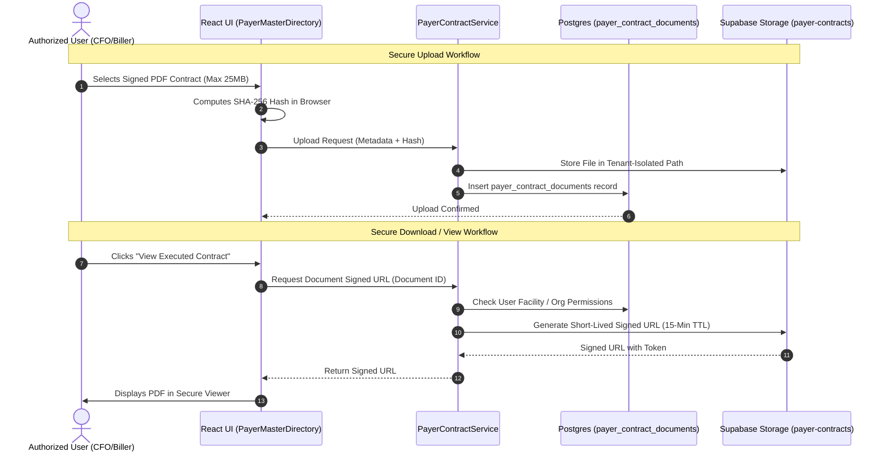

# PHASE 66 — PAYER CONTRACT MODEL: DOCUMENT MANAGEMENT SPECIFICATION

**Author:** ASCANALYST Platform Infrastructure & Document Security  
**Scope:** Private Storage, Signed URLs, SHA-256 Provenance, Access Controls, Retention Policy  
**Storage Target:** Supabase Storage Private Bucket `payer-contracts`  

---

## 1. Document Architecture & Security Model

Payer contracts, fee addenda, and rate schedules are confidential legal instruments containing trade secrets. They must be stored in an isolated, private storage bucket with strict zero-trust access controls.



---

## 2. Storage Bucket Architecture & Tenancy Pathing

### 2.1 Bucket Configuration
- **Bucket ID**: `payer-contracts`
- **Public Access**: `FALSE` (Strictly private; no public URL resolution).
- **File Size Limit**: `26,214,400 bytes` (25 MB).
- **Permitted MIME Types**:
  - `application/pdf` (Executed bilateral agreements, amendments)
  - `text/csv` (Line-item fee schedules, CPT rate tables)
  - `application/vnd.openxmlformats-officedocument.spreadsheetml.sheet` (Excel fee schedule exhibits)

### 2.2 Hierarchical Path Structure
Files are partitioned by Organization, Contract, and Version to ensure complete physical isolation:

```
payer-contracts/
  └── org_{organization_id}/
      └── contract_{contract_id}/
          ├── master/
          │   └── {file_sha256}_Executed_Master_Agreement.pdf
          ├── version_{version_number}/
          │   ├── {file_sha256}_Fee_Schedule_Exhibit_A.pdf
          │   └── {file_sha256}_Commercial_CPT_Rates.csv
          └── amendments/
              └── {file_sha256}_Amendment_01_Implant_Indexation.pdf
```

---

## 3. Cryptographic Provenance & SHA-256 Integrity Check

To guarantee non-repudiation and prevent undetected file replacement:
1. **Client-Side Hash Calculation**: Prior to binary stream upload, the browser computes the SHA-256 checksum of the file bytes.
2. **Database Hash Recording**: The hash is saved in `payer_contract_documents.file_sha256`.
3. **Approval Hash Binding**: When a version is formally approved, the active document's hash is recorded in `payer_contract_approvals.version_hash_at_approval`.
4. **Tamper Detection**: If the binary file in storage does not match `file_sha256`, the system flags the document as `TAMPER_SUSPECT` and blocks download.

---

## 4. Short-Lived Signed URL Generation

Direct object URLs are prohibited. All downloads and in-browser previews utilize time-bounded signed URLs:

```javascript
// Authoritative Signed URL Generator in payerContractService.js
async function getSecureContractDocumentUrl(documentId, facilityId) {
  // 1. Verify user holds payer.contract.document.view permission
  const hasPerm = rbacService.hasPermission(currentUser, 'payer.contract.document.view', facilityId);
  if (!hasPerm) {
    throw new Error('UNAUTHORIZED_DOCUMENT_ACCESS: Insufficient RBAC privileges.');
  }

  // 2. Fetch document metadata from database
  const { data: doc, error } = await supabase
    .from('payer_contract_documents')
    .select('storage_bucket, storage_path, file_name')
    .eq('id', documentId)
    .single();

  if (error || !doc) {
    throw new Error('DOCUMENT_NOT_FOUND: Invalid contract document identifier.');
  }

  // 3. Generate short-lived signed URL (900 seconds = 15 minutes)
  const { data: signedUrlData, error: signError } = await supabase.storage
    .from(doc.storage_bucket)
    .createSignedUrl(doc.storage_path, 900, {
      download: false // In-browser preview mode
    });

  if (signError) {
    throw new Error(`STORAGE_SIGNING_FAILURE: ${signError.message}`);
  }

  // 4. Log document access in audit trail
  await logContractAuditEvent({
    action: 'CONTRACT_DOCUMENT_ACCESSED',
    document_id: documentId,
    file_name: doc.file_name,
    facility_id: facilityId
  });

  return signedUrlData.signedUrl;
}
```

---

## 5. Document Lifecycle & Retention Governance

1. **Active Retention**: Contract documents and amendments must be retained for a minimum of **7 years** following contract termination (aligned with HIPAA 45 CFR § 164.316 and CMS financial record guidelines).
2. **Immutability of Executed Documents**: Documents linked to `APPROVED` or `ACTIVE` contract versions cannot be deleted or overwritten in storage.
3. **Replacement Workflow**: If an amended fee exhibit is executed, a new record is inserted into `payer_contract_documents` with an incremented version link; the prior document remains preserved in the archive history.

---

*Proceed to Risk and Blocker Register specifications.*
