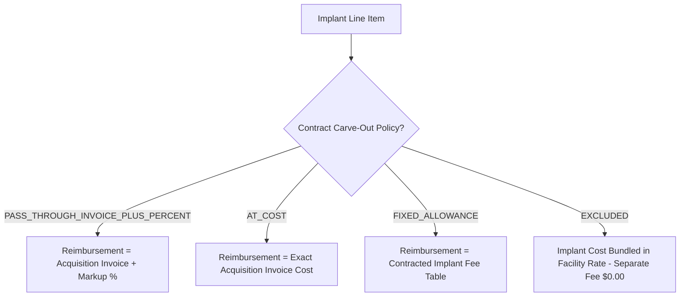

# PHASE 66 — PAYER CONTRACT MODEL: FINANCIAL REIMBURSEMENT INTEGRATION

**Author:** ASCANALYST Quantitative Financial Engineering  
**Scope:** Commercial Pricing Methodologies, Multipliers, MPPR Cascades, Device Carve-Outs, Reconciliation  
**Target Engine:** `src/utils/hospitalUtils.js`, `src/lib/payerContractService.js`, `src/lib/mpprService.js`  

---

## 1. Commercial ASC Reimbursement Methodologies

ASCANALYST supports four primary commercial reimbursement methodologies and one hybrid model. Every contractual calculation is deterministic, auditable, and reproducible from stored source metadata.

```
                                  ┌─────────────────────────────┐
                                  │   Target Contract Version   │
                                  └──────────────┬──────────────┘
                                                 │
            ┌─────────────────────┬──────────────┴──────────────┬─────────────────────┐
            ▼                     ▼                             ▼                     ▼
┌───────────────────────┐ ┌───────────────┐           ┌───────────────────┐ ┌───────────────────┐
│  PERCENT OF MEDICARE  │ │   FEE SCHED   │           │ % OF BILLED CHG   │ │     CASE RATE     │
│  (Base × Multiplier)  │ │ (Line Item $) │           │ (Charge × [1-Disc])│ │ (Procedural Pkg)│
└───────────────────────┘ └───────────────┘           └───────────────────┘ └───────────────────┘
```

### 1.1 Methodology 1: Percentage of Medicare (`PERCENT_OF_MEDICARE`)
The predominant methodology in commercial ASC contracting. Reimburses a contractual percentage (e.g. 140.00% to 185.00%) of the facility's localized Medicare ASC statutory allowable rate.

#### Formula:
$$\text{Expected Line Reimbursement} = \text{ROUND}\Big(\text{Medicare Localized Base Rate} \times \text{Contract Multiplier}, 2\Big)$$

- **Medicare Localized Base Rate**: Derived from Phase 60 base rates (`medicare_base_rate_calculations`) scaled by Phase 62 wage indices (`medicare_wage_indices`).
- **Contract Multiplier**: Stored in `payer_contract_versions.medicare_multiplier` as `NUMERIC(6, 4)` (e.g. `1.4500` = 145.00%).
- **Rounding Standard**: Evaluated to 4 decimal places internally, rounded half-up to exactly 2 decimal places at line completion.

---

### 1.2 Methodology 2: Commercial Fee Schedule (`COMMERCIAL_FEE_SCHEDULE`)
An explicit, line-item negotiated dollar amount established for each CPT/HCPCS code, independent of CMS updates.

#### Formula:
$$\text{Expected Line Reimbursement} = \text{ROUND}\Big(\text{Contracted Fixed Rate} \times \text{Units}, 2\Big)$$

- **Rate Source**: Looked up in `payer_contract_terms` where `contract_version_id = :active_version_id` AND `cpt_code = :line_cpt`.
- **Missing Code Policy**: If a billed CPT code does NOT exist in the fee schedule table:
  - If contract specifies a fallback methodology (e.g. 60% of billed charges for unlisted codes), apply fallback.
  - Otherwise, return status `UNPRICED_CPT_CODE` and escalate for billing supervisor review.
  - **PROHIBITED**: Never default to `$0.00` or silently assume Medicare rates.

---

### 1.3 Methodology 3: Percentage of Billed Charges (`PERCENT_OF_BILLED_CHARGES`)
Reimburses an agreed percentage of the ASC facility's standard Chargemaster gross charges.

#### Formula:
$$\text{Expected Line Reimbursement} = \text{ROUND}\Big(\text{Gross Chargemaster Rate} \times (1.0000 - \text{Contract Discount Pct}), 2\Big)$$

- **Gross Chargemaster Rate**: Retrieved from `cpt_codes.baseline_charge` or `surgery_procedures.baseline_charge`.
- **Contract Discount Pct**: Stored in `payer_contract_versions.billed_charge_discount_pct` (e.g. `0.3500` indicates a 35% discount off gross charges, resulting in a 65% payment factor).

---

### 1.4 Methodology 4: Case Rate & Bundled Package (`CASE_RATE`)
A single, all-inclusive facility reimbursement covering the entire surgical encounter (primary procedure, secondary procedures, internal supplies, routine drugs, and recovery).

#### Formula:
$$\text{Expected Case Reimbursement} = \text{Contracted Case Rate} + \text{Approved Carve-Outs}$$

- **Primary CPT determines Case Rate**: Looked up in `payer_contract_terms`.
- **Secondary Procedures**: Bundled at `$0.00` facility fee unless an explicit contract carve-out applies.
- **Supplies / Meds**: Bundled into case rate.

---

## 2. Interaction with Phase 64: Multiple Procedure Payment Rules (MPPR)

Commercial contracts negotiate explicit rules for multiple surgical procedures performed during the same operative session.

### 2.1 Standard Commercial Cascading Rule (`COM_STD_CASCADE`)
- Procedures ranked in descending order by unreduced contractual rate:
  - **Rank 1 (Primary)**: Paid at 100% of contractual allowable.
  - **Rank 2 (Secondary)**: Paid at 50% of contractual allowable.
  - **Rank 3+ (Tertiary)**: Paid at 25% or 50% depending on `payer_contract_versions.mppr_rule_set_code`.

### 2.2 CMS Alignment Rule (`CMS_50_PERCENT`)
- Direct alignment with Medicare Phase 64 rules:
  - Primary procedure: 100%.
  - Subsequent procedures: 50%.
  - Endoscopy family base-code deductions apply where specified in contract terms.

### 2.3 Strict No-Reduction Rule (`NO_MPPR_REDUCTION`)
- Applicable to select specialty commercial carve-outs (e.g. Pain Management, Retina Surgery).
- All payable procedures reimbursed at 100% of their contracted allowable without secondary discounting.

---

## 3. Interaction with Phase 63: Device-Intensive & Implant Carve-Outs

Surgical implants (joint prostheses, pacemakers, neurostimulators, ACL anchors) represent significant ASC cost exposure. Commercial contracts define explicit carve-out reimbursement terms.



### 3.1 Invoice Plus Percentage Markup (`PASS_THROUGH_INVOICE_PLUS_PERCENT`)
#### Formula:
$$\text{Expected Implant Reimbursement} = \text{ROUND}\Big(\text{Actual Invoice Cost} \times (1.0000 + \text{Markup Pct}), 2\Big)$$

- **Actual Invoice Cost**: Verified against `case_devices.purchase_cost` and vendor contract pricing from Phase 55 (`facility_vendor_contracts`).
- **Markup Pct**: Stored in `payer_contract_versions.device_invoice_markup_pct` (e.g. `0.1000` = Invoice + 10.0%).
- **Maximum Cap**: Contract may specify a maximum dollar markup cap (e.g. max `$1,500.00` markup per encounter).

### 3.2 At-Cost Pass-Through (`AT_COST`)
#### Formula:
$$\text{Expected Implant Reimbursement} = \text{ROUND}(\text{Actual Invoice Cost}, 2)$$

- Facility receives exact reimbursement for acquisition invoice; no profit margin permitted on hardware.

### 3.3 Device-Intensive Medicare Interaction
For contracts utilizing `PERCENT_OF_MEDICARE`:
- The Medicare base rate consists of a **Device Portion** and a **Service Portion** (Phase 63).
- If the commercial contract states "Implants paid separately at invoice + 10%", the Medicare multiplier applies **only to the Service Portion**, preventing double-reimbursement of the device.

---

## 4. Strict Financial Invariants & Prohibited Behaviors

1. **PROHIBITED: Silent Fallback to Medicare Rates**:
   - A commercial or out-of-network claim must NEVER receive statutory Medicare ASC rates unless a valid contract version explicitly specifies `reimbursement_methodology = 'PERCENT_OF_MEDICARE'`.
2. **PROHIBITED: Gross Charge Substitution**:
   - Chargemaster gross charges must NEVER be treated as expected revenue or allowable reimbursement without an explicit contractual `% of Billed Charges` term.
3. **PROHIBITED: Zero Dollar Substitution for Missing Terms**:
   - If an approved contract version is missing a rate for a billed CPT code, the engine must NOT substitute `$0.00`. It must fail closed and emit `CONTRACT_RATE_MISSING`.
4. **MANDATORY: Separation of Financial Dimensions**:
   - The engine must strictly isolate:
     - Gross Billed Charge (Facility standard charge)
     - Contractual Allowed Amount (Maximum enforceable by agreement)
     - Expected Payer Reimbursement (Allowed amount minus patient responsibility)
     - Patient Copay, Coinsurance, Deductible (Patient liability per benefit plan)
     - Direct Facility Cost (Labor, OR minutes, supplies, and implants)
     - Net Operating Margin (Expected Reimbursement minus Total Cost)

---

## 5. End-to-End Financial Calculation Execution Flow

```javascript
// Server-Side Authoritative Adjudication Algorithm
function calculateCommercialEncounterReimbursement(encounter, contractVersion, termsMap) {
  let totalAllowed = 0;
  let totalExpectedPayer = 0;
  let lineResults = [];

  // 1. Rank procedure lines in descending order of unreduced rate
  const sortedLines = sortProceduresByRateDesc(encounter.lines, contractVersion, termsMap);

  // 2. Iterate each line with MPPR rank
  sortedLines.forEach((line, index) => {
    const rank = index + 1;
    const term = termsMap.get(line.cpt_code);
    
    // Resolve base allowable
    let baseAllowable = 0;
    if (term && term.rate_methodology === 'FIXED_FEE') {
      baseAllowable = term.contracted_rate;
    } else if (contractVersion.reimbursement_methodology === 'PERCENT_OF_MEDICARE') {
      baseAllowable = line.medicare_localized_rate * contractVersion.medicare_multiplier;
    } else if (contractVersion.reimbursement_methodology === 'PERCENT_OF_BILLED_CHARGES') {
      baseAllowable = line.gross_charge * (1 - contractVersion.billed_charge_discount_pct);
    } else {
      throw new Error(`CONTRACT_METHODOLOGY_UNSUPPORTED: ${contractVersion.reimbursement_methodology}`);
    }

    // Apply MPPR discount based on rank
    const mpprDiscount = resolveMpprDiscount(rank, contractVersion.mppr_rule_set_code);
    const lineAllowed = Math.round(baseAllowable * (1 - mpprDiscount) * 100) / 100;

    lineResults.push({
      cpt_code: line.cpt_code,
      rank,
      base_allowable: baseAllowable,
      mppr_discount_pct: mpprDiscount,
      final_allowed: lineAllowed
    });

    totalAllowed += lineAllowed;
  });

  // 3. Process Implant Carve-Outs
  let implantTotal = 0;
  if (contractVersion.device_carve_out_mode === 'PASS_THROUGH_INVOICE_PLUS_PERCENT') {
    encounter.implants.forEach(imp => {
      const impPay = Math.round(imp.invoice_cost * (1 + contractVersion.device_invoice_markup_pct) * 100) / 100;
      implantTotal += impPay;
    });
  }

  return {
    contract_version_id: contractVersion.id,
    version_number: contractVersion.version_number,
    total_procedure_allowed: totalAllowed,
    total_implant_carveout: implantTotal,
    total_contractual_allowed: totalAllowed + implantTotal,
    line_breakdown: lineResults
  };
}
```

---

*Proceed to Security and RBAC specifications.*

