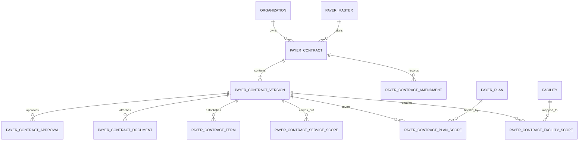
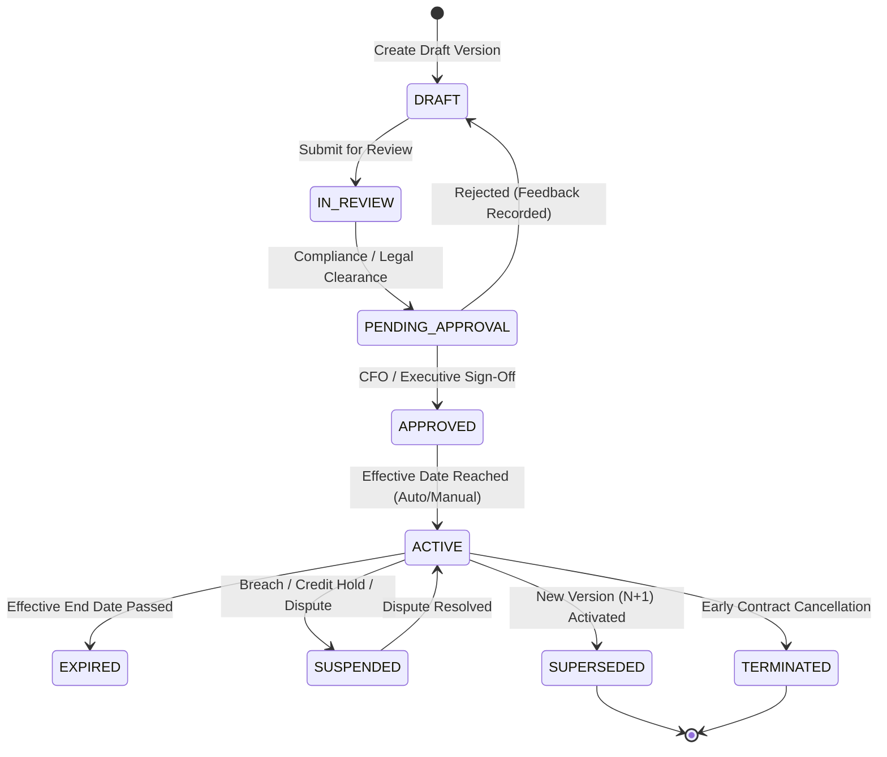
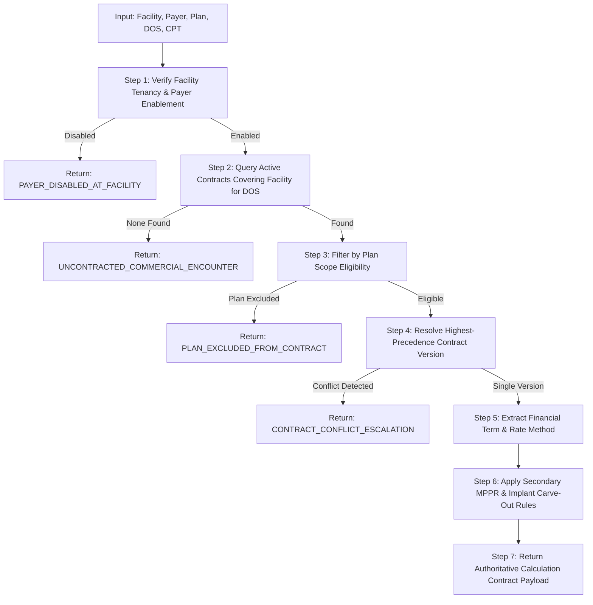

# PHASE 66 — PAYER CONTRACT MODEL: ARCHITECTURAL & FUNCTIONAL SPECIFICATION

**Author:** ASCANALYST Architecture & Financial Engineering Team  
**Scope:** Payer Contracts, Versions, Facility Scopes, Plan Scopes, Amendments, Lifecycle, Resolution Engine, UI  
**Target Migration Reference:** `042_payer_contract_model.sql` (Planning Reference Only)  
**Security Classification:** Proprietary Commercial Health Financial Specification  

---

## 1. Architectural Principles & Scope Boundaries

### Core Design Principles:
1. **Separation of Legal Identity from Terms**: A contract represents the ongoing bilateral relationship with a payer. Contract versions represent the immutable, effective-dated legal and financial terms active during specific service dates.
2. **Immutable Approved Versions**: Once a contract version is approved and activated, its terms, multipliers, and fee schedules cannot be modified. Changes require an authorized amendment or a new version ($N+1$).
3. **Decoupled Tenancy & Scope Inheritance**: Contracts belong to an Organization (corporate owner) and optionally bind to 1 to $N$ specific Facilities. Scope rules dictate which facilities, benefit plans, and clinical procedures inherit the agreement.
4. **Deterministic Precedence**: Contract and rate resolution follows a deterministic specificity hierarchy (Procedure-specific > Plan-specific > Facility-specific > Organization-wide default). Overlapping conflicting agreements fail closed and escalate to billing leadership.
5. **Fail-Closed Financial Adjudication**: If no active contract covers a commercial claim for a date of service, the system refuses to guess a rate or silently fall back to Medicare statutory rates. It flags the encounter as `UNCONTRACTED_COMMERCIAL_ENCOUNTER`.

---

## 2. Target Entity Architecture & Relationship Map



### Entity Role Breakdown:
- **A. Payer (`payer_master`)**: The insurance company or administrative entity (e.g. Blue Cross Blue Shield Florida).
- **B. Payer Plan (`payer_plans`)**: The specific coverage product (e.g. BlueCare HMO, BlueOptions PPO).
- **C. Contract (`payer_contracts`)**: The overarching business agreement between the organization/facility and payer. Holds contract number, legal names, governing jurisdiction, and renewal cycle.
- **D. Contract Version (`payer_contract_versions`)**: An immutable, effective-dated snapshot of terms valid for a date interval `[effective_start_date, effective_end_date]`.
- **E. Contract Amendment (`payer_contract_amendments`)**: Formal legal change document modifying terms for future or retroactive dates.
- **F. Contract Scope (`payer_contract_*_scopes`)**: Bridges defining which Facilities, Plans, Specialties, and CPTs are covered or excluded.
- **G. Contract Documents (`payer_contract_documents`)**: Secure PDF records of signed master agreements, rate exhibits, and amendments with SHA-256 integrity verification.
- **H. Contract Financial Terms (`payer_contract_terms`)**: Granular reimbursement methodology bindings (% of Medicare, commercial fee schedule amounts, % of billed charges, case rates).

---

## 3. Contract Lifecycle & Version State Machine

Every contract and contract version transitions through a strict, auditable state machine.



### Permitted Transitions & Authority Matrix:
| From State | To State | Trigger / Action | Required Role | Audit Recorded |
| :--- | :--- | :--- | :--- | :--- |
| *None* | `DRAFT` | Contract Initialization | `cfo`, `facility_admin`, `org_admin` | Yes |
| `DRAFT` | `IN_REVIEW` | Submit for Review | `biller`, `coder`, `facility_admin` | Yes |
| `IN_REVIEW` | `PENDING_APPROVAL` | Compliance Verification | `facility_admin`, `org_admin` | Yes |
| `PENDING_APPROVAL`| `APPROVED` | Financial Authorization | `cfo`, `org_admin` *(Two-person check)* | Yes (`payer_contract_approvals`) |
| `PENDING_APPROVAL`| `DRAFT` | Rejection with Notes | `cfo`, `facility_admin`, `org_admin` | Yes |
| `APPROVED` | `ACTIVE` | Effective Date Reached | System Cron / `org_admin` | Yes |
| `ACTIVE` | `SUSPENDED` | Contract Dispute Freeze | `cfo`, `org_admin` | Yes |
| `SUSPENDED` | `ACTIVE` | Dispute Resolution | `cfo`, `org_admin` | Yes |
| `ACTIVE` | `SUPERSEDED` | Version $N+1$ Becomes Active | System Activation Trigger | Yes |
| `ACTIVE` | `TERMINATED` | Bilateral Early Termination | `cfo`, `org_admin` | Yes |

### Immutability & Version Rules:
1. **Trigger Lock**: Once `payer_contract_versions.status` becomes `'APPROVED'` or `'ACTIVE'`, an explicit PostgreSQL trigger `trg_block_approved_contract_version_modification` blocks any `UPDATE` or `DELETE` on financial terms, multipliers, and date ranges.
2. **Amendment Flow**: Modifying approved terms requires creating Version $N+1$. The prior version automatically receives `effective_end_date = (new_version.effective_start_date - 1 day)` upon activation.
3. **Retroactive Amendments**: If an amendment is legally signed retroactive to an earlier date (e.g. retroactive July 1 rate increase), the system:
   - Does NOT rewrite historical finalized claim receipts or payment postings.
   - Creates a retroactive version snapshot.
   - Flags affected finalized claims with `POTENTIAL_UNDERPAYMENT_RECOVERY` for billing collections review.

---

## 4. Facility and Scope Precedence Engine

A contract agreement can cover multiple facilities, but individual facilities may negotiate local exceptions. The contract resolution engine enforces the following deterministic hierarchy:

```
[Level 1: Procedure-Level Specificity]
   └─ Does the contract version have a specific CPT carve-out or case rate for this procedure?
      ├─ YES ──> Apply Procedure-Specific Term
      └─ NO  ──> Proceed to Level 2

[Level 2: Benefit Plan Specificity]
   └─ Is there an active contract version scoped specifically to this patient's Benefit Plan (e.g. HMO)?
      ├─ YES ──> Apply Plan-Specific Term
      └─ NO  ──> Proceed to Level 3

[Level 3: Facility-Specific Contract]
   └─ Is there an active contract negotiated directly for this specific Surgical Facility?
      ├─ YES ──> Apply Facility-Specific Term
      └─ NO  ──> Proceed to Level 4

[Level 4: Organization-Wide Master Contract]
   └─ Is there an active corporate Organization-level contract whose facility scope includes this facility?
      ├─ YES ──> Apply Organization Master Term
      └─ NO  ──> Return UNCONTRACTED_ENCOUNTER (Fail-Closed)
```

### Overlap & Conflict Escalation:
- If two contract versions with equal specificity overlap for the same Facility, Payer, Plan, and Date of Service, the engine:
  1. Aborts automatic rate calculation.
  2. Emits status code `CONTRACT_CONFLICT_DETECTED`.
  3. Escalates the case to the billing supervisor workbench.
  4. Prevents claim submission until the primary governing agreement is explicitly selected.

---

## 5. Contract Resolution Engine (Deterministic 7-Step Algorithm)

All authoritative contract resolutions run server-side via `fn_resolve_payer_contract(p_facility_id, p_payer_id, p_plan_id, p_date_of_service, p_cpt_code)`.



### Step-by-Step Resolution Specifications:
1. **Step 1: Tenancy & Payer Verification**:
   - Confirms `p_facility_id` belongs to the authenticated user's organization.
   - Verifies `facility_payers.is_enabled = true` and `participation_status != 'NOT_OFFERED'`.
2. **Step 2: Effective Date Window Matching**:
   - Filters `payer_contract_versions` where `status = 'ACTIVE'` and `effective_start_date <= p_date_of_service` and `(effective_end_date IS NULL OR effective_end_date >= p_date_of_service)`.
3. **Step 3: Facility Scope Verification**:
   - If contract is facility-level: must match `p_facility_id`.
   - If contract is organization-level: `p_facility_id` must be present in `payer_contract_facility_scopes` (or contract has `scope_mode = 'ALL_FACILITIES'`).
4. **Step 4: Plan Scope Evaluation**:
   - If `payer_contract_plan_scopes` exist for the version: `p_plan_id` must be listed and have `is_covered = true`.
5. **Step 5: Precedence Filtering**:
   - Resolves ties using the specificity hierarchy. If two distinct contracts match at the exact same precedence tier, emit `CONFLICT`.
6. **Step 6: Financial Term Extraction**:
   - Looks up procedure term in `payer_contract_terms` for `p_cpt_code`.
   - If no CPT-specific term exists, falls back to the version's default methodology (`PERCENT_OF_MEDICARE`, `COMMERCIAL_FEE_SCHEDULE`, or `PERCENT_OF_BILLED_CHARGES`).
7. **Step 7: Output Payload Construction**:
   - Returns structured JSON payload containing: `contract_id`, `contract_version_id`, `version_number`, `reimbursement_methodology`, `base_rate`, `multiplier`, `mppr_rule_set_code`, `implant_carve_out_terms`, and `audit_hash`.

---

## 6. Frontend UI / Workflow Specifications

### Screen 1: Commercial Contracts Directory (`activeTab === 'payer_contracts'`)
- **Filter Toolbar**:
  - Payer multi-select filter (All, Florida Blue, Aetna, UHC, Cigna, Humana).
  - Facility selector (All Facilities, Main ASC, North Surgery Pavilion).
  - Contract status filter chips (`All`, `Active`, `Draft`, `Pending Approval`, `Expired`).
  - Search bar (by contract number, payer name, title).
- **Summary KPI Bar**:
  - Total Active Contracts.
  - Expiring in Next 60 Days.
  - Pending Executive Approval.
  - Average Commercial Multiplier (% of Medicare).
- **Contracts Data Table**:
  - Columns: Contract Number, Payer & Trade Name, Organization / Facility Scope, Methodology, Multiplier / Base, Active Version, Effective Window, Status Badge, Actions.
  - Actions: Inspect Details, Manage Versions, View Documents.

### Screen 2: Contract Version & Terms Inspector
- **Header**: Contract metadata, bilateral parties, execution date, primary contact.
- **Versions Timeline**: Vertical chronological list of all versions ($V1, V2, V3$) with date ranges, statuses, and author.
- **Financial Terms Configuration**:
  - Methodology radio selector: `PERCENT_OF_MEDICARE` vs. `COMMERCIAL_FEE_SCHEDULE` vs. `PERCENT_OF_BILLED_CHARGES` vs. `CASE_RATE`.
  - Multiplier input (e.g. `145.0000%`).
  - MPPR cascade linkage (CMS 50% vs Custom Commercial).
  - Surgical implant carve-out policy toggle (`PASS_THROUGH_INVOICE_PLUS_PERCENT`, `AT_COST`, `EXCLUDED`).
- **Scope Matrix**:
  - Facilities covered checklist.
  - Covered health plans checklist (HMO, PPO, EPO).
  - Procedure carve-outs table.
- **Documents Drawer**:
  - Upload contract PDF with SHA-256 validation.
  - Download signed contract via secure 15-minute signed URL.

### Screen 3: Contract Resolution Preview Tool (Biller Sandbox)
- **Interactive Sandbox Form**:
  - Inputs: Surgery Center Facility, Payer Organization, Benefit Plan, Procedure CPT Code, Date of Service.
- **Resolution Execution**:
  - Runs client-side simulation calling `payerContractService.resolveContract(...)`.
- **Output Inspection Panel**:
  - Displays: Matched Contract Number, Active Version Number, Applied Specificity Tier (e.g. "Tier 2: Plan-Specific Override"), Resolved Multiplier, Expected Reimbursement Amount, MPPR interaction breakdown.
  - Notice Pill: *"This simulation is for pre-bill contract verification and does not constitute final claim adjudication."*

---

*Proceed to Data Dictionary and Financial Integration specifications.*

