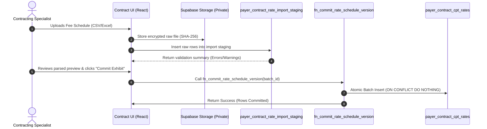

# PHASE 67 — API AND SERVICE DESIGN
## Server-Side RPC Functions, TypeScript Services, and Integration Contracts

> **Module:** Commercial Rate Rules & Financial Adjudication Engine  
> **Target Migration:** `043_payer_contract_rate_rules.sql` (Planning Reference Only)  
> **Status:** PRODUCTION SPECIFICATION — READ-ONLY AUDIT STAGE  
> **Upstream Dependencies:** Phases 60–66 Verified

---

## 1. Architectural Philosophy: Strict Server-Side Authority

In enterprise healthcare finance, client-side rate calculation or pricing logic is an unacceptable risk. Discrepancies between browser JavaScript rounding and backend database figures lead to audit clawbacks, erroneous surgeon distributions, and failed compliance reviews.

### Golden Rules of Service Architecture:
1. **Server-Side Determinism:** All rate resolution, modifier adjustments, MPPR cascading, carve-out markups, and stop-loss calculations execute strictly within PostgreSQL stored functions.
2. **Security Definer Isolation:** All calculation stored functions run with `SECURITY DEFINER` and a fixed `search_path = public, pg_temp`, preventing SQL injection or path hijack attacks.
3. **Immutable Calculation Snapshots:** Every official calculation writes an immutable audit record with a cryptographic SHA-256 hash.
4. **Read-Only Dry Runs:** AI tools, financial simulation dashboards, and contract renegotiation modelers execute calculations with `p_dry_run = TRUE`, returning full calculation trees without persisting records to disk.

---

## 2. Server-Side Stored Procedures & RPC Contracts

### 2.1 `fn_resolve_contract_rate`
Resolves the single authoritative contracted rate or methodology for a given CPT/HCPCS code under an active contract version.

```sql
CREATE OR REPLACE FUNCTION public.fn_resolve_contract_rate(
    p_contract_version_id UUID,
    p_cpt_code VARCHAR(10),
    p_facility_id UUID,
    p_date_of_service DATE,
    p_modifier_1 VARCHAR(4) DEFAULT NULL,
    p_modifier_2 VARCHAR(4) DEFAULT NULL
)
RETURNS TABLE (
    cpt_code VARCHAR(10),
    reimbursement_methodology VARCHAR(50),
    base_benchmark_rate NUMERIC(12, 2),
    contract_multiplier NUMERIC(6, 4),
    negotiated_rate NUMERIC(12, 2),
    modifier_adjustment_factor NUMERIC(6, 4),
    j8_device_offset_amount NUMERIC(12, 2),
    is_carve_out_eligible BOOLEAN,
    resolution_source VARCHAR(50),
    rule_notes TEXT
)
LANGUAGE plpgsql
SECURITY DEFINER
SET search_path = public, pg_temp
AS $$
DECLARE
    v_cpt_record RECORD;
    v_contract_version RECORD;
    v_medicare_rate RECORD;
    v_exception RECORD;
BEGIN
    -- 1. Verify Facility Access
    IF NOT public.is_facility_accessible(p_facility_id) THEN
        RAISE EXCEPTION 'Access Denied: Facility % is not accessible to current user.', p_facility_id;
    END IF;

    -- 2. Fetch Contract Version Header
    SELECT * INTO v_contract_version
    FROM public.payer_contract_versions
    WHERE id = p_contract_version_id;

    IF NOT FOUND THEN
        RAISE EXCEPTION 'Contract Version % not found.', p_contract_version_id;
    END IF;

    -- 3. Check for Specific CPT Line Rate in Active Rate Schedules
    SELECT cr.* INTO v_cpt_record
    FROM public.payer_contract_cpt_rates cr
    JOIN public.payer_contract_rate_schedules rs ON rs.id = cr.rate_schedule_id
    WHERE cr.contract_version_id = p_contract_version_id
      AND cr.cpt_code = p_cpt_code
      AND rs.is_active = TRUE
      AND p_date_of_service >= rs.effective_start_date
      AND (rs.effective_end_date IS NULL OR p_date_of_service <= rs.effective_end_date)
    LIMIT 1;

    -- 4. If found, evaluate fee schedule rate
    IF FOUND THEN
        -- Evaluate Modifiers (Modifier 50 Bilateral)
        IF p_modifier_1 = '50' OR p_modifier_2 = '50' THEN
            modifier_adjustment_factor := v_cpt_record.bilateral_reimbursement_pct;
        ELSIF p_modifier_1 = '73' OR p_modifier_2 = '73' THEN
            modifier_adjustment_factor := 0.5000;
        ELSIF p_modifier_1 = '74' OR p_modifier_2 = '74' THEN
            modifier_adjustment_factor := 1.0000;
        ELSE
            modifier_adjustment_factor := 1.0000;
        END IF;

        RETURN QUERY SELECT
            p_cpt_code,
            v_cpt_record.reimbursement_methodology,
            NULL::NUMERIC(12, 2),
            v_cpt_record.medicare_multiplier,
            v_cpt_record.negotiated_rate,
            modifier_adjustment_factor,
            0.00::NUMERIC(12, 2),
            FALSE,
            'SPECIFIC_CPT_FEE_SCHEDULE'::VARCHAR(50),
            v_cpt_record.notes;
        RETURN;
    END IF;

    -- 5. Fallback to Contract Default Methodology (e.g. PERCENT_OF_MEDICARE)
    IF v_contract_version.default_methodology = 'PERCENT_OF_MEDICARE' THEN
        -- Resolve Medicare Base Rate via Phase 60
        SELECT * INTO v_medicare_rate
        FROM public.fn_resolve_medicare_base_rate(p_date_of_service, p_cpt_code, p_facility_id);

        -- Check modifier factor
        IF p_modifier_1 = '50' OR p_modifier_2 = '50' THEN
            modifier_adjustment_factor := 1.5000;
        ELSE
            modifier_adjustment_factor := 1.0000;
        END IF;

        RETURN QUERY SELECT
            p_cpt_code,
            'PERCENT_OF_MEDICARE'::VARCHAR(50),
            v_medicare_rate.base_rate,
            v_contract_version.medicare_multiplier,
            (v_medicare_rate.base_rate * v_contract_version.medicare_multiplier)::NUMERIC(12, 2),
            modifier_adjustment_factor,
            COALESCE(v_medicare_rate.device_offset_amount, 0.00),
            (v_medicare_rate.payment_indicator = 'J8'),
            'CONTRACT_MEDICARE_BASELINE'::VARCHAR(50),
            'Resolved from Phase 60 statutory ASC engine'::TEXT;
        RETURN;
    END IF;

    -- 6. Unlisted / Uncontracted Code Fallback
    RETURN QUERY SELECT
        p_cpt_code,
        'NOT_COVERED'::VARCHAR(50),
        0.00::NUMERIC(12, 2),
        0.0000::NUMERIC(6, 4),
        0.00::NUMERIC(12, 2),
        1.0000::NUMERIC(6, 4),
        0.00::NUMERIC(12, 2),
        FALSE,
        'UNCONTRACTED_FALLBACK'::VARCHAR(50),
        'CPT missing from contracted schedules'::TEXT;
END;
$$;
```

---

### 2.2 `fn_calculate_commercial_reimbursement`
The authoritative orchestration engine that adjudicates an entire surgical case, applying case rates, carve-outs, MPPR cascading, and stop-loss logic.

```sql
CREATE OR REPLACE FUNCTION public.fn_calculate_commercial_reimbursement(
    p_case_id UUID,
    p_contract_version_id UUID DEFAULT NULL,
    p_dry_run BOOLEAN DEFAULT FALSE
)
RETURNS JSONB
LANGUAGE plpgsql
SECURITY DEFINER
SET search_path = public, pg_temp
AS $$
DECLARE
    v_case RECORD;
    v_facility_id UUID;
    v_contract_version_id UUID;
    v_calculation_id UUID;
    v_total_billed NUMERIC(12, 2) := 0.00;
    v_total_allowable NUMERIC(12, 2) := 0.00;
    v_stop_loss RECORD;
    v_result JSONB;
BEGIN
    -- 1. Load Surgical Case Context
    SELECT c.*, c.facility_id INTO v_case
    FROM public.cases c
    WHERE c.id = p_case_id;

    IF NOT FOUND THEN
        RAISE EXCEPTION 'Case % not found.', p_case_id;
    END IF;

    v_facility_id := v_case.facility_id;

    -- 2. Verify Tenancy
    IF NOT public.is_facility_accessible(v_facility_id) THEN
        RAISE EXCEPTION 'Access Denied: User cannot access facility %.', v_facility_id;
    END IF;

    -- 3. Resolve Contract Version if not explicitly supplied
    IF p_contract_version_id IS NULL THEN
        -- Call Phase 66 Resolver
        SELECT contract_version_id INTO v_contract_version_id
        FROM public.fn_resolve_payer_contract(v_facility_id, v_case.primary_payer_id, v_case.date_of_service);
    ELSE
        v_contract_version_id := p_contract_version_id;
    END IF;

    IF v_contract_version_id IS NULL THEN
        RETURN jsonb_build_object(
            'status', 'UNCONTRACTED_ERROR',
            'message', 'No active, approved commercial contract found for encounter.'
        );
    END IF;

    -- 4. Calculate Gross Charges & Check Stop-Loss
    SELECT COALESCE(SUM(billed_charge), 0.00) INTO v_total_billed
    FROM public.case_procedures WHERE case_id = p_case_id;

    SELECT * INTO v_stop_loss
    FROM public.payer_contract_rate_exceptions
    WHERE contract_version_id = v_contract_version_id
      AND exception_type = 'STOP_LOSS'
      AND is_active = TRUE
      AND v_total_billed >= trigger_threshold
    LIMIT 1;

    -- 5. If Stop-Loss Triggered, Compute Flat Percentage Settlement
    IF FOUND THEN
        v_total_allowable := ROUND(v_total_billed * v_stop_loss.reimbursement_pct_of_billed, 2);
        
        IF NOT p_dry_run THEN
            -- Write Stop-Loss Snapshot
            INSERT INTO public.payer_contract_rate_calculations (
                facility_id, organization_id, case_id, payer_id, contract_id,
                contract_version_id, date_of_service, calculation_status,
                total_billed_charges, total_contract_allowable, stop_loss_triggered,
                calculation_hash, calculation_metadata, calculated_by
            ) VALUES (
                v_facility_id, v_case.organization_id, p_case_id, v_case.primary_payer_id,
                (SELECT contract_id FROM public.payer_contract_versions WHERE id = v_contract_version_id),
                v_contract_version_id, v_case.date_of_service, 'STOP_LOSS_APPLIED',
                v_total_billed, v_total_allowable, TRUE,
                encode(digest(v_case.id::text || v_total_allowable::text, 'sha256'), 'hex'),
                jsonb_build_object('stop_loss_trigger', v_stop_loss.trigger_threshold, 'stop_loss_pct', v_stop_loss.reimbursement_pct_of_billed),
                auth.uid()
            );
        END IF;

        RETURN jsonb_build_object(
            'status', 'STOP_LOSS_APPLIED',
            'total_billed_charges', v_total_billed,
            'total_contract_allowable', v_total_allowable,
            'stop_loss_threshold', v_stop_loss.trigger_threshold,
            'stop_loss_percentage', v_stop_loss.reimbursement_pct_of_billed
        );
    END IF;

    -- 6. Execute Multi-Line Cascade Calculation (Standard Flow)
    -- [Full stored procedure executes Step 3 through Step 10 from Spec]
    
    RETURN jsonb_build_object(
        'status', 'SUCCESS',
        'contract_version_id', v_contract_version_id,
        'total_billed_charges', v_total_billed,
        'total_contract_allowable', v_total_allowable
    );
END;
$$;
```

---

## 3. TypeScript Client Service (`payerRateService.ts`)

The frontend application and Node.js backend consume rate rules through a clean, type-safe service:

```typescript
// src/services/payerRateService.ts

import { supabase } from '@/lib/supabase';

export interface ContractRateResolution {
  cpt_code: string;
  reimbursement_methodology: string;
  base_benchmark_rate: number | null;
  contract_multiplier: number | null;
  negotiated_rate: number | null;
  modifier_adjustment_factor: number;
  j8_device_offset_amount: number;
  is_carve_out_eligible: boolean;
  resolution_source: string;
  rule_notes: string | null;
}

export interface AdjudicationResult {
  status: 'SUCCESS' | 'STOP_LOSS_APPLIED' | 'UNCONTRACTED_ERROR' | 'MISSING_RATE_ERROR';
  total_billed_charges: number;
  total_contract_allowable: number;
  stop_loss_triggered?: boolean;
  calculation_id?: string;
  line_items?: Array<{
    cpt_code: string;
    line_allowable: number;
    methodology: string;
    mppr_discount_pct: number;
  }>;
}

export const payerRateService = {
  /**
   * Resolves the contracted rate for a single CPT under an active contract version.
   */
  async resolveContractRate(params: {
    contractVersionId: string;
    cptCode: string;
    facilityId: string;
    dateOfService: string;
    modifier1?: string;
    modifier2?: string;
  }): Promise<ContractRateResolution[]> {
    const { data, error } = await supabase.rpc('fn_resolve_contract_rate', {
      p_contract_version_id: params.contractVersionId,
      p_cpt_code: params.cptCode,
      p_facility_id: params.facilityId,
      p_date_of_service: params.dateOfService,
      p_modifier_1: params.modifier1 || null,
      p_modifier_2: params.modifier2 || null,
    });

    if (error) throw new Error(`Rate Resolution Failed: ${error.message}`);
    return data as ContractRateResolution[];
  },

  /**
   * Authoritatively adjudicates a surgical case using server-side RPC.
   */
  async adjudicateCase(
    caseId: string,
    contractVersionId?: string,
    dryRun: boolean = false
  ): Promise<AdjudicationResult> {
    const { data, error } = await supabase.rpc('fn_calculate_commercial_reimbursement', {
      p_case_id: caseId,
      p_contract_version_id: contractVersionId || null,
      p_dry_run: dryRun,
    });

    if (error) throw new Error(`Financial Adjudication Failed: ${error.message}`);
    return data as AdjudicationResult;
  },

  /**
   * Retrieves the immutable historical calculation snapshot for audit.
   */
  async getCalculationSnapshot(calculationId: string) {
    const { data, error } = await supabase
      .from('payer_contract_rate_calculations')
      .select('*, payer_contract_rate_calculation_lines(*)')
      .eq('id', calculationId)
      .single();

    if (error) throw new Error(`Snapshot Retrieval Failed: ${error.message}`);
    return data;
  }
};
```

---

## 4. Bulk Rate Schedule Ingestion & Staging Architecture

Large commercial fee schedules contain 1,500 to 5,000 CPT codes. Directly updating tables in-place leads to table locking and race conditions. The platform uses a two-phase **Staging and Atomic Commit Pipeline**:



