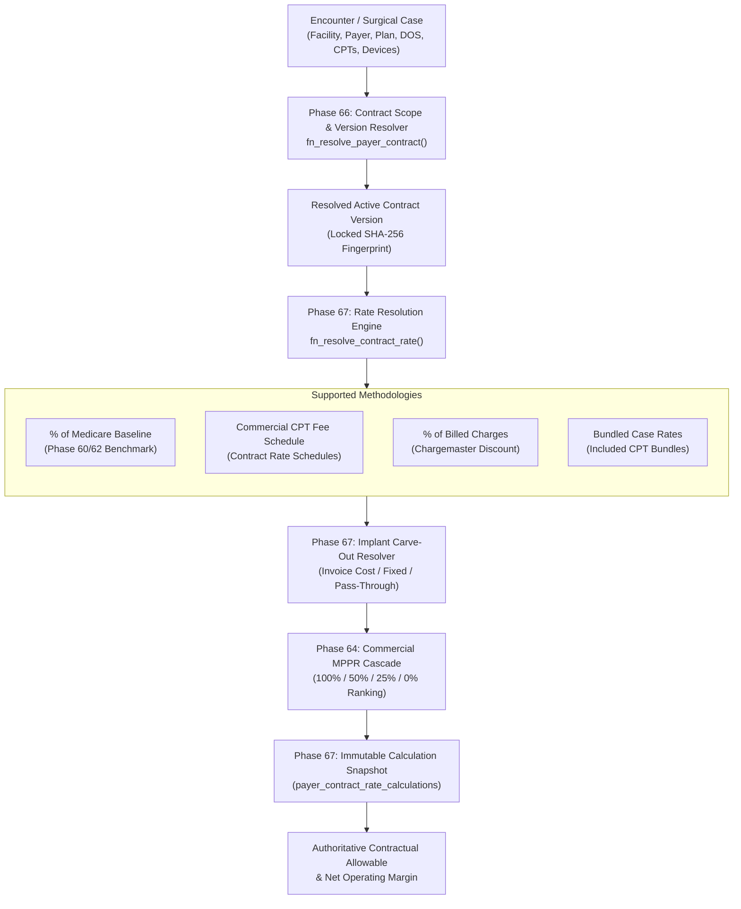

# PHASE 67 — PAYER CONTRACT RATE RULES SPECIFICATION
## Enterprise ASC Medical Operations & Financial Intelligence Platform

> **Module:** Commercial Rate Rules & Financial Adjudication Engine  
> **Status:** PRODUCTION SPECIFICATION — READ-ONLY AUDIT STAGE  
> **Target Migration:** `043_payer_contract_rate_rules.sql` (Planning Reference Only)  
> **Dependencies:** Phases 60–66 (Fully Verified Upstream)

---

## 1. Purpose & Architectural Principles

The purpose of **Phase 67: Payer Contract Rate Rules** is to engineer a deterministic, auditable, server-side reimbursement calculation engine capable of resolving and pricing commercial encounters under five distinct methodologies:
1. **Percentage of Medicare** (`PERCENT_OF_MEDICARE`)
2. **Commercial CPT/HCPCS Fee Schedules** (`COMMERCIAL_FEE_SCHEDULE`)
3. **Percentage of Billed Charges** (`PERCENT_OF_BILLED_CHARGES`)
4. **Bundled Case Rates** (`CASE_RATE`)
5. **Itemized Implant / Device Carve-Outs** (`IMPLANT_CARVE_OUT`)

### 1.1 Strict Separation of Financial Responsibilities
To maintain architectural purity and prevent logic fragmentation, responsibilities are partitioned as follows:
- **A. Payer Master (Phase 65):** Identifies the legal payer entity and global clearinghouse routing identifiers.
- **B. Payer Plan Master (Phase 65):** Identifies the specific benefit product (HMO, PPO, EPO) and timely filing limits.
- **C. Payer Contract (Phase 66):** Identifies the overarching legal agreement and organization/facility ownership.
- **D. Contract Version (Phase 66):** Identifies the approved, effective-dated agreement version locked with SHA-256 integrity hash.
- **E. Contract Scope (Phase 66):** Determines facility participation, plan exclusions, and specialty boundaries.
- **F. Contract Rate Rules & Fee Schedules (Phase 67):** Defines the negotiated CPT rate exhibits, case rates, multipliers, carve-outs, and contractual exceptions.
- **G. Rate Resolution Engine (Phase 67):** Server-side procedure selecting the single applicable contractual rate rule.
- **H. Reimbursement Calculation Engine (Phase 67):** Authoritative server-side calculation service computing line-item and encounter allowable amounts, applying MPPR cascades, and calculating carve-out payments.
- **I. Calculation Snapshot (Phase 67):** Immutable audit ledger capturing the exact input parameters, rule versions, and calculation math for 100% reproducible historical audits.



---

## 2. Core Functional Requirements

### 2.1 Principle of Fail-Closed Precision
- Commercial encounters without an active, approved contract version **must never silently default to statutory Medicare rates or chargemaster gross charges**.
- If a commercial claim cannot be resolved through an approved contract version or out-of-network schedule, the engine must return a structured `UNCONTRACTED_COMMERCIAL_ENCOUNTER` status code and set allowable reimbursement to `NULL` (or explicitly flagged estimate).
- Gross charges ($350\%$ of baseline) represent billed chargemaster list prices; they are never treated as allowable reimbursement unless the contract explicitly defines `PERCENT_OF_BILLED_CHARGES`.

### 2.2 Server-Side Authoritative Execution
- All financial calculations must execute server-side in PostgreSQL stored procedures (`SECURITY DEFINER` with fixed `search_path = public, pg_temp`).
- Client-side React components and AI agents must consume authoritative RPC results; **client-side duplicate formulas are prohibited**.
- AI tools may simulate and explain calculations using the server-side RPC, but cannot approve, invent, or mutate contractual rates.

### 2.3 Tenancy & Row-Level Security
- Contract rates and calculation snapshots must strictly enforce facility and organization tenancy via `public.is_facility_accessible(facility_id)`.
- RLS policies must **never query `public.user_roles` directly**; they must strictly call `public.is_facility_accessible()` and `public.user_has_facility_role()`.

---

## 3. Detailed Specification of Supported Methodologies

### 3.1 Percentage of Medicare (`PERCENT_OF_MEDICARE`)
The expected contract rate is computed as:
$$\text{Expected Rate} = \text{Applicable Medicare Baseline} \times \text{Contract Multiplier}$$

#### Benchmark Configuration Rules:
1. **Dynamic vs. Frozen Benchmark:**
   - *Dynamic DOS Baseline (Default):* Resolves Medicare ASC rate for the encounter's Date of Service via `fn_resolve_medicare_base_rate(dos, cpt, facility_id)`.
   - *Frozen Benchmark Release:* The contract version can specify a `benchmark_release_id` (e.g., "CY 2024 CMS-1786-FC"). When specified, the engine evaluates the rate against the frozen CMS addenda release regardless of the encounter DOS.
2. **Geographic Wage Adjustment Scope:**
   - *Locally Wage-Adjusted (Default):* Applies the facility CBSA wage index to the 50% labor portion per 42 CFR § 416.171.
   - *National Unadjusted:* Contract version flag `medicare_wage_adjustment_mode = 'NATIONAL_UNADJUSTED'`. Bypasses CBSA wage indexing and applies the multiplier directly to the national unadjusted rate.
3. **Double-Dipping Device Protection:**
   - If procedure is CMS Payment Indicator `J8` (Device-Intensive) AND the contract specifies a separate implant carve-out, the engine **must deduct the device offset amount from the Medicare baseline before applying the multiplier**:
   $$\text{Service Baseline} = \text{National Rate} - \text{Device Offset Amount}$$
   $$\text{Contract Allowable} = (\text{Wage-Adjusted Service Baseline} \times \text{Multiplier}) + \text{Carve-Out Reimbursement}$$

### 3.2 Commercial CPT/HCPCS Fee Schedules (`COMMERCIAL_FEE_SCHEDULE`)
1. **Direct CPT Lookup:**
   - Resolves exact negotiated dollar amount for the CPT/HCPCS code under the active rate schedule version.
   - Fallback hierarchy: Term-specific override $\rightarrow$ Schedule CPT rate $\rightarrow$ Schedule Category rate.
2. **Modifier Adjustments:**
   - **Bilateral (Modifier 50):** Reimbursed at 150% of the single-line contracted rate on 1 unit (unless contract exception specifies 200%).
   - **Discontinued Pre-Anesthesia (Modifier 73):** Reimbursed at 50% of the contracted rate.
   - **Discontinued Post-Anesthesia (Modifier 74):** Reimbursed at 100% of the contracted rate.
3. **Missing CPT Behavior:**
   - If a CPT is missing from the contracted fee schedule, the engine checks for a contract-level default methodology (e.g. 50% of Billed Charges for unlisted codes). If no default exists, it raises `UNLISTED_CPT_RATE_MISSING`.

### 3.3 Percentage of Billed Charges (`PERCENT_OF_BILLED_CHARGES`)
$$\text{Contract Allowable} = \text{Gross Billed Charge} \times (1.00 - \text{Contractual Discount Percentage})$$
$$\text{or: } \text{Contract Allowable} = \text{Gross Billed Charge} \times \text{Contractual Payment Percentage}$$
1. **Mathematical Distinction:**
   - `discount_percentage` (e.g., 0.35 = 35% discount $\rightarrow$ 65% payment).
   - `payment_percentage` (e.g., 0.65 = 65% allowable).
   - Stored explicitly as `payment_percentage` to eliminate ambiguity.
2. **Charge Exclusions:**
   - Chargemaster items tagged as non-covered, unbundled, or statutory pass-through can be excluded from the percentage calculation.
3. **Stop-Loss / Catastrophic Thresholds:**
   - If total encounter gross charges exceed `stop_loss_threshold` (e.g., $50,000), reimbursement converts from fee schedule to a negotiated stop-loss payment percentage (e.g., 70% of total charges).

### 3.4 Bundled Case Rates (`CASE_RATE`)
1. **Primary Procedure Definition:**
   - Case rate is triggered by the primary surgical CPT code (highest allowable).
   - Primary CPT allowable receives 100% of the bundled case rate.
2. **Inclusion Crosswalk (`payer_contract_case_rate_inclusions`):**
   - Secondary CPT codes identified as included within the bundle are reimbursed at **$0.00** with adjudication code `BUNDLED_IN_PRIMARY_CASE_RATE`.
   - Supplies, standard operating room time, and routine recovery are included.
3. **Approved Carve-Ins / Carve-Outs:**
   - Non-included secondary surgical procedures from an unrelated specialty are adjudicated at their standalone rate (subject to secondary MPPR).
   - High-cost implants are adjudicated under Section 3.5 only if `includes_implants = FALSE`.

### 3.5 Implant & Device Carve-Outs (`IMPLANT_CARVE_OUT`)
Supported contractual methodologies:
1. `NO_CARVE_OUT` / `BUNDLED`: $0.00 separate allowable. Implants included in procedure fee.
2. `AT_INVOICE_COST`: $100\%$ of verified supplier invoice cost (`implant_supplier_invoices`).
3. `INVOICE_COST_PLUS_PERCENT`: Verified invoice cost $+$ negotiated markup percentage (e.g., Cost $+ 12\%$).
4. `FIXED_FEE_CARVE_OUT`: Pre-negotiated allowable amount per HCPCS code or implant category.
5. `LESSER_OF_COST_PLUS_OR_CHARGES`: Reimburses the lower of (Invoice Cost $+$ Markup) vs. (Facility Chargemaster Gross Charge).
6. **Maximum Reimbursement Caps:**
   - Optional `max_carve_out_cap` (e.g., Cost $+ 10\%$ capped at $3,500 per device).

---

## 4. 10-Step Deterministic Rate Resolution Sequence

When an encounter is priced, the engine executes the following deterministic sequence:

```text
Step 1: Authorization & Tenancy Verification
        Verify auth.uid() possesses active membership in the target facility.
Step 2: Payer & Benefit Plan Resolution
        Verify primary payer ID and plan ID against public.payer_master and public.payer_plans.
Step 3: Contract Version Resolution (Phase 66)
        Call public.fn_resolve_payer_contract() to select the active, approved contract version.
Step 4: Effective Date Verification
        Confirm Date of Service falls within contract version [effective_start_date, effective_end_date].
Step 5: Scope & Exclusions Check
        Verify facility scope, plan scope, and service category scope; check for excluded CPTs.
Step 6: Primary Methodology & Benchmark Resolution
        Identify version-level methodology (Percent of Medicare, Fee Schedule, Billed Charges, Case Rate).
Step 7: Procedural Term Overrides & Fee Schedule Lookup
        Check public.payer_contract_terms for CPT-specific rate/multiplier overrides.
        If none, query active public.payer_contract_cpt_rates under the linked rate schedule.
Step 8: Implant & Device Carve-Out Adjudication
        Match used case devices against public.payer_contract_carve_outs; check for double-dipping.
Step 9: Multiple Procedure Reduction (Phase 64 Integration)
        Rank lines by resolved base allowable; apply contract's mppr_rule_set_code cascade.
Step 10: Immutable Snapshot Persistence
        Write calculation header and line items to public.payer_contract_rate_calculations.
```

---

## 5. Historical Reproducibility & Recalculation Governance

1. **Immutable Snapshot Ledger:**
   - Every calculation creates an immutable row in `payer_contract_rate_calculations` and `payer_contract_rate_calculation_lines`.
   - Modifying a contract or uploading a new rate schedule **never updates past calculation records**.
2. **Explicit Recalculation Audit Trail:**
   - If an encounter must be recalculated (e.g., after an executed retroactive amendment or coding correction), the engine creates a **new calculation record** with `supersedes_calculation_id` pointing to the previous snapshot, accompanied by mandatory `recalculation_reason` and actor audit attribution.
3. **Two-Person Version Activation:**
   - Commercial rate schedules and contract amendments cannot be used in production billing until signed off by an authorized CFO or Finance Lead (`payer.contract.approve`).

