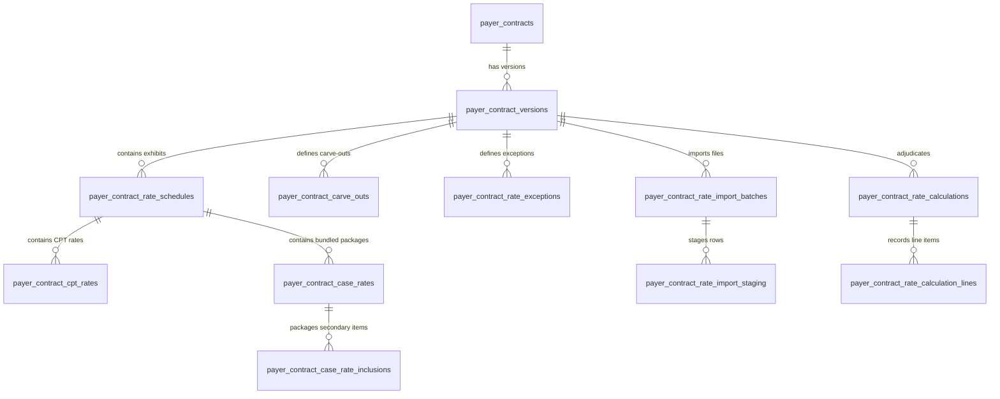

# PHASE 67 — RATE DATA DICTIONARY
## Enterprise Data Model & Schema Specification for Commercial Rate Rules

> **Module:** Commercial Rate Rules & Financial Adjudication Engine  
> **Target Migration:** `043_payer_contract_rate_rules.sql` (Planning Reference Only)  
> **Status:** PRODUCTION SPECIFICATION — READ-ONLY AUDIT STAGE  
> **Upstream Dependencies:** Phases 60–66 Verified

---

## 1. Schema Overview & Architectural Principles

The Phase 67 data model provides an industrial-grade, normalized schema for managing commercial CPT fee schedules, case rates, carve-outs, exceptions, and calculation snapshots.

### Core Design Rules
1. **Tenancy Isolation:** Every entity links directly or transitively to `facility_id` and `organization_id`. Access is governed by `public.is_facility_accessible(facility_id)`.
2. **Effective-Dated Immutability:** Fee schedules, case rates, and carve-outs belong to a specific `contract_version_id`. Once the parent version is marked `ACTIVE` or `APPROVED`, rates cannot be mutated in place; rate updates require a new contract version.
3. **High-Precision Numeric Types:**
   - Dollar amounts: `NUMERIC(12, 2)` (supports values up to \$9,999,999,999.99).
   - Multipliers and percentages: `NUMERIC(6, 4)` (e.g. `1.6500` for 165.00%, `0.1000` for 10.00% markup).
   - Never use floating point (`REAL`, `FLOAT`) for financial calculations.
4. **Permanent Audit Snapshots:** Calculations are written to immutable snapshot tables (`payer_contract_rate_calculations` and `payer_contract_rate_calculation_lines`) with cryptographic SHA-256 hashes to guarantee historical reproducibility for billing disputes and external audits.

---

## 2. Entity-Relationship Diagram



---

## 3. Detailed Entity Specifications

### 3.1 `payer_contract_rate_schedules`
Defines an exhibit or schedule of rates attached to a contract version (e.g., Exhibit A - Orthopedic Fee Schedule).

```sql
CREATE TABLE public.payer_contract_rate_schedules (
    id UUID PRIMARY KEY DEFAULT gen_random_uuid(),
    contract_version_id UUID NOT NULL REFERENCES public.payer_contract_versions(id) ON DELETE CASCADE,
    schedule_code VARCHAR(50) NOT NULL,
    schedule_name VARCHAR(150) NOT NULL,
    schedule_type VARCHAR(50) NOT NULL CHECK (schedule_type IN (
        'FEE_SCHEDULE',
        'CASE_RATE_SET',
        'PERCENT_OF_MEDICARE_OVERRIDE',
        'SPECIALTY_TIER_SCHEDULE'
    )),
    effective_start_date DATE NOT NULL,
    effective_end_date DATE,
    description TEXT,
    is_active BOOLEAN NOT NULL DEFAULT TRUE,
    total_line_count INTEGER NOT NULL DEFAULT 0,
    created_at TIMESTAMPTZ NOT NULL DEFAULT timezone('utc', now()),
    updated_at TIMESTAMPTZ NOT NULL DEFAULT timezone('utc', now()),
    CONSTRAINT uq_contract_version_schedule_code UNIQUE (contract_version_id, schedule_code),
    CONSTRAINT chk_schedule_dates CHECK (effective_end_date IS NULL OR effective_end_date >= effective_start_date)
);

CREATE INDEX idx_rate_schedules_version ON public.payer_contract_rate_schedules(contract_version_id);
CREATE INDEX idx_rate_schedules_dates ON public.payer_contract_rate_schedules(effective_start_date, effective_end_date);
```

---

### 3.2 `payer_contract_cpt_rates`
Line-item CPT/HCPCS fee schedule rates and code-specific contractual terms.

```sql
CREATE TABLE public.payer_contract_cpt_rates (
    id UUID PRIMARY KEY DEFAULT gen_random_uuid(),
    rate_schedule_id UUID NOT NULL REFERENCES public.payer_contract_rate_schedules(id) ON DELETE CASCADE,
    contract_version_id UUID NOT NULL REFERENCES public.payer_contract_versions(id) ON DELETE CASCADE,
    cpt_code VARCHAR(10) NOT NULL,
    description VARCHAR(255),
    reimbursement_methodology VARCHAR(50) NOT NULL CHECK (reimbursement_methodology IN (
        'COMMERCIAL_FEE_SCHEDULE',
        'PERCENT_OF_MEDICARE',
        'PERCENT_OF_BILLED_CHARGES',
        'CASE_RATE',
        'NOT_COVERED'
    )),
    negotiated_rate NUMERIC(12, 2) CHECK (negotiated_rate IS NULL OR negotiated_rate >= 0),
    medicare_multiplier NUMERIC(6, 4) CHECK (medicare_multiplier IS NULL OR medicare_multiplier > 0),
    billed_charge_discount_pct NUMERIC(6, 4) CHECK (billed_charge_discount_pct IS NULL OR (billed_charge_discount_pct >= 0 AND billed_charge_discount_pct <= 1.0000)),
    bilateral_reimbursement_pct NUMERIC(6, 4) NOT NULL DEFAULT 1.5000 CHECK (bilateral_reimbursement_pct >= 1.0000 AND bilateral_reimbursement_pct <= 2.0000),
    allow_mppr_reduction BOOLEAN NOT NULL DEFAULT TRUE,
    notes TEXT,
    created_at TIMESTAMPTZ NOT NULL DEFAULT timezone('utc', now()),
    updated_at TIMESTAMPTZ NOT NULL DEFAULT timezone('utc', now()),
    CONSTRAINT uq_rate_schedule_cpt UNIQUE (rate_schedule_id, cpt_code),
    CONSTRAINT chk_methodology_payload CHECK (
        (reimbursement_methodology = 'COMMERCIAL_FEE_SCHEDULE' AND negotiated_rate IS NOT NULL) OR
        (reimbursement_methodology = 'PERCENT_OF_MEDICARE' AND medicare_multiplier IS NOT NULL) OR
        (reimbursement_methodology = 'PERCENT_OF_BILLED_CHARGES' AND billed_charge_discount_pct IS NOT NULL) OR
        (reimbursement_methodology = 'CASE_RATE') OR
        (reimbursement_methodology = 'NOT_COVERED')
    )
);

CREATE INDEX idx_cpt_rates_schedule ON public.payer_contract_cpt_rates(rate_schedule_id);
CREATE INDEX idx_cpt_rates_cpt ON public.payer_contract_cpt_rates(cpt_code);
CREATE INDEX idx_cpt_rates_version_cpt ON public.payer_contract_cpt_rates(contract_version_id, cpt_code);
```

---

### 3.3 `payer_contract_case_rates`
Bundled procedure packages covering defined CPT combinations, facility time, and supplies.

```sql
CREATE TABLE public.payer_contract_case_rates (
    id UUID PRIMARY KEY DEFAULT gen_random_uuid(),
    rate_schedule_id UUID NOT NULL REFERENCES public.payer_contract_rate_schedules(id) ON DELETE CASCADE,
    contract_version_id UUID NOT NULL REFERENCES public.payer_contract_versions(id) ON DELETE CASCADE,
    package_code VARCHAR(50) NOT NULL,
    package_name VARCHAR(150) NOT NULL,
    primary_cpt_code VARCHAR(10) NOT NULL,
    bundled_rate NUMERIC(12, 2) NOT NULL CHECK (bundled_rate > 0),
    includes_anesthesia BOOLEAN NOT NULL DEFAULT FALSE,
    includes_facility_fee BOOLEAN NOT NULL DEFAULT TRUE,
    includes_standard_implants BOOLEAN NOT NULL DEFAULT FALSE,
    max_or_hours NUMERIC(4, 2) DEFAULT 3.00,
    hourly_overage_rate NUMERIC(10, 2) DEFAULT 0.00,
    notes TEXT,
    is_active BOOLEAN NOT NULL DEFAULT TRUE,
    created_at TIMESTAMPTZ NOT NULL DEFAULT timezone('utc', now()),
    updated_at TIMESTAMPTZ NOT NULL DEFAULT timezone('utc', now()),
    CONSTRAINT uq_case_rate_version_package UNIQUE (contract_version_id, package_code)
);

CREATE INDEX idx_case_rates_version ON public.payer_contract_case_rates(contract_version_id);
CREATE INDEX idx_case_rates_cpt ON public.payer_contract_case_rates(primary_cpt_code);
```

---

### 3.4 `payer_contract_case_rate_inclusions`
Line items packaged into the bundled case rate that receive \$0.00 separate allowable.

```sql
CREATE TABLE public.payer_contract_case_rate_inclusions (
    id UUID PRIMARY KEY DEFAULT gen_random_uuid(),
    case_rate_id UUID NOT NULL REFERENCES public.payer_contract_case_rates(id) ON DELETE CASCADE,
    included_code VARCHAR(10) NOT NULL,
    code_type VARCHAR(20) NOT NULL CHECK (code_type IN ('CPT', 'HCPCS', 'REVENUE_CODE')),
    description VARCHAR(255),
    is_bundled BOOLEAN NOT NULL DEFAULT TRUE,
    created_at TIMESTAMPTZ NOT NULL DEFAULT timezone('utc', now()),
    CONSTRAINT uq_case_rate_inclusion UNIQUE (case_rate_id, included_code)
);

CREATE INDEX idx_case_rate_inclusions_rate ON public.payer_contract_case_rate_inclusions(case_rate_id);
CREATE INDEX idx_case_rate_inclusions_code ON public.payer_contract_case_rate_inclusions(included_code);
```

---

### 3.5 `payer_contract_carve_outs`
Rules governing separately payable surgical implants, biologicals, and high-cost supplies.

```sql
CREATE TABLE public.payer_contract_carve_outs (
    id UUID PRIMARY KEY DEFAULT gen_random_uuid(),
    contract_version_id UUID NOT NULL REFERENCES public.payer_contract_versions(id) ON DELETE CASCADE,
    carve_out_code VARCHAR(50) NOT NULL,
    carve_out_name VARCHAR(150) NOT NULL,
    category VARCHAR(50) NOT NULL CHECK (category IN (
        'IMPLANT',
        'BIOLOGIC',
        'HIGH_COST_DRUG',
        'SPECIALTY_DEVICE'
    )),
    reimbursement_model VARCHAR(50) NOT NULL CHECK (reimbursement_model IN (
        'PASS_THROUGH_AT_COST',
        'INVOICE_PLUS_PERCENT',
        'INVOICE_PLUS_FIXED_FEE',
        'FEE_SCHEDULE_FIXED'
    )),
    markup_percentage NUMERIC(6, 4) CHECK (markup_percentage IS NULL OR markup_percentage >= 0),
    fixed_fee_amount NUMERIC(10, 2) CHECK (fixed_fee_amount IS NULL OR fixed_fee_amount >= 0),
    min_invoice_threshold_per_item NUMERIC(10, 2) NOT NULL DEFAULT 0.00,
    min_encounter_threshold NUMERIC(10, 2) NOT NULL DEFAULT 0.00,
    max_reimbursement_cap NUMERIC(10, 2),
    requires_invoice_attachment BOOLEAN NOT NULL DEFAULT TRUE,
    is_active BOOLEAN NOT NULL DEFAULT TRUE,
    created_at TIMESTAMPTZ NOT NULL DEFAULT timezone('utc', now()),
    updated_at TIMESTAMPTZ NOT NULL DEFAULT timezone('utc', now()),
    CONSTRAINT uq_version_carve_out_code UNIQUE (contract_version_id, carve_out_code),
    CONSTRAINT chk_carve_out_payload CHECK (
        (reimbursement_model = 'PASS_THROUGH_AT_COST') OR
        (reimbursement_model = 'INVOICE_PLUS_PERCENT' AND markup_percentage IS NOT NULL) OR
        (reimbursement_model = 'INVOICE_PLUS_FIXED_FEE' AND fixed_fee_amount IS NOT NULL) OR
        (reimbursement_model = 'FEE_SCHEDULE_FIXED')
    )
);

CREATE INDEX idx_carve_outs_version ON public.payer_contract_carve_outs(contract_version_id);
```

---

### 3.6 `payer_contract_rate_exceptions`
Contractual exceptions, catastrophic stop-loss triggers, and minimum allowable limits.

```sql
CREATE TABLE public.payer_contract_rate_exceptions (
    id UUID PRIMARY KEY DEFAULT gen_random_uuid(),
    contract_version_id UUID NOT NULL REFERENCES public.payer_contract_versions(id) ON DELETE CASCADE,
    exception_code VARCHAR(50) NOT NULL,
    exception_name VARCHAR(150) NOT NULL,
    exception_type VARCHAR(50) NOT NULL CHECK (exception_type IN (
        'STOP_LOSS',
        'MINIMUM_ALLOWABLE_PER_CASE',
        'EXCLUDED_CPT',
        'UNLISTED_PROCEDURE_OVERRIDE',
        'CUSTOM_MODIFIER_RULE'
    )),
    trigger_threshold NUMERIC(12, 2),
    reimbursement_pct_of_billed NUMERIC(6, 4) CHECK (reimbursement_pct_of_billed IS NULL OR (reimbursement_pct_of_billed >= 0 AND reimbursement_pct_of_billed <= 1.0000)),
    fixed_exception_amount NUMERIC(12, 2),
    applies_to_cpt VARCHAR(10),
    description TEXT,
    is_active BOOLEAN NOT NULL DEFAULT TRUE,
    created_at TIMESTAMPTZ NOT NULL DEFAULT timezone('utc', now()),
    updated_at TIMESTAMPTZ NOT NULL DEFAULT timezone('utc', now()),
    CONSTRAINT uq_version_exception_code UNIQUE (contract_version_id, exception_code)
);

CREATE INDEX idx_exceptions_version ON public.payer_contract_rate_exceptions(contract_version_id);
```

---

### 3.7 `payer_contract_rate_calculations`
Immutable historical snapshot header recording the exact inputs, rules, and allowable results for an encounter.

```sql
CREATE TABLE public.payer_contract_rate_calculations (
    id UUID PRIMARY KEY DEFAULT gen_random_uuid(),
    facility_id UUID NOT NULL REFERENCES public.facilities(id) ON DELETE RESTRICT,
    organization_id UUID NOT NULL REFERENCES public.organizations(id) ON DELETE RESTRICT,
    case_id UUID REFERENCES public.cases(id) ON DELETE SET NULL,
    payer_id UUID NOT NULL REFERENCES public.payer_master(id) ON DELETE RESTRICT,
    plan_id UUID REFERENCES public.payer_plans(id) ON DELETE SET NULL,
    contract_id UUID NOT NULL REFERENCES public.payer_contracts(id) ON DELETE RESTRICT,
    contract_version_id UUID NOT NULL REFERENCES public.payer_contract_versions(id) ON DELETE RESTRICT,
    calculation_date TIMESTAMPTZ NOT NULL DEFAULT timezone('utc', now()),
    date_of_service DATE NOT NULL,
    calculation_status VARCHAR(50) NOT NULL CHECK (calculation_status IN (
        'CALCULATED',
        'UNCONTRACTED_ERROR',
        'MISSING_RATE_ERROR',
        'STOP_LOSS_APPLIED',
        'MANUAL_OVERRIDE'
    )),
    total_billed_charges NUMERIC(12, 2) NOT NULL DEFAULT 0.00,
    total_contract_allowable NUMERIC(12, 2) NOT NULL DEFAULT 0.00,
    total_primary_procedure_allowable NUMERIC(12, 2) NOT NULL DEFAULT 0.00,
    total_secondary_procedure_allowable NUMERIC(12, 2) NOT NULL DEFAULT 0.00,
    total_implant_allowable NUMERIC(12, 2) NOT NULL DEFAULT 0.00,
    total_other_allowable NUMERIC(12, 2) NOT NULL DEFAULT 0.00,
    mppr_rule_set_code VARCHAR(50),
    stop_loss_triggered BOOLEAN NOT NULL DEFAULT FALSE,
    calculation_hash VARCHAR(64) NOT NULL,
    calculation_metadata JSONB NOT NULL DEFAULT '{}'::jsonb,
    calculated_by UUID REFERENCES auth.users(id) ON DELETE SET NULL,
    created_at TIMESTAMPTZ NOT NULL DEFAULT timezone('utc', now())
);

CREATE INDEX idx_calculations_facility ON public.payer_contract_rate_calculations(facility_id);
CREATE INDEX idx_calculations_case ON public.payer_contract_rate_calculations(case_id);
CREATE INDEX idx_calculations_contract_version ON public.payer_contract_rate_calculations(contract_version_id);
CREATE INDEX idx_calculations_dos ON public.payer_contract_rate_calculations(date_of_service);
CREATE INDEX idx_calculations_hash ON public.payer_contract_rate_calculations(calculation_hash);
```

---

### 3.8 `payer_contract_rate_calculation_lines`
Individual line-item audit records detailing the step-by-step mathematical trace for each billed CPT and implant.

```sql
CREATE TABLE public.payer_contract_rate_calculation_lines (
    id UUID PRIMARY KEY DEFAULT gen_random_uuid(),
    calculation_id UUID NOT NULL REFERENCES public.payer_contract_rate_calculations(id) ON DELETE CASCADE,
    line_number INTEGER NOT NULL,
    cpt_code VARCHAR(10) NOT NULL,
    modifier_1 VARCHAR(4),
    modifier_2 VARCHAR(4),
    units NUMERIC(6, 2) NOT NULL DEFAULT 1.00,
    service_description VARCHAR(255),
    line_billed_charge NUMERIC(12, 2) NOT NULL DEFAULT 0.00,
    applied_methodology VARCHAR(50) NOT NULL,
    base_benchmark_rate NUMERIC(12, 2),
    contract_multiplier NUMERIC(6, 4),
    negotiated_fee_rate NUMERIC(12, 2),
    modifier_adjustment_factor NUMERIC(6, 4) NOT NULL DEFAULT 1.0000,
    mppr_rank INTEGER NOT NULL DEFAULT 1,
    mppr_discount_pct NUMERIC(6, 4) NOT NULL DEFAULT 1.0000,
    j8_device_offset_deducted NUMERIC(12, 2) NOT NULL DEFAULT 0.00,
    final_line_allowable NUMERIC(12, 2) NOT NULL DEFAULT 0.00,
    is_packaged BOOLEAN NOT NULL DEFAULT FALSE,
    is_carve_out BOOLEAN NOT NULL DEFAULT FALSE,
    calculation_trace TEXT,
    created_at TIMESTAMPTZ NOT NULL DEFAULT timezone('utc', now()),
    CONSTRAINT uq_calculation_line UNIQUE (calculation_id, line_number)
);

CREATE INDEX idx_calc_lines_calc_id ON public.payer_contract_rate_calculation_lines(calculation_id);
CREATE INDEX idx_calc_lines_cpt ON public.payer_contract_rate_calculation_lines(cpt_code);
```

---

### 3.9 `payer_contract_rate_import_batches` & `payer_contract_rate_import_staging`
Manages fee schedule file ingestion (CSV/Excel) with pre-commit validation.

```sql
CREATE TABLE public.payer_contract_rate_import_batches (
    id UUID PRIMARY KEY DEFAULT gen_random_uuid(),
    contract_version_id UUID NOT NULL REFERENCES public.payer_contract_versions(id) ON DELETE CASCADE,
    rate_schedule_id UUID REFERENCES public.payer_contract_rate_schedules(id) ON DELETE CASCADE,
    file_name VARCHAR(255) NOT NULL,
    file_size_bytes BIGINT NOT NULL,
    storage_path TEXT NOT NULL,
    file_hash_sha256 VARCHAR(64) NOT NULL,
    total_rows INTEGER NOT NULL DEFAULT 0,
    valid_rows INTEGER NOT NULL DEFAULT 0,
    error_rows INTEGER NOT NULL DEFAULT 0,
    import_status VARCHAR(50) NOT NULL CHECK (import_status IN (
        'PENDING',
        'VALIDATING',
        'VALIDATED_WITH_ERRORS',
        'STAGED',
        'COMMITTED',
        'FAILED'
    )),
    uploaded_by UUID REFERENCES auth.users(id) ON DELETE SET NULL,
    error_summary JSONB DEFAULT '{}'::jsonb,
    created_at TIMESTAMPTZ NOT NULL DEFAULT timezone('utc', now()),
    committed_at TIMESTAMPTZ
);

CREATE TABLE public.payer_contract_rate_import_staging (
    id UUID PRIMARY KEY DEFAULT gen_random_uuid(),
    import_batch_id UUID NOT NULL REFERENCES public.payer_contract_rate_import_batches(id) ON DELETE CASCADE,
    row_number INTEGER NOT NULL,
    raw_cpt_code VARCHAR(50),
    raw_description TEXT,
    raw_methodology VARCHAR(50),
    raw_rate VARCHAR(50),
    raw_multiplier VARCHAR(50),
    raw_discount_pct VARCHAR(50),
    validation_status VARCHAR(20) NOT NULL CHECK (validation_status IN ('VALID', 'WARNING', 'ERROR')),
    validation_message TEXT,
    parsed_cpt_code VARCHAR(10),
    parsed_methodology VARCHAR(50),
    parsed_rate NUMERIC(12, 2),
    parsed_multiplier NUMERIC(6, 4),
    parsed_discount_pct NUMERIC(6, 4),
    created_at TIMESTAMPTZ NOT NULL DEFAULT timezone('utc', now())
);

CREATE INDEX idx_import_staging_batch ON public.payer_contract_rate_import_staging(import_batch_id);
```

---

## 4. Trigger & Immutability Rules

To enforce financial data integrity, PostgreSQL triggers are specified on rate tables:

```sql
-- Trigger to prevent rate modification on APPROVED or ACTIVE contract versions
CREATE OR REPLACE FUNCTION public.trg_lock_contract_rates_on_approval()
RETURNS TRIGGER AS $$
DECLARE
    v_status VARCHAR(50);
BEGIN
    SELECT status INTO v_status
    FROM public.payer_contract_versions
    WHERE id = COALESCE(NEW.contract_version_id, OLD.contract_version_id);
    
    IF v_status IN ('ACTIVE', 'APPROVED', 'SUPERSEDED', 'TERMINATED') THEN
        RAISE EXCEPTION 'Financial Data Integrity Violation: Rates attached to contract version % in status % cannot be modified or deleted. Create a new contract version.',
            COALESCE(NEW.contract_version_id, OLD.contract_version_id), v_status;
    END IF;
    
    RETURN NEW;
END;
$$ LANGUAGE plpgsql;

CREATE TRIGGER trg_lock_cpt_rates
    BEFORE INSERT OR UPDATE OR DELETE ON public.payer_contract_cpt_rates
    FOR EACH ROW EXECUTE FUNCTION public.trg_lock_contract_rates_on_approval();

CREATE TRIGGER trg_lock_case_rates
    BEFORE INSERT OR UPDATE OR DELETE ON public.payer_contract_case_rates
    FOR EACH ROW EXECUTE FUNCTION public.trg_lock_contract_rates_on_approval();

CREATE TRIGGER trg_lock_carve_outs
    BEFORE INSERT OR UPDATE OR DELETE ON public.payer_contract_carve_outs
    FOR EACH ROW EXECUTE FUNCTION public.trg_lock_contract_rates_on_approval();
```

