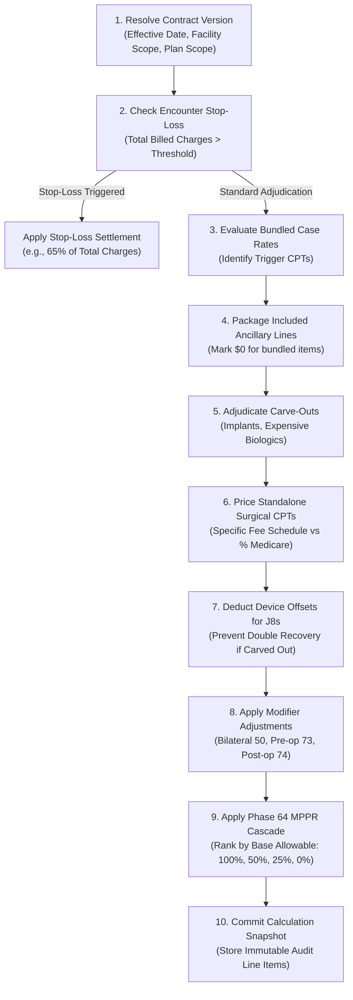

# PHASE 67 — REIMBURSEMENT METHODOLOGY MATRIX
## Enterprise Commercial Rate Determination & Payment Rule Interactions

> **Module:** Commercial Rate Rules & Financial Adjudication Engine  
> **Target Migration:** `043_payer_contract_rate_rules.sql` (Planning Reference Only)  
> **Status:** PRODUCTION SPECIFICATION — READ-ONLY AUDIT STAGE  
> **Upstream Dependencies:** Phases 60–66 Verified

---

## 1. Executive Summary & Purpose

In an Ambulatory Surgical Center (ASC), commercial payer reimbursement is substantially more complex than statutory Medicare. While Medicare operates under a uniform national prospective payment system (42 CFR Part 416), commercial managed care organizations (Aetna, UnitedHealthcare, Cigna, Blue Cross Blue Shield, Humana, Kaiser) negotiate highly bespoke contracts featuring multiple concurrent reimbursement methodologies, bundled package logic, carve-outs, and conflicting multiple procedure cascading rules.

This specification establishes the authoritative, deterministic cross-methodology interaction matrix for **Phase 67: Payer Contract Rate Rules**. It governs exactly how the calculation engine reconciles, computes, and audits commercial reimbursement across the five core pricing methodologies and resolves interactions with Medicare baselines, wage indices, device offsets, and commercial fee schedules.

---

## 2. Core Reimbursement Methodologies

The engine supports five primary reimbursement methodologies configured at the contract version, service scope, or line-item level:

```
┌─────────────────────────────────────────────────────────────────────────────────┐
│                     5 COMMERCIAL REIMBURSEMENT METHODOLOGIES                    │
├──────────────────────────┬──────────────────────────┬───────────────────────────┤
│ Methodology              │ Calculation Formula      │ Core Application          │
├──────────────────────────┼──────────────────────────┼───────────────────────────┤
│ PERCENT_OF_MEDICARE      │ Baseline × Multiplier    │ Commercial PPO / HMO      │
│ COMMERCIAL_FEE_SCHEDULE  │ Fixed Negotiated Dollar  │ High-Volume Ortho / GI    │
│ PERCENT_OF_BILLED_CHARGES│ Gross Charge × (1 - Disc)│ Unlisted / Specialty Rare │
│ CASE_RATE                │ Bundled Encounter Rate   │ Ophthalmology / Pain Mgmt │
│ IMPLANT_CARVE_OUT        │ Invoice + Markup %       │ High-Cost Hardware / Ortho│
└──────────────────────────┴──────────────────────────┴───────────────────────────┘
```

---

## 3. Deep-Dive Specification of Each Methodology

### 3.1 Percentage of Medicare (`PERCENT_OF_MEDICARE`)

Commercial contracts frequently peg ASC facility fees to the Medicare ASC prospective payment system as a benchmark (e.g., "165% of Medicare").

#### 3.1.1 Benchmark Resolution Rules
The contract version specifies whether the Medicare baseline is **Dynamic DOS** or **Frozen Benchmark**:
1. **Dynamic DOS (Default):**
   - The engine calls `fn_resolve_medicare_base_rate(dos, cpt, facility_id)` using the exact Date of Service.
   - Automatically adapts to annual CMS Addendum AA/BB updates (January 1) and quarterly mid-year adjustments.
2. **Frozen Benchmark Release:**
   - The contract defines `benchmark_release_id` (e.g., `CMS-1786-FC-2024` or `CY2023_FINAL`).
   - The engine bypasses the encounter DOS and evaluates the rate against the static historical CMS release defined in `cms_asc_addenda`.
   - Protects the ASC from mid-contract CMS payment cuts or payment indicator changes.

#### 3.1.2 Geographic Wage Adjustment Scope
Medicare statutory ASC rates are geographically adjusted per 42 CFR § 416.171:
$$\text{Medicare Base Rate} = (\text{National Rate} \times 0.50 \times \text{CBSA Wage Index}) + (\text{National Rate} \times 0.50)$$

Under commercial contracts, the multiplier may apply to either the local adjusted rate or the national rate:
- **`LOCALLY_WAGE_ADJUSTED` (Standard):**
  $$\text{Contract Allowable} = \text{Locally Adjusted Medicare Rate} \times \text{Multiplier}$$
- **`NATIONAL_UNADJUSTED`:**
  $$\text{Contract Allowable} = \text{CMS National Unadjusted Base Rate} \times \text{Multiplier}$$
  *Use Case:* High-wage metro ASCs negotiating a national floor, or rural ASCs negotiating to eliminate the low-wage index penalty.

#### 3.1.3 CMS Payment Indicator (PI) Interaction Table

| CMS PI Code | CMS Description | Phase 60/61 Base Behavior | Commercial Percent of Medicare Rule |
|:---:|:---|:---|:---|
| **A2** | Surgical procedure on ASC list | Wage-adjusted base rate | Multiplier applies directly to wage-adjusted base rate |
| **G2** | Non-office based surgical procedure | Wage-adjusted base rate | Multiplier applies directly to wage-adjusted base rate |
| **P2** | Office-based surgical procedure | Lesser of MPFS non-facility PE or standard ASC rate | Multiplier applies to resolved statutory base rate |
| **J8** | Device-intensive surgical procedure | Embedded device offset + wage-adjusted service portion | **Special Device Handling Required** (See Section 3.1.4) |
| **Z2** | Radiology / Diagnostic service | Separate wage-adjusted rate | Multiplier applies to radiology base rate |
| **F4** | Corneal tissue / Specialized service | Paid at contractor-priced invoice | Reimbursed at 100% invoice cost or contract carve-out |
| **L1** | Influenza / Pneumococcal vaccine | Reasonable cost / statutory limit | Paid at statutory allowable or contract carve-out |
| **K2** | Drugs and biologicals | ASP + 6% / statutory allowance | Contractual Pharmacy schedule or ASP + contract markup % |

#### 3.1.4 The J8 Device-Intensive "Double-Dipping" Trap & Solution
Under CMS rules (Phase 63), a `J8` procedure embeds a substantial device offset (ranging from 31% to 85% of the total reimbursement). For example, CPT 23430 (Biceps Tenodesis) has a national rate of \$6,200 with an embedded device offset of \$2,100 (service portion = \$4,100).

```
CRITICAL CONTRACTUAL CONFLICT:
Scenario: Contract specifies 175% of Medicare PLUS Implant Carve-Out (Invoice + 10%).

IF UNADJUSTED:
Allowable = ($6,200 × 1.75) + (Invoice Cost $1,800 × 1.10)
          = $10,850 + $1,980 = $12,830.
--> The payer pays for the implant TWICE (once inside the 175% multiplier, once in the carve-out).
--> During post-payment audit, payer demands a $3,675 overpayment refund.

ENGINE DETERMINISTIC SOLUTION:
When (Procedure = J8) AND (Carve-Out Applied):
1. Compute Service Baseline = National Rate - Device Offset Amount
2. Wage-Adjust Service Portion: Service Wage Adjusted = (Service Baseline × 0.50 × Wage Index) + (Service Baseline × 0.50)
3. Compute Service Contract Allowable = Service Wage Adjusted × Multiplier
4. Add Itemized Implant Carve-Out = Invoice Cost × (1 + Markup %)
5. Total Allowable = Service Contract Allowable + Implant Carve-Out
```

---

### 3.2 Commercial CPT/HCPCS Fee Schedules (`COMMERCIAL_FEE_SCHEDULE`)

Under this methodology, the payer and ASC agree to a comprehensive dollar-denominated fee schedule (Exhibit A).

#### 3.2.1 Fee Schedule Resolution Hierarchy
When pricing a CPT code under a commercial fee schedule:
1. **Tier 1 (Specific Line Override):** Check `payer_contract_cpt_rates` for exact `contract_version_id` + `cpt_code`. If found, use `negotiated_rate`.
2. **Tier 2 (Surgical Category / Specialty Rate):** If CPT has no line rate, check for category default in `payer_contract_specialty_rates` (e.g., all ENT CPTs priced at \$2,400).
3. **Tier 3 (Contract Version Default Fee Schedule):** Check master rate schedule attached to `payer_contract_versions.default_rate_schedule_id`.
4. **Tier 4 (Fallback Methodology):** If CPT is not found in fee schedule, execute contract fallback rule:
   - If `unlisted_cpt_methodology = 'PERCENT_OF_BILLED_CHARGES'`, apply chargemaster discount (e.g. 55% of billed charges).
   - If `unlisted_cpt_methodology = 'PERCENT_OF_MEDICARE'`, resolve CMS baseline × fallback multiplier.
   - If no fallback rule is defined, flag claim as `UNLISTED_CPT_RATE_MISSING` and halt calculation.

#### 3.2.2 Modifier Interaction Rules on Fee Schedules
- **Modifier 50 (Bilateral Procedure):**
  - Standard rule: Reimbursed at 150% of the single-procedure fee schedule rate on 1 unit (or 100% on line 1, 50% on line 2 if billed as 2 units).
  - Contract exception rule: Certain contracts allow 200% for bilateral procedures (e.g. bilateral tympanostomy or bilateral blepharoplasty). Engine checks `payer_contract_versions.bilateral_reimbursement_pct` (default: 150.00%, overridden if contract specifies 200.00%).
- **Modifier 73 (Surgery Discontinued Prior to Anesthesia):**
  - Reimbursed at exactly 50% of the contracted fee schedule rate. Secondary procedures receive $0.
- **Modifier 74 (Surgery Discontinued Post-Anesthesia / Incision):**
  - Reimbursed at 100% of the primary contracted fee schedule rate. Secondary procedures receive $0 unless medically justified.
- **Modifier 51 / Multiple Procedures:**
  - Evaluated under the contract's multiple procedure cascade ruleset (See Section 4).

---

### 3.3 Percentage of Billed Charges (`PERCENT_OF_BILLED_CHARGES`)

Used primarily for unlisted CPT codes, high-cost specialized procedures, or out-of-network arrangements.

#### 3.3.1 Mathematical Rule
$$\text{Contract Allowable} = \text{Chargemaster Gross Billed Charge} \times (1.0000 - \text{Discount Percentage})$$
*Example:* Gross charge = \$8,400.00; Contract discount = 35.00% (`0.3500`).
$$\text{Allowable} = \$8,400.00 \times (1.0000 - 0.3500) = \$8,400.00 \times 0.6500 = \$5,460.00$$

#### 3.3.2 Guardrails & Maximum Allowable Charges (MAC)
1. **Gross Charge Verification:** Gross charge must be pulled from the facility's active chargemaster (`facility_chargemaster`) effective on Date of Service, preventing arbitrary manual claim padding.
2. **Ceiling / Stop-Loss Threshold:** If contract defines `max_allowable_charge_limit`, allowable is clamped:
   $$\text{Allowable} = \min(\text{Gross} \times (1 - \text{Discount}), \text{MAC Ceiling})$$
3. **Implant Segregation:** High-cost implants are deducted from billed charges before applying the percentage if implants are carved out separately, preventing dual reimbursement.

---

### 3.4 Bundled Case Rates (`CASE_RATE`)

Bundled case rates package all facility services, routine supplies, intraocular lenses, medications, and recovery room time into a single all-inclusive payment for a specific surgical package.

#### 3.4.1 Case Rate Packaging Rules

```
┌─────────────────────────────────────────────────────────────────────────────────┐
│                           BUNDLED CASE RATE ADJUDICATION                        │
├─────────────────────────────────────────────────────────────────────────────────┤
│ PRIMARY TRIGGER CPT: e.g., CPT 66984 (Cataract Extracapsular with IOL)         │
│ CONTRACT CASE RATE ALLOWABLE: $2,150.00 FLAT                                    │
├─────────────────────────────────────────────────────────────────────────────────┤
│ INCLUDED IN CASE RATE (Reimbursed at $0 line allowable, packaged):              │
│  - Intraocular Lens Supply (HCPCS V2632 / C1713 standard monofocal)             │
│  - Anesthesia Supplies & Topical Agents                                         │
│  - Operating Room & Recovery Room Time (up to 4 hours)                          │
│  - Routine surgical packs, cannulas, viscoelastic substances                   │
├─────────────────────────────────────────────────────────────────────────────────┤
│ SEPARATELY PAYABLE EXCLUSIONS (Carved Out from Package):                        │
│  - Premium Toric / Multifocal IOL Patient Co-Pay Delta (Non-Covered Upgrade)    │
│  - Femtosecond Laser Ancillary Fee (CPT 66999-GY)                               │
│  - Secondary Independent Procedure (e.g., CPT 65855 Trabeculoplasty @ 50%)      │
└─────────────────────────────────────────────────────────────────────────────────┘
```

#### 3.4.2 Case Rate Inclusions & Exclusions Schema
The engine evaluates bundled packages through `payer_contract_case_rates` and `payer_contract_case_rate_inclusions`:
- If an encounter contains a Primary Case Rate CPT, all secondary CPT/HCPCS codes listed in the inclusion table are marked as `PACKAGED_IN_CASE_RATE` with an allowable of \$0.00.
- Codes not listed in inclusions are evaluated according to the contract's secondary procedure terms.

---

### 3.5 Itemized Implant / Device Carve-Outs (`IMPLANT_CARVE_OUT`)

In orthopedic, spine, and cardiology cases, implantable medical devices (plates, screws, artificial discs, pacemakers, neurostimulators) often exceed the entire facility fee. Commercial contracts frequently include an implant carve-out provision.

#### 3.5.1 Carve-Out Methodologies
1. **`PASS_THROUGH_AT_COST`:**
   $$\text{Implant Allowable} = \sum \text{Verified Invoice Cost}$$
2. **`INVOICE_PLUS_PERCENT`:**
   $$\text{Implant Allowable} = \sum \text{Verified Invoice Cost} \times (1.0000 + \text{Markup Percentage})$$
   *Standard Contract Markup:* 10% to 15% (e.g. Markup = `0.1000` $\rightarrow$ Allowable = Invoice $\times 1.10$).
3. **`INVOICE_PLUS_FIXED_FEE`:**
   $$\text{Implant Allowable} = \sum \text{Verified Invoice Cost} + \text{Handling Fee Per Case}$$
4. **`FEE_SCHEDULE_FIXED`:**
   $$\text{Implant Allowable} = \sum \text{HCPCS C-Code Schedule Rate}$$

#### 3.5.2 Qualifying Cost Thresholds (De Minimis Rule)
Most commercial contracts define an **Implant De Minimis Threshold** (e.g., \$250.00 or \$500.00):
- **Item Cost < Threshold:** Packaged into primary facility fee (\$0 separate allowable).
- **Item Cost $\ge$ Threshold:** Qualifies for carve-out reimbursement.
- **Encounter Total Threshold:** Certain contracts require that the *aggregate* implant cost across the entire encounter must exceed a minimum threshold (e.g., \$1,000.00) before any implant reimbursement is triggered.

#### 3.5.3 Verification & Provenance Requirements
Per commercial contract compliance requirements:
- The system must link each carved-out implant line to a verified vendor purchase order (`implant_purchase_order_id`) or vendor invoice (`implant_invoice_id`).
- Failure to attach an invoice results in warning flag `IMPLANT_INVOICE_UNVERIFIED` and prevents claim submission.

---

## 4. Cross-Methodology Interaction Matrix

When multiple methodologies apply to a single surgical encounter, the engine resolves payments in a deterministic 10-step sequence:



### Detailed Interaction Precedence Table

| Precedence | Methodology / Component | Evaluated Object | Output / Action | Fallback if Missing |
|:---:|:---|:---|:---|:---|
| **1** | **Stop-Loss / Catastrophic** | Case Total Gross Charges | Replaces entire calculation with negotiated charge % (e.g. 70%) if charges > \$50k | Proceed to Line-by-Line Adjudication |
| **2** | **Bundled Case Rate** | Primary Surgical CPT | Establishes primary package allowable; packages defined inclusive CPTs to \$0 | Proceed to Step 3 |
| **3** | **Implant Carve-Out** | Itemized Implants (Category C) | Computes Invoice + Markup % for items $\ge$ threshold | Packaged in primary surgical rate |
| **4** | **Specific CPT Line Rate** | Individual CPT code | Fixed contracted dollar amount from `payer_contract_cpt_rates` | Proceed to Step 5 |
| **5** | **Percent of Medicare** | Standard CPT code | Dynamic or Frozen CMS Base Rate $\times$ Contract Multiplier | Proceed to Step 6 |
| **6** | **Percent Billed Charges** | Unlisted CPT (e.g. 29999) | Chargemaster Gross $\times$ (1 - Discount %) | Flag `UNRESOLVED_RATE_ERROR` |
| **7** | **J8 Device Offset Deduction** | J8 CPT with Carve-Out | Deducts device offset from Medicare baseline prior to multiplier | Standard base rate without deduction |
| **8** | **Modifier Adjustments** | Modifiers 50, 73, 74 | Adjusts base allowable (150%, 50%, 100%) | Standard single-line allowable |
| **9** | **Phase 64 MPPR Cascade** | All remaining active CPTs | Ranks by allowable descending: Line 1 = 100%, Line 2 = 50%, Line 3+ = 25% or 50% | CMS 50% Standard Cascade |
| **10** | **Total Allowable Sum** | All adjudicated lines | Sum of Case Rates + CPTs + Implants | Verified server-side total |

---

## 5. Interactions with Upstream Phases

### 5.1 Phase 60: Medicare Base Rate Engine
- Phase 67 consumes `fn_resolve_medicare_base_rate` when a contract specifies `PERCENT_OF_MEDICARE`.
- It passes the encounter DOS, CPT code, and facility ID to retrieve the exact statutory ASC base rate.
- If the contract specifies `medicare_wage_adjustment_mode = 'NATIONAL_UNADJUSTED'`, Phase 67 extracts `national_base_rate` directly from `cms_asc_addenda`.

### 5.2 Phase 61: CMS Payment Indicators
- Phase 67 inspects the CMS payment indicator (`A2`, `G2`, `P2`, `J8`, `Z2`).
- Commercial contracts that state "We pay Medicare rates except for office-based codes" utilize Phase 61 indicators to divert `P2` codes to MPFS baselines or commercial fee schedules.

### 5.3 Phase 62: Geographic Wage Adjustment
- Phase 67 utilizes `facility_medicare_settings` to determine the facility's CBSA code and applicable wage index.
- If the contract uses a "Frozen Wage Index" (e.g. 2023 CBSA wage index held constant for 3-year contract term), Phase 67 looks up the specified release in `medicare_wage_indices`.

### 5.4 Phase 63: Device-Intensive Payment Rules
- Device-intensive procedures (`J8`) require Phase 63 metadata (`device_offset_percentage`, `device_offset_amount`).
- When commercial contracts carve out implants separately, Phase 67 automatically strips out the Phase 63 device offset to eliminate double payment.

### 5.5 Phase 64: Multiple Procedure Payment Rules (MPPR)
- Commercial contracts vary significantly in multiple procedure discounting:
  - **`CMS_STANDARD_50`:** 100% primary, 50% all subsequent surgical lines.
  - **`COMMERCIAL_CASCADE_25`:** 100% primary, 50% secondary, 25% tertiary, 0% quaternary.
  - **`NO_MPPR_100_PERCENT`:** 100% on all surgical procedures (rare, but negotiated in high-demand specialties).
- Phase 67 reads `payer_contract_versions.mppr_rule_set_id` and executes the matching cascade defined in `multiple_procedure_rule_sets`.

### 5.6 Phase 65: Payer Master & Plan Master
- Phase 67 validates that rates are resolved against the correct legal carrier (`payer_master`) and specific health benefit plan (`payer_plans`).
- A commercial contract may have separate fee schedules for Commercial PPO vs. Medicare Advantage vs. Commercial HMO under the same master payer.

### 5.7 Phase 66: Payer Contract Model
- Phase 67 attaches rate schedules, case rates, and carve-outs to the approved `payer_contract_versions` established in Phase 66.
- It enforces Phase 66's two-person approval gate: **no rate schedule can be executed for financial adjudication unless the contract version status is `ACTIVE` and signed off by the CFO/Authorized Approver**.

---

## 6. Prohibited Adjudication Behaviors

To ensure strict financial compliance and pass rigorous audit standards:
1. **NO Silent Fallback to Medicare:** If an encounter is commercial, the engine must never fall back to statutory Medicare without explicit contract configuration.
2. **NO Gross Charge Presentation as Contract Allowable:** Gross chargemaster prices are list prices, not expected cash flow. Treating gross charges as allowable without a discount contract violates ASC financial reporting standards.
3. **NO Unadjusted Double-Dipping on J8 Implants:** Combining a full `J8` Medicare multiplier with an itemized implant invoice carve-out without subtracting the device offset is strictly prohibited.
4. **NO Client-Side Financial Calculations:** Web browser UI and mobile applications are strictly presentation layers. All pricing math must run inside PostgreSQL RPCs.
5. **NO Unaudited In-Place Overwrites:** When rates are renegotiated, historical calculation records must remain untouched. New rates apply only to new contract versions.

